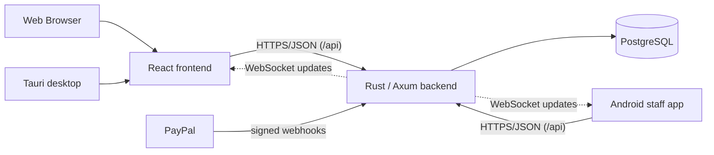

# Hotel Booking System

A hotel property management system covering reservations, rooms, housekeeping, maintenance, rates, payments, ledgers, invoicing, night audit, eKYC, loyalty, communications, and a self-service guest portal where guests can book without an account. It ships across four projects — web application, Tauri desktop app (with bundled PostgreSQL), native Android staff app, and a shared Rust API — with no root workspace, so run commands from each subdirectory.

## Stack

| Layer | Technology |
|---|---|
| Frontend | React 19 + TypeScript (Vite 8, MUI 9, TanStack Query/Router/Table) — Bun 1.3.14 |
| Backend | Rust 1.95.0 + Axum 0.8 (SQLx 0.9, Tokio, tonic 0.14) |
| Database | PostgreSQL 19 (`postgres:19beta3` server/CI; `19beta2` embedded desktop) |
| Desktop | Tauri 2 — backend sidecar + bundled PostgreSQL |
| Android | Native Kotlin `2.2.21` + Jetpack Compose Material 3 (Retrofit, OkHttp, Biometrics, Credential Manager, WorkManager, Glance) |
| API & Real-time | REST/JSON under `/api`, gRPC-Web (`/hotel.*`, partial opt-in rollout), WebSockets (`/api/updates/socket` + domain sockets; no SSE) |
| Authentication | JWT (in-memory access token + HttpOnly refresh cookie / Keystore on Android), RBAC, TOTP 2FA (AES-256-GCM at rest), passkeys |
| Payments | PayPal (signature-verified webhooks) + staff-recorded payments |
| Deployment | Docker Compose + Caddy (TLS), deployed by GitHub Actions |

## Features

**Guests**

- Public Salim Inn landing page (`/salim-inn/`) in English, Bahasa Melayu, and Simplified/Traditional Chinese
- Browse rooms and offers, check live availability
- Book single or multi-room stays without an account (public, rate-limited, PDPA consent-gated endpoints)
- Manage single or group bookings via secure access token: guest portal, payments, eKYC upload, self check-in

**Front desk & Mobile Operations (Web, Desktop, Android)**

- Reservations, arrivals/departures, walk-ins, check-in/checkout, stay charges, deposits, folio printing
- Room status board, housekeeping, maintenance tickets, global search, guest 360 CRM
- Record payments, approve bank transfers, issue invoices, manage guest/city ledgers

**Admin**

- Hotel configuration, system settings, users, teams, RBAC roles/permissions (`manager` owns IAM & `data_transfer:*`)
- Rooms, room types, rates, booking channels, campaigns/vouchers, guest segments, loyalty
- Audit log (trigger-enforced append-only), eKYC review, night audit, reports/insights, backup & restore (`hotel-backup` v1)

Canonical per-feature status list: [docs/features.md](docs/features.md).

## Architecture



PostgreSQL is the single source of truth via a V1 baseline plus a checksum-verified patch catalog (`manifest.tsv`). Web and desktop clients share `/api/*` REST (plus opt-in gRPC-Web for select domains behind runtime flags), WebSockets push domain invalidations across replicas via `pg_notify`, and `hotel-android/` consumes REST + WebSockets directly with local SQLite offline caching and WorkManager background sync.

## Project structure

```text
hotel-app-be/               # Rust backend API
  src/modules/<domain>/     # 40 domain dirs: routes → handlers → service → repository → models
  src/core/                 # auth, DB pool, middleware, rate limiting, i18n, caches
  src/grpc/                 # tonic adapters for gRPC-Web contexts
  src/bin/seed/             # deterministic demo/staging dataset (`make db-seed`)
  database/postgres/        # 0001_v1_baseline.sql, seed.sql, patches/ catalog (head v32)
  tests/                    # 83 integration test files (79 require DATABASE_URL)
hotel-web-fe/               # React frontend (staff SPA, guest.html, salim-inn/)
  src/features/<domain>/    # 26 feature modules
  src/api/                  # ky client + 24 REST services + Connect-ES gRPC adapters
hotel-desktop/              # Tauri 2 desktop app (sidecar backend + embedded PostgreSQL)
hotel-android/              # Native Kotlin + Jetpack Compose Material 3 Android staff app
proto/                      # gRPC contract of record (buf)
deploy/                     # production Compose file, Caddyfile, deploy scripts
docs/                       # consolidated documentation (index: docs/README.md)
infra/terraform/oci/        # OCI free-tier dev environment
Makefile                    # task runner — `make help`
```

## Getting started

Prerequisites: Rust `1.95.0` (`rust-toolchain.toml`), Bun `1.3.14` (`.bun-version`), Docker, `protoc` (backend builds), plus JDK 17 + Android SDK 36 for `hotel-android/`.

The only Compose file is `deploy/docker-compose.prod.yml`. It is the stack that runs on the AIC VPS and expects the release images and `/opt/saliminn`, so it is not a laptop stack.

**Local development:**

```bash
cd hotel-web-fe && bun install

cp hotel-app-be/.env.example hotel-app-be/.env         # set DATABASE_URL and JWT_SECRET

cd hotel-app-be && cargo run --bin hotel-app-be        # API on :3030
cd hotel-web-fe && bun run start                       # Vite on :3000, proxies /api → 127.0.0.1:3030
cd hotel-android && ./gradlew testDebugUnitTest assembleDebug  # Android debug APK (:3030 via 10.0.2.2)
```

Optional demo data: `make db-seed` (`cd hotel-app-be && cargo run --bin seed -- --list`).

**Database lifecycle** (no migration runner):

```bash
make db-baseline   # fresh DB: baseline + system seed + all patches (needs DATABASE_URL)
make db-patch      # converge an existing V1 database
make db-seed       # optional deterministic staging dataset
```

## Environment

| Variable | Required | Purpose |
|---|---|---|
| `POSTGRES_PASSWORD` | Docker Compose | DB password (`:?` required) |
| `JWT_SECRET` | Always | JWT signing secret, ≥ 32 chars; rotation invalidates staff tokens |
| `TOTP_ENCRYPTION_KEY` | Production | 32-byte base64/hex or ≥32-char ASCII key for AES-256-GCM TOTP encryption at rest |
| `DATABASE_URL` | Backend outside Docker | e.g. `postgres://hotel_admin:<pw>@127.0.0.1:5432/hotel_management` |
| `APP_ENV` / `ENVIRONMENT` | Production | `development`/`staging`/`production` (`APP_ENV` wins); prod refuses insecure combos |
| `ALLOWED_ORIGINS` | Production | Comma-separated CORS origins (HTTPS, non-localhost in prod) |
| `BACKEND_PORT` | No | API port, default `3030` |

See [.env.example](.env.example), [hotel-app-be/.env.example](hotel-app-be/.env.example), and [hotel-web-fe/.env.example](hotel-web-fe/.env.example). Never commit real `.env` files.

## Development & Verification

```bash
# Backend (hotel-app-be/)
cargo check --all-features && cargo fmt --check && cargo clippy --all-features -- -D warnings
cargo test --all-features                       # needs DATABASE_URL or PG suites silently skip

# Frontend (hotel-web-fe/)
bun run typecheck && bun run lint:strict && bun run test && bun run build

# Android (hotel-android/)
./gradlew testDebugUnitTest lintDebug assembleDebug assembleRelease --console=plain

# Root shortcuts
make lint format typecheck test build install-hooks check-all docs-check
```

Schema changes go in both `0001_v1_baseline.sql` **and** a registered patch in `hotel-app-be/database/postgres/patches/manifest.tsv`. See [hotel-app-be/database/README.md](hotel-app-be/database/README.md).

## Documentation

- [Feature registry](docs/features.md) — per-feature delivery status across Web, Backend, Desktop & Android
- [Architecture](docs/architecture/overview.md) · [ADRs 001–016](docs/architecture/decision-records.md)
- [API contract](docs/api/README.md) · generated [openapi.json](docs/api/openapi.json) (CI-enforced)
- [Development guide](docs/development.md) · [Dependencies](docs/dependencies.md) · [Design system](docs/design-system.md)
- [Database lifecycle & seed data](hotel-app-be/database/README.md) · [Data transfer (`hotel-backup` v1)](docs/guides/data-transfer.md)
- [Deployment, VPS & PG19 upgrade](docs/guides/deployment.md) · [Desktop guide](docs/guides/desktop.md) · [Android guide](docs/guides/android.md)
- [Internationalisation & glossary](docs/guides/internationalization.md) · [Admin guide (zh)](docs/guides/admin-user-guide-zh.md) · [Guest guide (zh)](docs/guides/guest-user-guide-zh.md)
- [Security, retention & go-live readiness](docs/security.md) · [Security policy](SECURITY.md)
- [Contributing](CONTRIBUTING.md) · [Full documentation index](docs/README.md)

## Status

- **Implemented:** Web staff PMS, Salim Inn public landing, guest portal + anonymous single/group bookings, Rust backend + PostgreSQL schema through patch `0032`, desktop app (`hotel-desktop/`), and native Android staff app (`hotel-android/`) — details in [docs/features.md](docs/features.md).
- **In progress:** gRPC-Web rollout (5 services / 47 RPCs live behind opt-in flags; host deploy matchers need `/hotel.*` before production activation), desktop OS code-signing certs, Android release keystore distribution, and the PostgreSQL 19 GA migration (patches 0015/0016/0021/0022 cleared beta4 reverts).
- **Planned / gated:** SMS notification channel, automated PayPal refund reconciliation, PDPA retention purge jobs (awaiting counsel sign-off), and live host backup/restore drill ([docs/security.md](docs/security.md)).

Assessed as *ready with conditions* — see [docs/security.md](docs/security.md).

## Important rules

- PostgreSQL is the source of truth; booking overlap is prevented by `bookings_no_room_date_overlap`.
- Shipped patches are immutable: add a new version, never edit one. Additive changes go in both the baseline and a registered patch.
- Parameterized SQL only; sanitize free text with the existing utilities; multi-step mutations run in transactions.
- Backend PG tests silently skip without `DATABASE_URL` and each skip counts as a pass — judge runs by wall-clock time, never exit code or count alone.
- Changes land via PR on `master` with green CI (`ci.yml`, `android-ci.yml`, `security.yml`).

## License

[MIT](LICENSE)
