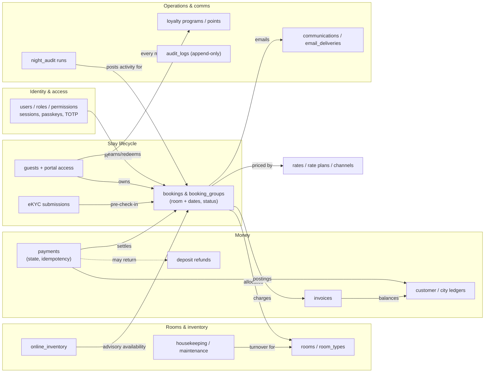
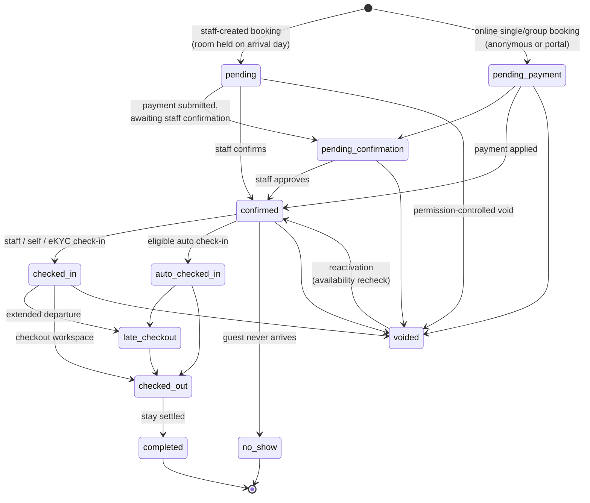
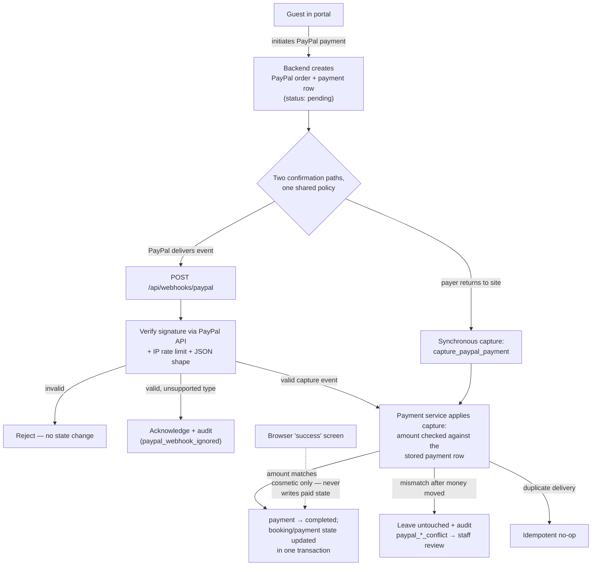
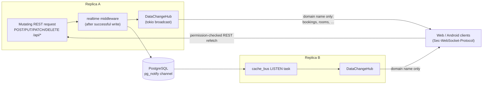

# Architecture Overview

Canonical architecture reference for the Hotel Property Management System (`2026-11-25`). It consolidates system layers, request/database/reservation/payment/realtime flows, the gRPC-Web transport, and the Guest Relations CRM boundary into one document. Architectural rationale lives in [decision-records.md](decision-records.md); setup commands live in [../development.md](../development.md).

## System overview

Four deployment surfaces share one Rust + PostgreSQL backend:

- **Staff web application (`hotel-web-fe/`)** — front-desk and back-office operations: bookings, rooms, housekeeping, night audit, invoicing, ledgers, payments, promotions, eKYC review, communications, loyalty, reports, and administration.
- **Guest portal & landing (`hotel-web-fe/`, `guest.html` & `salim-inn/`)** — public landing page, anonymous single/multi-room booking, pre-check-in, eKYC submission, payments, loyalty, support, and legal pages.
- **Desktop application (`hotel-desktop/`)** — the same web frontend and backend packaged with Tauri 2 and an embedded PostgreSQL (`19beta2`), for on-premise/offline operation.
- **Native Android staff application (`hotel-android/`)** — native Kotlin + Jetpack Compose Material 3 app for front-desk, housekeeping, maintenance, payment approval, eKYC review, guest CRM, night-audit preview, and offline-capable operations.

Major user roles span staff hierarchies (`super_admin`, `manager`, `admin`, and operational/audit roles), companies with city-ledger accounts, and guests.

## High-level architecture & request flows

### Web & Caddy request flow

```text
Browser (React / MUI / TanStack Router and Query)
  └─ src/api/client.ts (ky, bearer token, refresh cookie, retries)
      └─ Vite proxy in development / Caddy in production
          └─ Axum routes — CORS, rate limits, security headers
              └─ require_auth + check_permission (route layer)
                  └─ handlers (thin)
                      └─ services (business logic)
                          └─ repositories (SQL only)
                              └─ PostgreSQL
```

In production the edge has two hops: **Caddy** terminates TLS and applies security headers, then splits by path — `/api/*`, `/uploads/*`, `/health`, `/ws*` go to `backend:3030` (and `deploy/Caddyfile` also includes `/hotel.*`), and everything else goes to `frontend:80`, an **nginx:1.31-alpine** container serving three built documents (`hotel-web-fe/Dockerfile`, `hotel-web-fe/nginx.conf`): the staff SPA (`index.html`), the guest portal (`guest.html`), and the public landing page (`salim-inn/index.html`). nginx answers a cookie-less request for `/` with a 302 redirect to `/salim-inn/` (what crawlers and link previewers see). Caddy's `@backend` matcher is meant to stay aligned with `PROXY_PREFIXES` in `hotel-web-fe/vite.config.ts` (`/api`, `/uploads`, `/health`, `/ws`, `/hotel.`); `deploy/Caddyfile` already routes `/hotel.*`, whereas the generated host site matchers in `deploy/deploy.sh` and `deploy/deploy-staging.sh` do not yet include `/hotel.*`, so gRPC flags stay off outside development until those scripts match.

Three transports share the single Axum process:

- **REST/JSON under `/api`** — the primary contract for web, desktop, and Android.
- **gRPC + gRPC-Web (Connect)** — tonic services merged into the same router at `/hotel.<package>.<Service>/<Method>` plus health and reflection (ADR 014).
- **WebSocket** — staff data-change notifications and availability, loyalty, and support sockets (ADR 015). There is no SSE endpoint.

### Desktop flow

```text
Tauri webview
  └─ Tauri IPC (get_status / backend-ready event)
      └─ backend sidecar on a dynamically probed 127.0.0.1 port
          └─ bundled PostgreSQL under src-tauri/pgsql/
```

Desktop mode is signalled by `HOTEL_DESKTOP_MODE`. The webview learns the dynamically probed backend port via Tauri IPC; the sidecar receives an explicit `ALLOWED_ORIGINS` list (`tauri://localhost` / `http://tauri.localhost`). Embedded PostgreSQL initializes via baseline → seed → patch catalog (`src-tauri/src/postgres/patches.rs`).

> **Engine versions differ by surface.** Server/Docker/CI run `postgres:19beta3`; the desktop bundle is **19beta2**, pinned by `CONFIGURED_POSTGRES_BUILD_IDENTITY` in `hotel-desktop/src-tauri/src/postgres.rs` and enforced by `hotel-desktop/scripts/provision-pgsql.mjs`. The bundled `pgsql/` tree is git-ignored and provisioned locally. Bumping it requires re-provisioning and a data-directory rebuild ("Restore from backup"). 19 Beta 4 reverted SQL/PGQ and `SPLIT/MERGE PARTITION`; patches 0015/0016 removed both from the schema and must run on `19beta3` before any dump-and-restore upgrade ([../guides/deployment.md](../guides/deployment.md#postgresql-engine-upgrade-dump-and-restore)).

### Android staff flow

```text
Android App (Kotlin / Jetpack Compose M3)
  └─ AppContainer (Retrofit + OkHttp + TokenAuthenticator + EncryptedCookieJar)
      └─ Direct HTTPS (saliminn.my in release) / configurable URL (10.0.2.2:3030 in debug)
          └─ Backend REST API (/api/*) + Staff WebSocket (/api/updates/socket)
  └─ SQLite cache & OfflineOpsCoordinator ──▶ WorkManager (SyncPendingMutationsWorker)
  └─ Glance Home Widget (HotelOpsWidget) ──▶ WorkManager (WidgetRefreshWorker)
```

Authentication uses in-memory JWT access tokens plus an AES-GCM encrypted refresh cookie store backed by Android Keystore (`EncryptedCookieJar`), Credential Manager passkeys/saved credentials, cold-launch `BiometricPrompt` lock, and an explicit guard blocking guest-only accounts (`isGuestOnlyAccount`).

## Repository structure

```text
hotel-app-be/      Rust 1.95.0 backend (Axum 0.8, SQLx 0.9, tonic 0.14, PostgreSQL 19)
hotel-web-fe/      React 19 + TypeScript ~6.0 frontend (Vite 8, MUI 9, TanStack)
hotel-desktop/     Tauri 2 desktop wrapper (Rust sidecar + embedded PostgreSQL)
hotel-android/     Kotlin 2.2.21 / Jetpack Compose Material 3 native Android staff app
docs/              Consolidated documentation (index: docs/README.md)
proto/             gRPC contract of record (buf v2 module)
deploy/            Production + staging compose files, Caddyfile, deploy scripts
scripts/           Repo gates: doc links, desktop DB mirror, proto mirror, gRPC bench
infra/             Terraform OCI Always Free dev environment
.github/workflows/ CI, Android CI, security, desktop packaging, Docker, and deploy pipelines
```

There is no root workspace: each project owns its manifest, lockfile, and toolchain commands.

## Backend architecture

`hotel-app-be/src/`:

```text
modules/<domain>/  Domain modules — routes.rs, handlers.rs, service.rs,
                   repository.rs, models.rs, plus domain-specific files
                   (queries.rs, validation.rs, schedulers, clients) as needed
grpc/              tonic service adapters (rooms, room types, housekeeping,
                   maintenance, guests) + generated pb code; delegates to the
                   same service/repository layer as the REST handlers
routes/mod.rs      Router composition (.merge per module) + shared extractors
services/          Cross-domain services only: audit, account_emails,
                   google_identity, invoice_numbers
repositories/      Cross-domain persistence only: audit, invoice_numbers
models/            Cross-domain DTOs only: audit, common, row_mappers
core/              Auth, DB pool, errors, middleware, rate limiting, RBAC/settings caches
utils/             Small pure helpers (sanitization, dates)
bin/               seed/ (deterministic demo dataset, `make db-seed`),
                   hash_password, fix_password; server entrypoint is main.rs
database/postgres/ Baseline, seed, and the checksum-verified patch catalog
```

Forty domain directories live in `modules/<domain>/` — 38 are merged into `routes/mod.rs::create_router`; `consent` and `booking_groups` are internal routeless modules.

Cross-cutting machinery:

- `core/auth.rs` — JWT issue/verify, bcrypt hashing, TOTP secret encryption at rest (`TOTP_ENCRYPTION_KEY`, required in production), passkey support, session/refresh-token lifecycle.
- `core/middleware.rs` — `require_auth`, `check_permission`; `<resource>:manage` implies all actions on that resource.
- `core/db.rs` — pool creation, per-connection hotel timezone from `system_settings.timezone`, `hotel_today()` business-day helper, decimal/UUID helpers.
- `core/rate_limiter.rs` — shared fixed-window limiter over `rate_limit_buckets` (multi-replica safe; supersedes ADR 005).
- `services/audit.rs` — append-only audit log called from mutating handlers.
- Background loops spawned in `main.rs` via `core::leader::spawn_exclusive` (PostgreSQL advisory locks — one replica per loop): night audit, payment receipts, unpaid online-hold release, communications delivery worker & campaign scheduler, and hourly session-retention + rate-limit bucket prune. `core::cache_bus::spawn_listener` applies cross-replica cache invalidation and data-change fan-out via `pg_notify`.
- Error handling: `ApiError` variants map to HTTP status + JSON body (`{"error": ..., "code"?: ...}`); internal details stay in server logs.

## Frontend architecture

`hotel-web-fe/src/`:

```text
index.tsx           Entry: providers (QueryClient, Theme, Auth, i18n)
App.tsx / routes/   TanStack Router file routes (routeTree.gen.ts generated)
router/             RootLayout, route guards, registry→router rendering
navigation/         routeRegistry.tsx — 53 lazy page definitions driving sidebar & routing
features/<domain>/  26 feature modules: components/, hooks/, api.ts, utils, types
api/                client.ts (ky), grpc/, gen/ Connect-ES stubs, 24 <domain>.service.ts
auth/               AuthContext (session state, permissions, in-memory token store)
components/         Shared UI (data-table, dialogs, layout, common, charts)
hooks/              Shared hooks (useApi, usePermissions, useOnlineStatus, sockets, …)
guest/              Guest-facing app shell — separate `guest.html` Vite entry
desktop/            Tauri runtime helpers (service gate, IPC bridge)
theme/              MUI theme + semantic token layer (see ../design-system.md)
i18n/               In-house Intl-based i18n engine + JSON locale bundles (30 namespaces)
utils/              date.ts, errorMessage, errorReporter, pagination, sanitization, …
```

- Server state: TanStack Query; deliberately no client-state library (ADR 006). Auth state lives in `AuthContext`; route state in the router.
- Routing: register pages in both `src/routes/` and `src/navigation/routeRegistry.tsx`.
- HTTP: all requests go through `src/api/client.ts` (in-memory access token, HttpOnly refresh cookie, idempotent-GET retry, single-flight refresh-and-retry on 401, `Retry-After` honored). Never call `fetch` directly.
- UI: MUI 9 + Emotion; shared `DataTable` on TanStack Table 9; charts via Nivo wrapped in `src/components/charts/` (`HotelBarChart`, `HotelLineChart`, `HotelPieChart`, `HotelSparkline`); PDFs via jsPDF (+autotable); `OfflineBanner` via `useOnlineStatus`; PII-scrubbing `reportClientError` wired to `ErrorBoundary`.
- i18n: `useTranslation(ns)` → `{ t, tOr, locale, setLocale }` backed by `Intl` (ADR 012; see [../guides/internationalization.md](../guides/internationalization.md)).

## Android architecture (`hotel-android/`)

```text
app/src/main/java/com/hotelapp/staff/
  HotelStaffApp.kt    Application + manual DI AppContainer wiring network, storage, sync, notifications
  MainActivity.kt     Single-activity Compose host, SplashScreen, BiometricPrompt lock, deep-link routing
  core/               auth, config (DataStore), design (M3 theme/tokens), format, network (OkHttp/Retrofit/WS),
                      notifications (NotificationManager), print (PrintManager), storage (SQLite), sync (WorkManager), ui
  data/               api/ (13 Retrofit interfaces), dto/ (kotlinx.serialization), repository/ (12 repositories)
  feature/            13 screens/flows: auth, bookings, dashboard, ekyc, guests, housekeeping, maintenance,
                      more, notifications, payments, rooms, search, server
  navigation/         AppDestination routes, HotelNavHost (strict RBAC + deep-link validation)
  widget/             Glance home-screen operational summary widget + WidgetRefreshWorker
```

See [../guides/android.md](../guides/android.md) for the complete Android implementation, security, offline sync, and build/test guide.

## Database architecture

PostgreSQL is the only engine (ADR 002), and the schema is the source of truth (ADR 010):

```text
database/postgres/migrations/0001_v1_baseline.sql   (V1 baseline, fresh installs)
  → database/postgres/seed.sql                       (one-time seed, self-validating)
      → database/postgres/patches/                   (manifest.tsv-ordered, sha256-verified)
```

- Every additive schema change lands in **both** the baseline (fresh installs) and a new catalog patch (installed DBs). Only files registered in `patches/manifest.tsv` (generation 1, currently versions 2–32) execute, and shipped versions/checksums are immutable.
- Each patch runs as `_begin.sql` + `<patch>.sql` + `_end.sql` in a single transaction under `pg_advisory_xact_lock`, verifying the recorded V1 baseline checksum (`unsupported V1 baseline checksum` aborts legacy layouts) and skipping already-applied revisions via `\if`.
- Backend startup validates `manifest.tsv` via `core/schema_catalog.rs` and refuses to boot if any compiled-in revision is missing or mismatched. Revisions newer than the build are accepted for safe app rollback.
- Full lifecycle, executor table, `seed` binary (`make db-seed`, 800000–899999 id band), and failure recovery live in [../../hotel-app-be/database/README.md](../../hotel-app-be/database/README.md).



## Authentication & authorization

- **Staff login**: username/password → short-lived JWT access token + revocable HttpOnly refresh token row (30d TTL on web, encrypted Keystore storage on Android, `SameSite=Lax` web limitation on desktop webview). Optional TOTP 2FA with hashed recovery codes; secrets are AES-256-GCM encrypted at rest under `TOTP_ENCRYPTION_KEY` (required in production startup). Enrolling TOTP requires confirming the account password. Accounts with a passkey can satisfy 2FA via `/auth/passkey/2fa/*`; registering a passkey requires password or TOTP step-up (`modules/passkey/service.rs`). Account lockout (5 failed attempts / 30 min) applies to both password and passkey logins. `require_two_factor_roles` + `require_two_factor_grace_days` enforce role-based enrollment when configured.
- **Guest portal**: separate guest registration/login sessions; anonymous booking mints a 256-bit booking access token (SHA-256 hashed at rest, expiring relative to the stay); a booking-number + guest-name lookup (`verify_guest_booking`) mints a 48-hour pre-check-in token; Turnstile protects public forms; Google Sign-In/One Tap federates both surfaces.
- **Authorization**: `check_permission(pool, user_id, "<resource>:<action>")` at the route layer; `<resource>:manage` implies all actions of that resource. Priority hierarchy: `super_admin` → `manager` (150; owns users/roles/permissions/teams/`data_transfer:*`) → `admin` (100) → operational roles → `guest`.
- **Webhooks**: `/api/webhooks/paypal` carries no bearer auth by design — each delivery is signature-verified against PayPal and IP rate-limited.

## Core domain & operational flows

### Reservation lifecycle



- **Overlap-blocking statuses**: `bookings_no_room_date_overlap` (updated in patch `0032`) blocks room/date overlap across `pending`, `pending_payment`, `pending_confirmation`, `confirmed`, `checked_in`, `auto_checked_in`, `late_checkout`, `partial_complimentary`, and `fully_complimentary`.
- **Arrival-day holds**: `reconcile_room_holds` (patch `0018`) sets physical `rooms.status = 'reserved'` only on the arrival day so future bookings do not block current walk-ins.
- **Channel check-in holdback**: channel-attributed online check-ins post only channel-settled room charges (`settlement_payment_methods`, patch `0023`), holding back desk-collected charges (`tourism_tax_amount`, `extra_bed_charge`, upgrade differences) for reception settlement.
- **Complimentary & void**: `comp_void`, `partial_complimentary`, and `fully_complimentary` model complimentary stays alongside the main flow. Voiding reverses payment/loyalty/unpaid-ledger effects; reactivation re-checks room availability.

### Anonymous online single & group booking

Guests book single or multi-room (`booking_groups`, `modules/booking_groups` + `modules/guest_booking/group.rs`) stays without an account via `/api/booking/{offers,room-types,quote,reservations,groups*}` — public, IP rate-limited, and PDPA consent-gated (`modules/consent`).

```mermaid
sequenceDiagram
    participant Guest
    participant API as guest_booking service
    participant DB as PostgreSQL

    Guest->>API: POST /api/booking/reservations (or /groups)
    API->>API: validate PDPA consents + generate access token (256-bit)
    API->>DB: BEGIN
    API->>DB: recheck online availability + allocate room(s)<br/>(FOR UPDATE SKIP LOCKED + smoking preference)
    API->>DB: insert anonymous guest + booking(s) + consent_records (pending_payment)
    API->>DB: persist SHA-256 hash of access token
    API->>DB: reconcile arrival-day room hold + history (source: anonymous)
    API->>DB: COMMIT — bookings_no_room_date_overlap guards the range
    API-->>Guest: booking_number + raw access token (shown once)
    Guest->>API: /api/guest-portal/me/* (bearer / X-Booking-Access-Token)
    API->>DB: SHA-256(token) lookup; expiry vs stay dates
```

- `allocate_room_tx` steers selection using the optional soft `bookings.smoking_preference` (patch `0009`), filling non-smoking rooms first when unspecified without ever blocking availability.
- `claim_account` upgrades an anonymous guest record into a portal account later.

### Payments, PayPal webhooks, idempotency & checkout deposit guard



- **Bank-transfer claims**: Guest submissions create a `pending` payment row, audit `payment_pending_approval`, and notify `payments:read` staff (`bank_transfer_pending`). Staff resolve on `/payment-approvals` (or Android Pending Payments); PayPal rows cannot be manually approved, and staff rejection is refused after manual booking confirmation.
- **Idempotency & deposits**: Staff booking/ledger payment endpoints require a client `idempotency_key` paired with a SHA-256 `idempotency_fingerprint` enforced by partial unique indexes `(booking_id, idempotency_key)` and `(ledger_id, idempotency_key)`. Exact replay returns the original row; payload mismatch returns `409`. `PaymentRepository::refund_deposit` caps keycard deposit refunds by held deposit (`bookings.deposit_amount` when `deposit_paid` is positive, else sum of completed `deposit` payments; one refund + partial refunds supported).
- **Checkout deposit guard**: `ensure_checkout_balance_resolved` (`modules/bookings/lifecycle.rs`, mirrored in web `features/invoices/hooks/useDepositResolution.ts`) gates `checked_out`/`completed` transitions: (1) billable balance minus non-deposit payments must be zero unless company-billed to the city ledger, and (2) held deposits (max of ledger deposits vs `bookings.deposit_amount` legacy mirror) must already be refunded, forfeited (`deposit_forfeited`), or waived prior to the checkout request.
- **Closed-day reversals & ledger reporting**: Voiding payments closed by night audit posts reversing journal entries (`void_reversal_date`, patch `0019`). `customer_ledgers` includes nullable booking stay dates (`check_in_date`, `check_out_date`), prevents duplicate active reversals via `uq_customer_ledgers_active_reversal` and duplicate room charges via `uq_customer_ledgers_booking_room_charge` (patch `0032`).

### Hotel business day, revenue attribution & segments

- **Business day**: `system_settings.timezone` is applied to every pooled PostgreSQL connection (`core/db.rs`), making SQL `CURRENT_DATE` the hotel day. Always use `hotel_today(executor)` in Rust — never `chrono::Local`/`Utc`.
- **Channel & promo economics**: `bookings.booking_channel_id` + `channel_pricing_snapshot` + `commission_amount` + `net_revenue` freeze economics at write time (ADR 013). Promotions allocate across stay nights in `voucher_redemption_allocations` via the single pricing engine `modules/promotions/pricing.rs::calculate_promotion_pricing`.
- **Guest segments & comms**: `guest_segments` JSONB rules compile live in `modules/segments/rules.rs` to parameterized SQL (no materialized member list). `email_campaigns.segment_id` intersects with suppression, topic opt-in, and per-campaign dedup inside `modules/communications/`'s leased SMTP outbox worker.

### Realtime WebSocket fan-out



- Sockets live at `/api/updates/socket` (staff), `/api/admin/loyalty/socket`, `/api/guest-portal/me/{loyalty,support}/socket`, and `/api/guest-portal/me/availability`, authenticating via `Sec-WebSocket-Protocol` (`hotel-updates`).
- Payloads carry domain names only (never record PII); clients refetch via permission-checked queries and reconnect with capped exponential backoff + jitter.

## gRPC-Web transport (partial rollout)

Tonic gRPC + `tonic_web::GrpcWebLayer` services run inside the same Axum server at `/hotel.<package>.<Service>/<Method>` alongside REST (ADR 014):

| Service | Package | RPCs | Frontend flag |
|---|---|---|---|
| `RoomService` | `hotel.rooms.v1` | 21 | `rooms` |
| `RoomTypeService` | `hotel.rooms.v1` | 5 | `rooms` |
| `HousekeepingService` | `hotel.housekeeping.v1` | 5 | `housekeeping` |
| `MaintenanceService` | `hotel.housekeeping.v1` | 4 | `maintenance` |
| `GuestService` | `hotel.guests.v1` | 12 | `guests` |

- **Locations**: `proto/` (buf v2 contract), `hotel-app-be/proto/hotel/` (mirror verified by `make proto-mirror-check`), `hotel-app-be/src/grpc/{rooms,housekeeping,guests,auth,convert,error,idempotency,server}.rs` (plus `tonic-health` and `tonic-reflection`), `hotel-web-fe/src/gen/` (`buf generate`), and `hotel-web-fe/src/api/grpc/{flags.ts,convert.ts,*.ts}`.
- **Contract rules (`src/grpc/convert.rs`)**: `hotel.common.v1.Money { int64 amount_minor; string currency_code }` (×100 over major `numeric(…,2)`), `google.type.Decimal` for ratings/percentages/hours, `google.type.Date` + UTC `Timestamp`, AIP-122 `{collection}/{id}` names, `request_id` idempotency, `FieldMask` + explicit clear booleans, `_UNSPECIFIED = 0` enums, unique response wrappers, and `ToApiError` status mapping.
- **Browser selection**: `grpcEnabled(ctx)` checks localStorage `grpcContexts` override first, then `VITE_GRPC_CONTEXTS` build default, otherwise defaults to REST.
- **Rollout status**: Off by default (`VITE_GRPC_CONTEXTS` unset). `deploy/Caddyfile` routes `/hotel.*`, while the host deploy scripts (`deploy/deploy.sh`, `deploy/deploy-staging.sh`) do not yet match `/hotel.*`; keep flags off outside development and desktop until those host scripts route `/hotel.*`. WebSockets, multipart uploads, webhooks, auth/sessions, and `/health` stay REST permanently. Benchmark with `scripts/bench-rest-vs-grpc.sh`.

## Guest Relations CRM boundary

`modules/guest_relations/` (`/guest-relations` web, Guest detail in Android) is a join workspace over the canonical `guests` record (separate from `guests.guest_type` discount flag and `users.guest_id` portal logins):

- **Owns**: `guests` profile fields, `guest_notes` (interactions + follow-ups; `is_private` restricted to author or `guests:manage`), and `guest_preferences`.
- **Joins without duplicating**: `guest_reviews` (staff response via `reviews:read|update`), `bookings`, `loyalty_*` (read summary), `vouchers` (read list), `support_conversations` (`support:read|write`), `notification_subscriptions`/`email_deliveries` (`communications:read|manage`), ledgers/payments (outstanding balance only).
- **Sensitive fields**: `guests:reveal` gates `id_*` and `date_of_birth` on `GET /guests/{id}/profile` and edits alongside `guests:update`, writing audit logs on reveal.
- **Endpoints**: `/guests/{id}/{interactions,preferences,reviews,loyalty,vouchers,communications,support}`, `GET /guest-relations/overview` (omits unauthorized sections), `GET /guest-relations/follow-ups` (`due=overdue|today|upcoming|all`), plus `segment=returning|in_house|upcoming|inactive` on `GET /guests`.

## Feature modules & invariants

Canonical per-feature delivery statuses live in [../features.md](../features.md).

### Architectural invariants

- All money/status transitions run in PostgreSQL transactions; never swallow errors with `let _ = sqlx::query(...)` inside a transaction (aborts the txn — use a savepoint or propagate).
- `bookings_no_room_date_overlap` enforces room-date exclusivity in Postgres; allocation uses `FOR UPDATE` / `FOR UPDATE SKIP LOCKED`.
- PayPal capture mismatches after money moves never auto-resolve — they log `paypal_*_conflict` for staff review.
- Every mutating handler records `services/audit.rs`, and `audit_logs` + all partitions enforce append-only via database triggers (patch `0022`).
- Every new backend router merges into `routes/mod.rs`; every new top-level API prefix registers in both `PROXY_PREFIXES` (`vite.config.ts`) and `ROOT_API_PREFIXES` (`runtimeApi.ts`, checked by `origin-parity.test.mjs`) as well as production edge matchers; every new web page registers in both `src/routes/` and `src/navigation/routeRegistry.tsx`.
