# 酒店管理系统管理员与员工使用指南（简体中文）

> **适用对象**：超级管理员、经理、管理员、合规管理员、高级审核员、eKYC 审核员、审计员、前台接待、客房服务、普通员工及只读支持人员。  
> **关联文档**：
> - 普通宾客操作指南（官网、在线预订、宾客门户、自助入住与 eKYC）：[guest-user-guide-zh.md](guest-user-guide-zh.md)
> - 国际化和术语规范（中英马对照与覆盖基线）：[internationalization.md](internationalization.md)
> - 数据迁移技术规范：`hotel-backup` v1：[data-transfer.md](data-transfer.md)
> - 桌面端安装、更新与托管备份恢复：[desktop.md](desktop.md)
> - 原生 Android 员工端指南：[android.md](android.md)
> - 系统功能总表与边界清单：[../features.md](../features.md)
>
> **术语与口径说明**：本指南严格对齐系统简体中文界面（`zh-CN`）与数据库权限策略（基线至补丁 `0032`）。全篇统一以**营业日**（由酒店设置中的时区驱动）与**酒店币种**（默认 `MYR`）为准。

---

## 目录

1. [第 1 章：系统概览、访问入口与界面操作](#第-1-章系统概览访问入口与界面操作)
2. [第 2 章：员工登录、账户安全与个人资料](#第-2-章员工登录账户安全与个人资料)
3. [第 3 章：12 个系统角色与完整权限矩阵（RBAC 规则）](#第-3-章12-个系统角色与完整权限矩阵rbac-规则)
4. [第 4 章：概览仪表盘（`/`）](#第-4-章概览仪表盘)
5. [第 5 章：前厅运营（预订、时间轴、客房与客房服务）](#第-5-章前厅运营预订时间轴客房与客房服务)
6. [第 6 章：客人关系、客服与会员忠诚度](#第-6-章客人关系客服与会员忠诚度)
7. [第 7 章：收益与营销（7 大模块）](#第-7-章收益与营销7-大模块)
8. [第 8 章：财务管理（4 大模块）](#第-8-章财务管理4-大模块)
9. [第 9 章：经营分析与报告库（`/insights`）](#第-9-章经营分析与报告库insights)
10. [第 10 章：系统管理（8 大模块）](#第-10-章系统管理8-大模块)
11. [第 11 章：工具与辅助模块（通知投递与帮助中心）](#第-11-章工具与辅助模块通知投递与帮助中心)
12. [第 12 章：桌面客户端（Tauri）专项指南](#第-12-章桌面客户端tauri专项指南)
13. [第 13 章：常见场景速查、系统边界与故障排查](#第-13-章常见场景速查系统边界与故障排查)

---

## 第 1 章：系统概览、访问入口与界面操作

### 1.1 运行形态与实时同步

本酒店管理系统（PMS）支持三种访问方式，页面与业务规则保持一致：

- **Web 管理端**：通过浏览器登录，已登录员工访问 `/` 或 `/admin-portal` 进入管理工作台。
- **桌面客户端（Tauri）**：内置本地后端与 PostgreSQL 数据库，支持离线单机运行、本地定时备份与自动更新（详见第 12 章与 [desktop.md](desktop.md)）。
- **原生 Android 员工端（`hotel-android/`）**：基于 Kotlin 与 Jetpack Compose Material 3 的员工端应用，支持工作台、预订/入住/账单打印、房态/保洁/维修、eKYC 审核、支付审批、全局搜索、离线队列与桌面小组件（详见 [android.md](android.md)）。
- **手机与平板端**：响应式移动 Web 界面，自动切换底部主导航栏与底部操作抽屉，方便前台移动巡房与客房保洁操作。

**全局实时同步（WebSocket）**：
员工登录后，客户端会自动连接 `/api/updates/socket`。当后端触发以下 **6 个业务域**的数据变更时，当前打开的关联页面会自动刷新缓存，无需手动刷新网页：

- `bookings`（预订，连带刷新客房、仪表盘分析、台账与发票）
- `guests`（客人档案）
- `rooms`（客房状态与配置）
- `ledgers`（公司台账）
- `housekeeping`（客房服务任务）
- `night-audit`（夜审状态）

> [!NOTE]
> `客服`（`/support`）未使用全局 WebSocket，而是按每 **5 秒**自动轮询一次（标签页隐藏时暂停）。`会员忠诚度`（`/loyalty`）则使用独立的忠诚度实时通道 `/api/admin/loyalty/socket`。

### 1.2 侧边栏 8 大导航分组与路由总表

侧边栏仅显示**您的角色与权限允许打开**的菜单项；不同岗位员工看到的侧边栏各不相同。

| 导航分组 | 菜单中文名称 | 面包屑名称 | 访问路径 | 主要职责 |
|---|---|---|---|---|
| **概览**（无标题） | `概览` | `概览` | `/` 或 `/admin-portal` | 前台当日运营看板或经理分析仪表盘 |
| **前厅** | `预订管理` | `预订管理` | `/bookings`（详情 `/bookings/$bookingId`） | 新建预订、查询、入住、退房、账单发票、团订操作 |
| **前厅** | `时间轴` | `预订时间轴` | `/timeline` | 按客房×日期的只读房态与预订甘特图 |
| **前厅** | `客房` | `客房管理` | `/room-management` | 实时房态看板、逾期退房、换房、房态更新 |
| **前厅** | `客房服务` | `客房服务` | `/housekeeping` | 清洁与查房看板、任务调度、维修工单 |
| **客人** | `宾客关系` | `宾客关系` | `/guest-relations`（跟进 `/guest-relations/follow-ups`） | 对客运营总览、VIP、待回复评价与跟进队列 |
| **客人** | `客人` | `宾客目录` | `/guest-relations/guests`（360° `/guest-relations/guests/$guestId`） | 客人档案库、细分筛选、360° 全景视图 |
| **客人** | `客服` | `客人支持` | `/support` | 宾客在线咨询队列、SLA 监控、已付取消审核 |
| **客人** | `会员忠诚度` | `会员忠诚度` | `/loyalty` | 会员概览、赠分、奖励目录、兑换审批、积分规则 |
| **收益与营销** | `收益` | `收益` | `/revenue` | 收入 KPI、入住率与房晚趋势、渠道贡献 |
| **收益与营销** | `房价` | `房价` | `/rates` | 14 天生效房价日历、房价计划与区间批量改价 |
| **收益与营销** | `营销活动` | `营销活动` | `/campaigns`（`/promotions` 重定向至此） | 优惠活动、发布审批、效果漏斗与代金券管理 |
| **收益与营销** | `客群细分` | `客人细分` | `/segments` | 14 字段动态规则建群与实时受众预览 |
| **收益与营销** | `渠道` | `预订渠道` | `/channels`（详情 `/channels/$channelId`） | 渠道维护、价格矩阵、定价规则、佣金与结算约束 |
| **收益与营销** | `通信管理` | `通信管理` | `/communications` | 邮件群发活动、HTML 模板、退订与屏蔽名单 |
| **收益与营销** | `线上库存` | `线上库存控制` | `/online-inventory` | 14 天线上配额、上门客保留、停售与覆价网格 |
| **财务** | `台账` | `公司台账` | `/company-ledger` | 企业账户、挂账条目、多条目付款核销、贷记单与发票 |
| **财务** | `支付审批` | `支付审批` | `/payment-approvals` | 银行转账审核、补充收据、拒付重付、PayPal 冲突提示 |
| **财务** | `夜审` | `夜审` | `/night-audit` | 营业日过账锁定、日记账分录、PDF/CSV 导出与重跑 |
| **财务** | `免费房晚` | `免费房晚` | `/complimentary` | 免费预订管理与按房型发放/调整客人免费额度 |
| **经营分析**（无标题） | `经营分析` | `经营分析` | `/insights`（`/reports` 重定向至此） | 16 份标准化运营/财务/分析/会计报表与打印 |
| **系统管理** | `访问控制` | `访问控制` | `/rbac` | 角色与权限、员工用户管理、页面访问策略 |
| **系统管理** | `eKYC 管理` | `eKYC 管理` | `/ekyc-admin` | 宾客身份认证审核队列、敏感字段解密与前台建档 |
| **系统管理** | `酒店设置` | `酒店设置` | `/settings` | 酒店基础、营业时间、税费、报表字体、安全与代码列表 |
| **系统管理** | `客房配置` | `客房配置` | `/room-config` | 房型 CRUD、房型照片、单房配置与批量调价/撤回 |
| **系统管理** | `审计日志` | `审计日志` | `/audit-log` | 数据库强制只追加的不可篡改操作审计记录与导出 |
| **系统管理** | `数据迁移` | `数据迁移` | `/data-transfer` | `hotel-backup` v1 导出/加密备份、分步导入与桌面本地备份 |
| **系统管理** | `系统健康` | `系统健康` | `/system-health` | 数据库状态、运行指标、邮件队列、应用更新与任务监控 |
| **系统管理** | `后台任务` | `后台任务` | `/jobs` | 9 个后台定时任务心跳与近期失败记录 |
| **工具**（无标题） | `通知` | `通知` | `/notifications`（页标题：`宾客投递`） | 外发宾客事务与营销邮件投递状态动态 |
| **工具**（无标题） | `帮助` | `帮助与支持` | `/help`（文章 `/help/$slug`） | 43 篇离线内置简体中文员工帮助文章 |

**非侧边栏已登录路由**：
- `/profile`（`个人资料`）：修改个人资料、头像、密码、2FA、通行密钥与已登录设备管理。
- `/enroll-two-factor`：角色强制启用双重身份验证（2FA）时的引导页。

### 1.3 全局顶栏、命令面板与移动/平板操作

#### 顶栏全局控件

- **左侧**：桌面端显示面包屑导航；手机端显示当前页面标题。
- **命令面板触发栏（`⌘K` / `Ctrl+K`）**：点击顶栏搜索栏或按下快捷键，可即时打开全局命令面板。
  - **7 个检索范围**（按 `Tab` 或 `Shift+Tab` 切换）：`全部`、`预订`、`客人`、`台账`、`客房`、`页面`、`帮助`。
  - **操作模式**：直接输入 `/` 可仅筛选快捷操作（根据您的权限动态展示，例如 `新建预订`、`今日抵店`、`今日离店`、`收取款项`、`空置客房`、`待清洁客房`、`新建任务`、`上报问题`、`新增客人`、`切换至浅色模式` / `切换至深色模式`）。
  - **实时检索**：输入至少 **2 个字符**即可联动搜索预订、客人、台账、客房、页面及内置帮助文章；面板自动记住最近打开的 **6 个**页面，且每次新登录会自动清空上一位操作员的最近记录。
  - **键盘快捷键**：`↑` / `↓` 移动光标，`Enter` 打开，`Tab` 切换范围，`Esc` 关闭。
- **通知铃铛**：汇集即时应用提醒、系统持久通知（`系统`分签）及宾客投递记录（详见第 11 章）。
- **语言切换（地球图标）**：支持 `English`、`Bahasa Melayu`、`简体中文`、`繁體中文` 四语即时无刷新切换；界面货币金额始终按酒店配置的币种（默认 `MYR`）显示，不随语言变化。
- **全屏按钮**：仅浏览器端可用（桌面客户端与 iOS Safari 自动隐藏）。
- **账户菜单**：显示当前登录账号与角色，提供`个人资料`（`/profile?edit=true`）与`酒店设置`（`/settings`）入口。
- **一键`退出登录`图标**：位于顶栏最右侧、全视口宽度常驻显示，方便共用前台电脑快速安全换班。

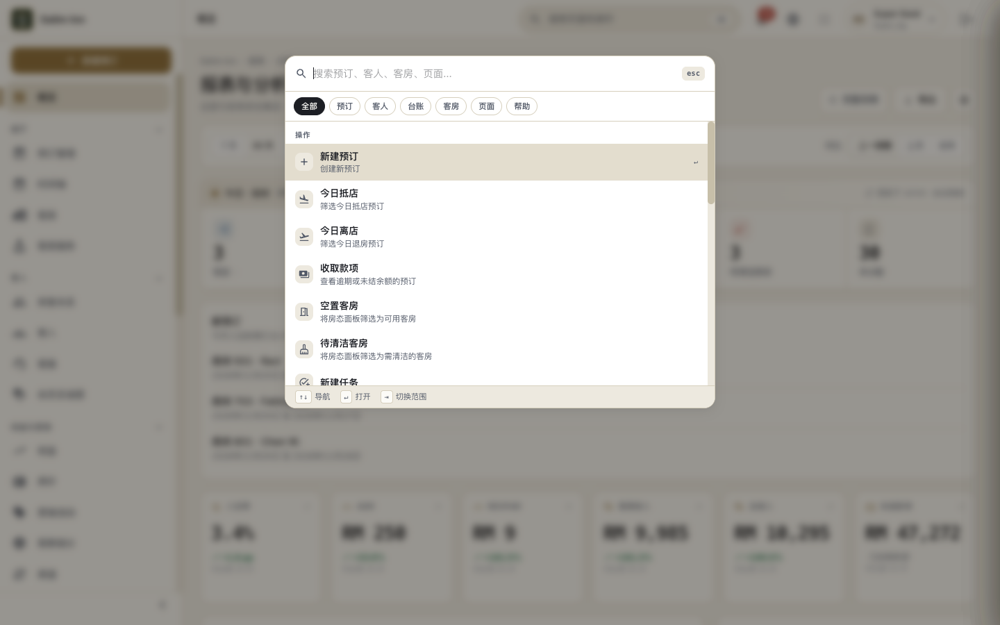

#### 手机与平板端操作

- **底部主导航栏**：在手机尺寸下替代左侧边栏，最多展示 4 个按角色优先级筛选的核心标签（顺序：`概览`、`预订管理`、`客人`、`客房` 或替补 `客房服务`），右侧为`更多`按钮（展开所有其余有权限的模块及`个人资料`、`语言`选择器）。
- **浮动`快捷操作`按钮**：手机端右下角提供快捷操作悬浮球；当页面底部出现保存栏（如批量保存栏）时会自动隐藏，避免遮挡按钮。

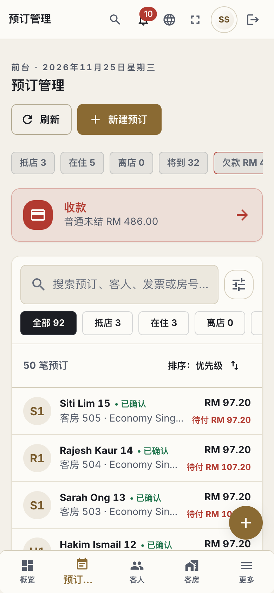

#### 外观与主题模式

- 在`酒店设置`（`/settings`）→ `外观`中可切换**`浅色`**与**`深色`**主题，并调整`背景模糊`像素滑块（`0px` 为完全不透明）。
- 外观偏好保存在**当前设备的本地浏览器/客户端**中，即时生效且不同步至服务器，因此共用电脑不会覆盖其他设备的视觉设置；也可通过 `⌘K` 命令面板快速切换浅色/深色模式。

---

## 第 2 章：员工登录、账户安全与个人资料

### 2.1 员工登录（`/login`）

1. 打开 `/login` 页面，输入管理员为您分配的**`用户名或电子邮箱`**（至少 3 个字符）与**`密码`**（支持点击眼睛图标切换明文显示）。
2. 如系统启用了人机防刷校验，请按页面提示完成安全验证（Cloudflare Turnstile）。
3. 点击登录：
   - 登录后若原本因会话过期被跳转至登录页，系统会自动恢复至您原先访问的目标页面；否则跳转至`/`（`概览`，无仪表盘权限的特定岗位角色会自动跳转至其有权限访问的首个工作台页面）。
   - 如果您的账户曾有首次登录标记，可能会弹出`使用通行密钥保护您的账户`引导框，可选择`注册通行密钥`或`暂时跳过`。

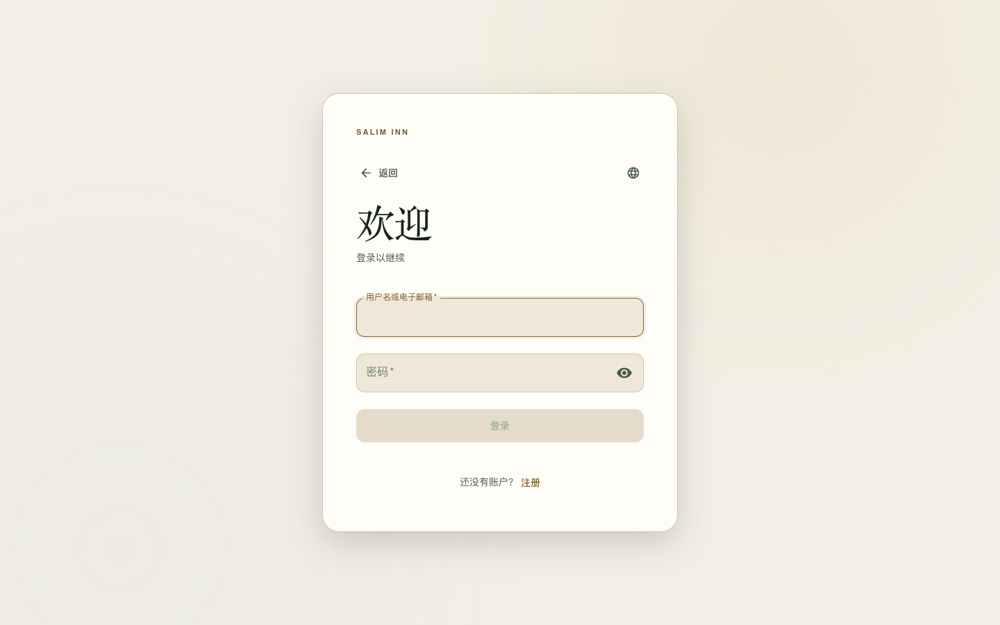

> [!WARNING]
> **员工禁止使用 Google 登录**：登录页上的`使用 Google 登录`按钮及公开页的 Google One Tap **仅限宾客账户使用**。员工尝试用 Google 账号登录会被系统拦截并提示：`Google 登录仅限客人账户。员工请使用用户名和密码登录。`

### 2.2 双重身份验证（2FA）、强制注册与账户锁定

#### 登录二次验证流程

当您的账户已启用验证器应用（TOTP）或已注册通行密钥（Passkey）时，验证密码后系统会签发一个有效期 **5 分钟**的单次 `mfa_token` 并进入二次验证界面：

- **验证器应用（TOTP）**：输入验证器生成的 **`6 位验证码`**，输满 6 位后自动提交；若同时绑定了通行密钥，页面下方会提供`改用通行密钥`按钮。
- **通行密钥（仅绑定通行密钥时）**：点击`使用通行密钥`按钮触发浏览器/系统生物识别或设备 PIN 验证。
- **备用码救急**：点击`无法使用验证器应用？`（或通行密钥提示）→ `使用备用码`，输入格式为 `XXXXX-XXXXX-XXXXX-XXXXX` 的一次性备用码。使用后界面会提示剩余备用码数量，建议尽快前往`个人资料`重新生成。

#### 角色强制 2FA 注册（`/enroll-two-factor`）

当系统配置 `require_two_factor_roles` 包含您的角色时，登录后会引导至 `/enroll-two-factor`：

- 绑定**验证器应用（TOTP）**或**通行密钥（Passkey）**任意一种即满足要求。
- 在宽限期（`require_two_factor_grace_days`，默认 `14` 天）内可点击`暂不`跳过并继续工作；**宽限期届满后未绑定将被禁止登录**。

#### 登录失败锁定与解锁

- 无论密码错误还是 2FA 验证码错误，都会累计`failed_login_attempts`。
- 达到`酒店设置 → 安全`中配置的`max_login_attempts`（默认 **`5` 次**，范围 `1–20`）后：
  - 账户立即锁定 **30 分钟**；
  - 撤销该账户全部活跃会话与刷新令牌；
  - 销毁当前 MFA 挑战并写入 `login_failure` 审计日志。
- 如需提前解锁，需由持有用户管理权限的`经理`或`超级管理员`处理（后端提供 `/api/users/{id}/unlock` 解锁接口）。

### 2.3 通行密钥（Passkeys / WebAuthn）

- **数量上限**：每个账户最多可注册 **`10` 个**通行密钥。
- **管理功能**：在`个人资料`的`已注册的通行密钥`区域可查看设备类型图标、添加日期与最近使用时间，并支持`编辑通行密钥名称`与`删除通行密钥`。
- **密码变更联动撤销**：无论是员工自己在`个人资料`修改密码，还是管理员在`访问控制`中重置员工密码，系统都会在同事务中**自动撤销该账户的所有活跃会话及全部已注册通行密钥**（写入审计事件 `passkeys_revoked_by_password_change` / `passkeys_revoked_by_password_reset`），防止旧凭据继续登录。

> [!NOTE]
> **二次鉴权规则**：点击`添加通行密钥`时，页面会弹出「`请确认是您本人`」确认框（要求验证当前密码或已启用的 6 位 TOTP 验证码），后端 `/auth/passkey/register/start` 亦同步执行 `ensure_step_up` 校验，以防被盗会话静默添加免密登录凭据。

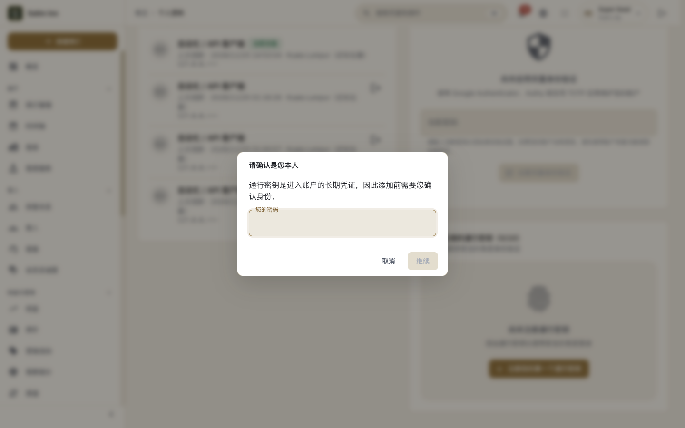

### 2.4 个人资料与安全管理（`/profile`）

桌面端页面分左右两栏（手机端顶部提供`账户详情` / `安全` / `设备`快捷跳转芯片）：

1. **`账户详情`**：
   - 编辑`姓名`、`电子邮箱`（员工邮箱可在此修改；已验证邮箱的宾客账号则锁定）、`电话`。
   - 头像设置：点击`上传头像`上传图片（支持 **JPG / PNG / GIF，不超过 2 MB**），或填写`头像 URL`，也可点击`移除图片`。
2. **`修改密码`**：
   - 采用两步验证：输入`当前密码` → 点击`继续` → 输入`新密码`与`确认新密码` → 点击`更新密码`。
   - **密码复杂度要求**：UTF-8 长度 **8–128 字节**，必须同时包含至少 **1 个大写字母、1 个小写字母、1 个数字和 1 个特殊字符**，且不可包含常见弱密码片段（如 `password`、`12345678`、`admin123` 等）。
   - 修改密码后会强制退出其他设备并撤销所有通行密钥。
3. **`双重身份验证`**：
   - **开启**：输入`当前密码` → 界面在本地生成 SVG 二维码（密钥不会上传至任何第三方服务）或提供可复制密钥文本 → 使用验证器扫描后输入 6 位验证码确认 → **一次性弹出 备用码弹窗**，请务必点击`复制全部备用码`并点击`我已保存备用码`。
   - **维护**：已开启后可查看剩余备用码数量，点击`生成新备用码`（需验证 6 位动态码，旧备用码随即失效）或`停用双重身份验证`（支持使用 6 位动态码或备用码确认）。
4. **`已登录的设备`**：
   - 列出当前所有有效会话（依据操作系统/浏览器识别设备类型）、`当前设备`徽章、根据时区推断的近似位置、最近活跃时间与 IP 地址。
   - 点击非当前设备右侧的`退出登录此设备`并确认，即可远程吊销该端会话。

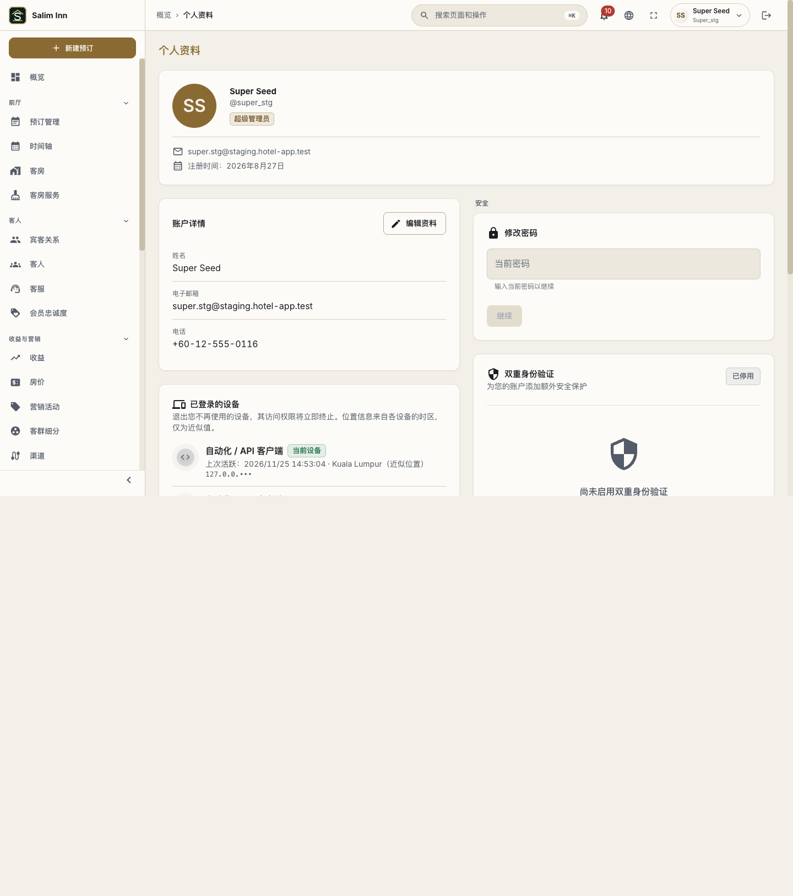

> [!IMPORTANT]
> 员工在`/profile`页面**没有**自助停用账号按钮。如需离职停用或重新激活员工账号，须由`经理`或`超级管理员`在`系统管理 → 访问控制 → 用户`中操作。

### 2.5 共用前台工作站安全交接规范

- 前台等多员工共用的工作站，换班或离开工位前**务必点击顶栏最右侧的`退出登录`按钮**。
- 系统执行安全登出时，会通知服务器吊销刷新令牌 Cookie、清空内存 JWT 访问令牌、清退客户端缓存与 `⌘K` 最近访问记录，并解除 Google 自动选择，确保下一位接班员工不会继承您的会话与权限。

---

## 第 3 章：12 个系统角色与完整权限矩阵（RBAC 规则）

### 3.1 权限引擎核心规则

1. **通配蕴含规则（`:manage`）**：持有 `<resource>:manage` 权限即自动拥有该资源下的全部细分操作权限（例如 `bookings:manage` 等同于同时拥有 `bookings:read`、`bookings:create`、`bookings:update`、`bookings:delete` 等）。
2. **角色优先级与权限超集保护**：
   - 非超级管理员只能编辑/分配**优先级严格低于自身最高角色优先级**的角色与用户账号。
   - 非超级管理员无法授予**自己未持有的权限**（防止越权提权）。
   - **系统内置角色（`is_system_role = true`）不可重命名或删除**，且只有`超级管理员`（`super_admin` / `is_super_admin = true`）可以增减系统内置角色的权限。
3. **补丁 `0031` 重要权限边界调整（必读）**：
   - **`经理（manager）`优先级已提升至 `150`**（高于`管理员 admin` 的 `100`，低于`超级管理员 super_admin` 的 `1000`）。
   - **`经理`拥有`管理员`的全部权限，外加**：用户管理（`users:*`）、角色管理（`roles:*`）、权限管理（`permissions:*`）、团队管理（`teams:create/update/delete/assign/manage`）、访问控制菜单（`navigation_rbac:read`）以及数据迁移全部权限（`data_transfer:*`、`navigation_data_transfer:read`）。
   - **`管理员（admin）`不再拥有**上述用户/RBAC/团队写操作（仅保留只读 `teams:read`）与数据迁移功能（`/rbac` 与 `/data-transfer` 对普通 `admin` 隐藏且拒绝访问）。
   - **种子账号说明**：数据库内所有 `is_super_admin = true` 的活跃账号已自动拥有 `super_admin` 角色，不受此收紧影响。

### 3.2 12 个系统内置角色完整对照表

| 序号 | 角色标识（DB） | 中文显示名称 | 优先级 | 核心权限范围 | 可访问主要页面与典型权限边界 |
|---:|---|---|---:|---|---|
| 1 | `super_admin` | **超级管理员** | **1000** | 全部系统权限 + 越权守卫豁免 | 全部员工页面；**独占功能**：修改 12 个系统角色权限、创建/编辑/删除自定义权限（`/rbac`）、导出/导入 AES-256-GCM 加密`完整系统备份`（`/data-transfer` `system` 范围）、管理其他超级管理员账号。 |
| 2 | `manager` | **经理** | **150** | 全部酒店运营/财务/收益/合规 + 用户与业务数据迁移 | 全部员工页面；可管理 `admin`（100）及以下所有角色用户与自定义角色、使用 `/data-transfer` 导出与还原业务数据；**不可**管理同级 `manager` 或 `super_admin`、不可改系统角色权限、不可触碰加密 `system` 备份。 |
| 3 | `admin` | **管理员** | **100** | 酒店日常运营、收益、房价、渠道、财务、夜审、设置、系统监控与 eKYC | 除 `/rbac` 与 `/data-transfer` 外的全部管理与运营页面；拥有 `rooms:*`、`online_inventory:manage`、`bookings:*`、`guests:*`（含 `guests:reveal`）、`payments:*`、`ledgers:*`、`night_audit:*`、`settings:*`、`audit:{read,export}`、`ekyc:*`、`loyalty:*` 等。 |
| 4 | `compliance_admin` | **合规管理员** | **90** | eKYC 全流程管理与合规监督 + 审计查看 | `/ekyc-admin`（含 `view_sensitive`、`reveal_sensitive`、`download_documents`、`assign`、`approve`、`reject`、`escalate`、`request_resubmission`、`override`、`export`、原因代码与风控规则管理）、`/audit-log`（仅查看，**无 `audit:export`**）。 |
| 5 | `senior_reviewer` | **高级审核员** | **75** | eKYC 二级复核与高风险覆写 | `/ekyc-admin`（可看部分脱敏字段 `view_sensitive`、下载证件、认领、批准、拒绝、上报、请求补件、覆写决定 `override`；**无 `reveal_sensitive` 解密权限、无导出、无审计日志**）。 |
| 6 | `ekyc_reviewer` | **eKYC 审核员** | **70** | eKYC 一线审核 | `/ekyc-admin`（`read`、`review`、`download_documents`、`assign`、`approve`、`reject`、`escalate`、`request_resubmission`；**无 `view_sensitive`、`reveal_sensitive`、`override` 与导出权限**）。 |
| 7 | `auditor` | **审计员** | **65** | 合规审计日志查阅与导出 | `/audit-log`（含 CSV/PDF 导出 `audit:export`）、`/ekyc-admin`（仅只读查看与 CSV 导出 `ekyc:read` / `ekyc:export`，不可审核操作）。 |
| 8 | `receptionist` | **前台接待** | **60** | 前台预订、入离店、房态、收退款与作废、账本、客服 | `/admin-portal`（前台运营看板）、`/bookings`、`/timeline`、`/room-management`、`/housekeeping`、`/guest-relations`、`/guest-relations/guests`、`/support`、`/loyalty`、`/company-ledger`（可读与新增/收款）、`/payment-approvals`、`/complimentary`、`/insights`；`/settings` **只读**、`/room-config` **仅更新不能建删房型**、`/online-inventory` **只读不可保存**；具备 `payments:delete`（作废付款权限，补丁 `0020`）。 |
| 9 | `housekeeping` | **客房服务** | **45** | 房态更新、清洁任务全管理与维修上报 | `/housekeeping`（清洁任务增改管 + 维修工单读写）、`/room-management`、`/timeline`、`/room-config`（仅更新）、`/online-inventory`（只读）、`/help`；不持有仪表盘权限的员工（如 `housekeeping`、`staff`、`support_readonly`）在访问 `/` 或 `/admin-portal` 时会自动导向其有权限访问的首个业务模块页面。 |
| 10 | `staff` | **员工** | **40** | 基础只读查询 + 客人支持协办 | `/bookings`（只读）、`/timeline`、`/room-management`（只读）、`/guest-relations` 与 `/guest-relations/guests`（只读）、`/support`（读写回复）、`/complimentary`（只读）、`/help`。 |
| 11 | `support_readonly` | **支持（只读）** | **30** | 仅只读查看客服工单与 eKYC 状态 | `/support`（只读）、`/ekyc-admin`（只读）、`/help`（不可回复或审核）。 |
| 12 | `guest` | **宾客** | **20** | 公开房型读取与评价权限（无管理端权限） | **被强制排除在所有员工导航之外**，仅可访问宾客门户（`/guest-portal`）及公开/宾客路由；不包含任何后台 `bookings:*` 权限。 |

> [!TIP]
> 在简体中文翻译文件中虽存在 `roles.front_desk`（`前台`）词条，但数据库中实际生效的标准系统角色为上述 **12 个**。若管理员创建了自定义角色，权限需自行在`/rbac`中逐项配置。

---

## 第 4 章：概览仪表盘（`/`）

访问 `/` 或 `/admin-portal` 时，系统会根据当前登录账号的角色自动分流仪表盘视图：

- **`super_admin`、`manager`、`admin`**：进入**`报表与分析`（管理分析仪表盘）**。
- **`receptionist`、`employee`**（且不同时持有管理员/经理角色）：进入**`前台`（前台运营看板）**。

### 4.1 `新预订`滚动条（受营业时间门控的唯一视图）

两类仪表盘均会展示`新预订`（`NewReservationsStrip`）区域：

- **显示逻辑**：仅展示**入住日期为今天（酒店营业日）**且状态为 `pending`、`pending_payment`、`pending_confirmation` 或 `confirmed` 的未入住预订。
- **时间门槛（`new_reservation_visible_time`）**：默认时间为 **`07:00`**（酒店本地时间，可在`酒店设置 → 酒店`修改）。昨天或更早创建的今日抵店预订会在到达 `07:00` 后统一显示在这里；`07:00` 之后新下的今日抵店预订则会**立即显示**。
- **不会遗漏预订**：系统明确提示——`新预订`条只是前台交接的聚焦视图，**绝不会隐藏或过滤`预订时间轴`、`客房管理`或`预订管理`列表中的任何预订**。点击其中一行可直接跳转 `/bookings/$bookingId`。

### 4.2 前台运营看板（`前台`）

副标题：`酒店运营与客房状态的实时概览`（点击右上角刷新图标可同步刷新房态、订单与`新预订`条）。

1. **顶部 4 张可点击房态 KPI 卡**：`可用客房`、`已入住客房`、`已预订客房`、`入住率`（点击后携带对应状态跳转 `/room-management?status=...`）。
2. **今日动态（3 张卡片）**：
   - **`今日入住`**：展示前 5 笔当日待入住订单（`查看全部`跳转 `/bookings?view=arriving`）；`confirmed` 或 `pending` 订单可直接点击行内`办理入住`打开快捷入住弹窗（要求核验身份证/护照号、选择付款与押金收取/免收）。
   - **`今日退房`**：展示前 5 笔当日应退房订单（`查看全部`跳转 `/bookings?view=departing`）。
   - **`需要注意`**：显示当前`维修客房`数量，点击跳转 `/room-management?status=maintenance`。
3. **`新预订`滚动条**。
4. **`客房状态概览`**：
   - 支持按房号或客人姓名实时筛选（`筛选房号或客人…`）及状态图例过滤芯片（`可售`、`占用中`、`已预订`、`清洁中（自动）`、`维修中`）。
   - 桌面端以方格网格平铺，手机端以可折叠状态分组展示。
   - **点击方块交互**：若点击状态为`已预订`且入住日期 ≤ 今天的客房，直接弹出快捷入住弹窗；点击其他状态客房则打开`RoomEventDialog`（可切换`更改状态`或查看`历史记录`）。

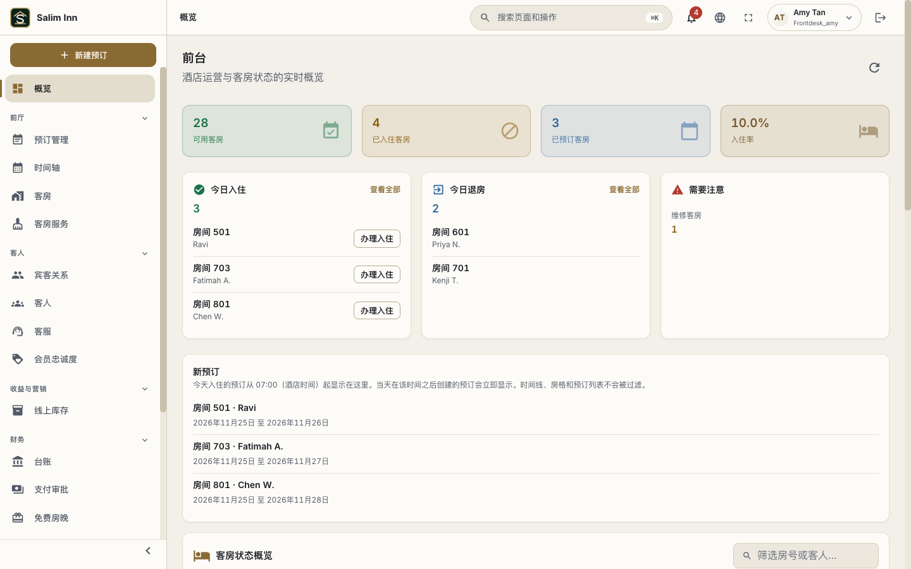

### 4.3 管理分析仪表盘（`报表与分析`）

副标题：`运营与财务综合概览 · 主物业`。

- **权限标识与导出**：顶部显示`完整权限`或`受限权限`徽章（财务收入与未结余额数字受 `ledgers:read` / `revenue:read` 或管理角色保护，无权限时将覆盖`仅限财务`遮罩）；右上角支持`导出`与`打印`。
- **筛选控制栏**：时间范围（`7 天` / `30 天` / `90 天`）、`房型`、`来源`、对比周期（`上一周期` / `上月` / `去年`）。
- **今日实时运营条（`今日 · 实时`）**：标注`更新于 {{time}} · 自动刷新`（30 秒缓存 + WebSocket 实时失效），展示 `到店`、`离店`、`在住客人`、`当前入住率`、`待清洁房间`、`未分配`。
- **6 张核心 KPI 卡片**（含微型趋势线与同比/环比增减）：`入住率`、`ADR`、`RevPAR`、`客房收入`、`总收入`、`未结款项`。

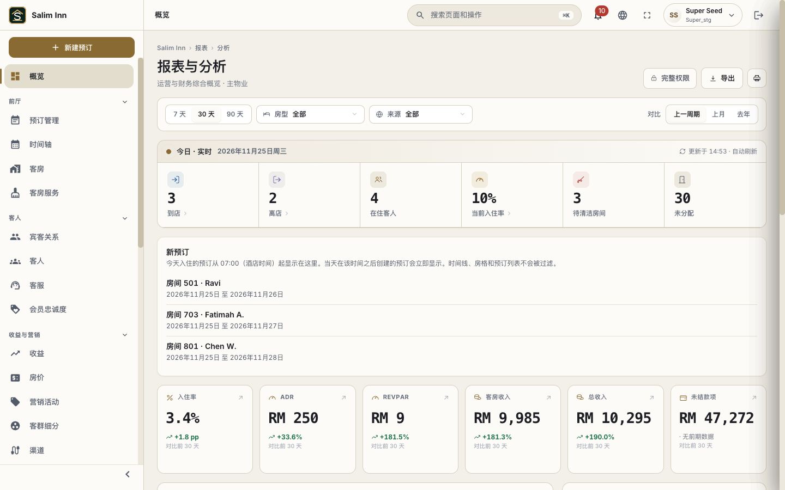
- **可视化图表与下钻抽屉**：
  - 点击 KPI 卡片或图表（`入住率`、`收入`、`未结账龄`、`今日到店`/`离店`），可从右侧打开 4 个明细抽屉：
    1. **`未结余额`（`OutstandingDrawer`）**：支持切换`客人余额`与`公司余额`分签，并查看逾期账龄分布。
    2. **`入住率详情`（`OccupancyDrawer`）**：展示房态构成、各房型入住率柱状图与今日离店列表。
    3. **`收入详情`（`RevenueDrawer`）**：展示互不累加的 4 阶段收入口径漏斗（`已预订`、`已实现`、`已收取`、`未结`）及分房型明细。
    4. **`到店 / 离店明细`（`FlowDrawer`）**：快速查看今日抵店与离店全量名单。
  - 主区还包含`每日收入趋势`（客房收入 + 其他收入）、`预订渠道组合`环形图、`入住率趋势`、`房型表现`、`未结账龄`、`今日到店`与`今日离店`清单。

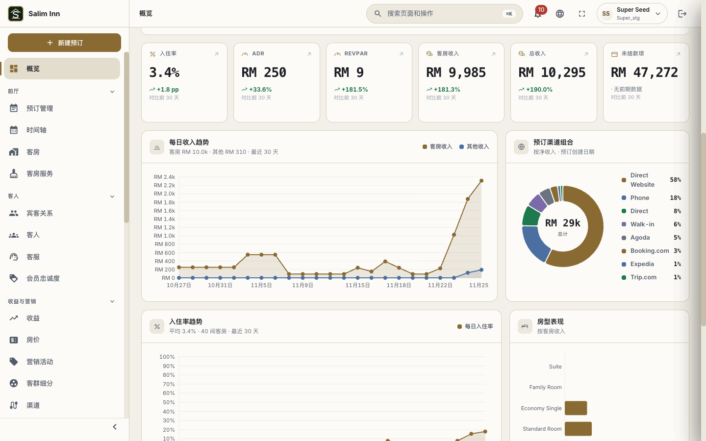

---

## 第 5 章：前厅运营（预订、时间轴、客房与客房服务）

### 5.1 预订管理（`/bookings` 与 `/bookings/$bookingId`）

- **访问权限**：页面访问 `bookings:read`（或 `bookings:manage`）；创建 `bookings:create`；入住/退房/编辑/作废/恢复/释放 `bookings:update`；删除 `bookings:delete`。

#### 5.1.1 列表视图、筛选与行详情抽屉

- **8 个服务端视图筛选芯片**：`全部`、`抵店`、`在住`、`离店`、`未来预订`、`逾期未结`、`普通`（超退房日且仍有普通欠款）、`公司`（超退房日超过 1 个月仍有企业欠款）。顶部汇总条在存在逾期欠款时提供一键`收款`入口。
- **搜索与组合过滤**：
  - 搜索框支持匹配预订编号（`BK-...`）、客人姓名、发票号或房号（键盘快捷键 `/` 聚焦，`Esc` 清空）。
  - 可按`支付方式`、`线上渠道`、`搜索日期`、`搜索月份`（前后 12 个月或`全部月份`）筛选，点击`清除`重置条件；支持按`优先级`（入住日期）或`客人`排序，每页 20 条。
- **行内快捷操作**：随当前行状态动态显示 `办理入住`（早于标准入住时间悬停提示提前入住）、`办理退房`、`收款`（非团订的未付线上预订）或 `发票`（已退房/已完成），同时展示渠道徽章、挂账类型、`团体 {{number}}` 徽章与夜审过账徽章。
- **右侧抽屉 vs 完整页面**：点击列表行会在右侧滑出`BookingDetailDrawer`（含`快速编辑`：调整入住/退房日期、`-1晚`/`+1晚`快捷改期、`备注`、`特殊要求`与`保存更改`）；点击`打开完整页面`可进入 `/bookings/$bookingId` 查看全量账单、时间线与团订信息。

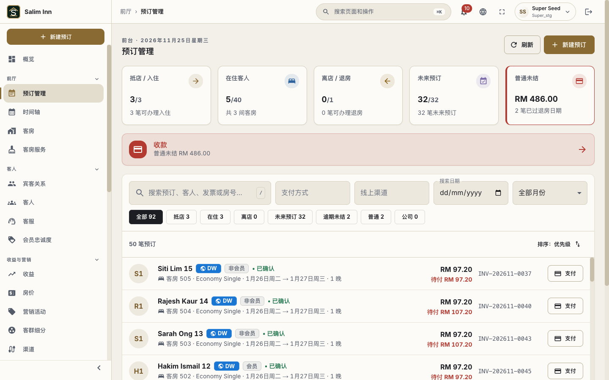

#### 5.1.2 创建预订（单房与多房团订）

点击侧边栏或页面右上角`新建预订`打开统一预订向导（步骤 ①–⑦）：

1. **选择客房**：支持勾选 **1 间房**（普通单房预订）或**多间房**（自动创建关联同一 `booking_groups` 的多房团体预订，并在单次事务内原子分配；加床费用仅可作用于主房）。
2. **选择模式**：
   - **`直接预订`**：用于现场上门客（Walk-in），建单后直接跳转至 5 选项卡入住窗（`基本信息`、`住宿信息`、`支付`、`自定义字段`、`备注`）。
   - **`预订`**：用于后续抵店的预约，需在`预订类型`中选择：
     - `上门客`（散客上门/电话预订）
     - `线上`（OTA 或渠道订单——**必须**选择渠道并填写外部`预订编号`）
     - `免费`（消耗客人名下匹配该房型的免费房晚额度）
3. **客人资料**：可搜索选择已有客人或`登记新客人`。
   - 快速建单最少仅需填`名`与`旅客类型`（`本地` / `外籍`）；电话与证件号可留待办理入住时补全（系统弹出非阻塞提示提醒）。
   - **公司入住智能提示**：若所选客人有历史公司挂账记录，页面自动提示`使用公司入住？`，支持一键`挂账至 {{name}}`或现场注册新公司。
4. **住宿与房价**：支持`1晚` / `2晚` / `3晚` / `1周` 快捷按钮，勾选`钟点入住`时按 1 晚基准价计费；可勾选`使用自定义房价`覆写每晚单价，并配置`加床`、客人`特殊要求`与内部`备注`。

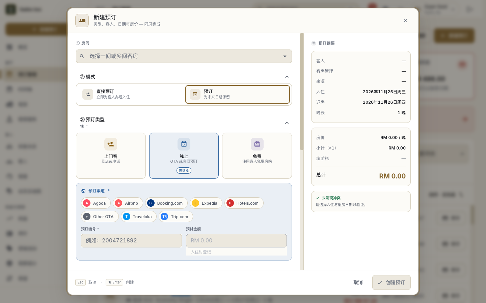

#### 5.1.3 计价、SST、旅游税与吸烟偏好规则

- **SST 服务税内含制**：系统中的房型房价与加床费**均已包含服务税（SST，默认 8%）**。净房费按 `round(含税价 / (1 + 税率), 2)` 反算，税额为含税价减去净房费。
- **旅游税（Tourism Tax）外加制**：仅当客人类型为**`外籍`（`foreign`）**时按每房每晚 **RM 10**（读 `tourism_tax_rate`）外加计费；`本地`（马来西亚公民/永久居民）免征。
- **吸烟偏好提示**：宾客门户下单时可选`要求无烟房`或`要求吸烟房`（仅作偏好，不保证分配）。当所选客房的吸烟属性与客人偏好冲突时，预订详情与房卡会醒目警示`客人要求无烟房，但此客房被标记为吸烟房。`或相反提示。

#### 5.1.4 预订生命周期状态全集（13 个数据库合法状态）

| 状态值 | 简体中文标签 | 业务含义 |
|---|---|---|
| `pending` | `待处理` | 初始保留状态（可办入住） |
| `pending_payment` | `待支付` | 线上预订等待付款（受未支付保留时限约束） |
| `pending_confirmation` | `待确认` | 客人已提交银行转账申报，等待财务/前台审批确认 |
| `confirmed` | `已确认` | 已担保或付款完成，等待抵店入住 |
| `checked_in` | `已入住` | 客人已于前台完成入住 |
| `auto_checked_in` | `自动入住` | 客人通过 eKYC 门户自助入住完成 |
| `checked_out` | `已退房` | 已结账离店 |
| `completed` | `已完成` | 住宿与账务流程完结 |
| `no_show` | `预订未到` | 客人未按期抵店 |
| `comp_void` | `免费作废` | 免费住宿预订已作废 |
| `partial_complimentary` | `部分免费` | 仅部分房晚使用免费额度减免 |
| `fully_complimentary` | `全额免费` | 全部房晚已由免费额度覆盖 |
| `voided` | `已作废` | 预订已取消/作废（注：系统将取消统一记为 `voided`） |

#### 5.1.5 办理入住与 OTA 结算锁定

- **抵店日与状态门槛**：仅当状态为 `confirmed` 或 `pending` **且**当前酒店营业日 ≥ 入住日期时，才出现`办理入住`按钮；处于 `pending_payment` 或 `pending_confirmation` 时系统明确拦截提示`此预订尚待付款，暂时无法办理入住`。若客人提前一天到店，须先修改预订入住日期。
- **提前入住提示**：抵店当天早于`酒店设置 → 入住时间`（默认 `15:00`）办理入住时，按钮标注`提前入住`并给出提示，但不硬性阻断。
- **入住核验内容**：需确认或补全法定姓名、身份证/护照号、选填电话、付款方式以及押金（`收取押金` 或 `免收押金` 并填免收原因）。
- **OTA / 线上渠道结算支付方式锁定（补丁 `0023`）**：
  - 对于关联了线上渠道（如 `Booking.com`、`Agoda`、`Traveloka`、`Expedia`、`Direct Website`）的预订，**房费付款方式被锁定为该渠道允许的结算方式**（并展示`已通过 {{platform}} 结算`）。若线上订单未绑定渠道或未配置结算方式，系统禁止登记房费，须先编辑预订补设渠道。
  - **前台升级差额解锁**：一旦渠道结算金额的房费入账完成后，若前台为客人升级房型或加住产生额外余额，系统自动解锁现金/银行卡/DuitNow 等现场收款方式收取差额（仍禁止记为其他 OTA 渠道方式）。
  - **保留至前台收取的费用（`前台费用`）**：线上预订的旅游税（外籍）、加床费与房型升级差价不会由线上自动扣款结清，均留待客人抵店时在前台收取。
  - 押金不受渠道锁限制，但在线预订退还押金必须原路退回原押金付款方式。

#### 5.1.6 办理退房、账单发票与押金处置

点击`办理退房`打开两步结账窗口：

- **第 1 步：`发票预览 - 退房前核对`**：
  - 核对或使用`编辑房价`调整逐晚房费、查看含 SST 与旅游税的明细账单。
  - 登记收款、修改付款或作废误录付款（作废时须填原因；若原营业日已夜审关账，页面自动弹出跨日冲销提醒，详见第 8.2 节）。
  - **退房放行条件**：① 应付余额须清零为 `RM 0.00`（**公司挂账预订例外**，退房时跳过现金清零并在同事务自动过账至`公司台账`）；② 在住押金须完成处置。
  - **押金处置 3 选 1**：
    1. `退还押金`（全额或部分退回，需 `payments:refund` 与备注；撤销退款需 `payments:manage`）。
    2. `没收押金`（选择原因：`房间损坏` / `物品或钥匙遗失` / `未结费用` / `其他` 并二次确认，生成 `deposit_forfeited`；撤销没收需 `payments:manage`）。
    3. `取消未收取的押金`（作废未实收的押金记录 `payments:delete` 或解除免收绑定 `bookings:update`）。
- **第 2 步：`确认退房`**：提交后系统在单事务内自动执行 4 项动作：
  1. 将客房置为 `dirty`（若当天另有预订等待入住则置为 `reserved_dirty`）；
  2. 自动生成一条`退房清洁`（`checkout_clean`）客房服务任务；
  3. 分配连续月度发票号 `INV-YYYYMM-XXXX`（与公司台账共用唯一编号序列）；
  4. 按客人语言偏好（`language_preference` → 酒店默认语言 → `en`）将多语言退房收据邮件排入发送队列。
- **打印与 PDF**：支持点击`打印发票`调用浏览器打印或另存 PDF；多房团订支持在详情页点击打印统一团体收据。

#### 5.1.7 编辑、换房、作废、恢复、释放保留与团体员工操作

- **编辑预订**：可修改住期、实际退房日、状态、预订渠道/OTA 参考号（实时预览预计佣金与净收入）、关联公司、覆写房价、加床数、备注与特殊要求。**入住前的换房**可在编辑预订中直接选房；**入住后的换房**须使用客房管理或仪表盘的`换房`功能（`ChangeRoomDialog`）。
- **作废（`作废`）**：软作废预订、释放占用客房、作废关联付款及未付（`paid_amount = 0`）台账条目，并自动将已扣用的`免费房晚`退回客人额度；若该预订已被夜审过账，弹窗提示风险。
- **恢复（`重新激活`）**：仅单房已作废预订支持单独恢复；团体预订须在团体区整组恢复。
- **释放未付款保留（`释放客房`）**：仅当预订为 `pending_payment` **且已收金额为 0** 时可用（一旦存在任何付款记录，系统强制禁用释放，须走作废与退款）。后台定时任务每 **15 分钟**自动清理超过`unpaid_hold_release_hours`（默认 24 小时，`0` 表示关闭）的未付款线上保留。
- **多房团体预订员工操作**：在团订卡片区域支持原子化批量操作（并发锁保护）：
  - `收款`（`payments:create`）：一次收款自动按顺序分摊至组内未付房间；
  - `全部入住` / `全部退房`（`bookings:update`）：退房前统一校验所有房间的余额与押金；
  - `取消全部客房` / `恢复全部客房`：组内任意房间已入住或已退房时拒绝整组取消；团体代金券随房间删减按比例重分（已付或已入住房间份额冻结）。

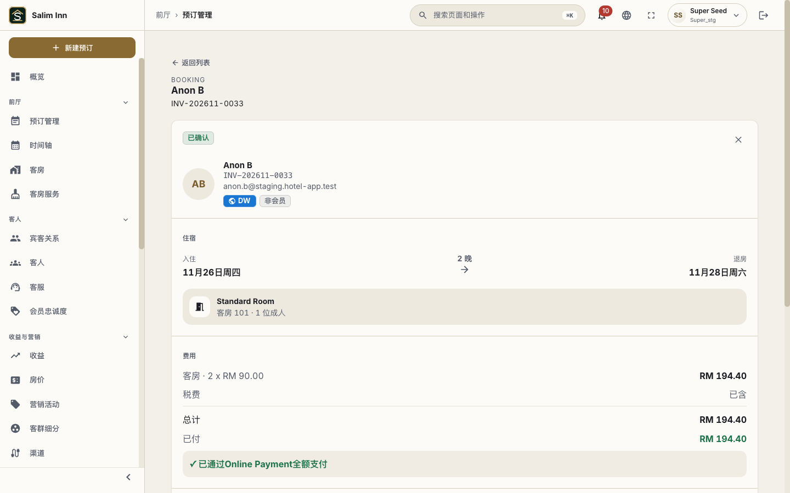

---

### 5.2 预订时间轴（`/timeline`）

- **访问权限**：页面需要 `rooms:read`（侧边栏菜单需要 `bookings:read`）。
- **页面特性**：展示`{{rooms}} 间客房 · {{bookings}} 个有效预订`，支持 **7 天 / 14 天（桌面默认）/ 30 天 / 60 天（手机默认 7 天）**窗口与前后翻页（`‹` / `›`）、一键`今天`、`刷新时间轴`以及每 **30 秒自动刷新**。手机端支持切换`列表`（按今日抵店/离店/在住/空房分组）与`网格`视图。
- **颜色图例与堆叠**：`占用中`（琥珀色）、`已预订`（蓝色）、`待处理`（紫色）、`免费`（绿色）；已退房与已作废订单不显示，逾期未退房仍保留显示。同一房间的冲突/紧邻预订会自动叠放在多条横向泳道中。
- **重要边界说明**：
  - 时间轴是**纯粹的只读规划视图**——**不支持拖拽改房、不支持拉伸改日期，也不支持行内直接建单**。
  - 页面上**没有楼层、房型或房间搜索框**，默认按房号升序展示全部客房，左侧固定列标注最近一条即将入住的保留日期。
  - 将鼠标悬停（约 250 ms）或点击/点按任意预订条，可弹出详细浮层查看客人、房号、创建人、联系方式、住期、人数、加床、费用、付款状态、押金、公司与备注。

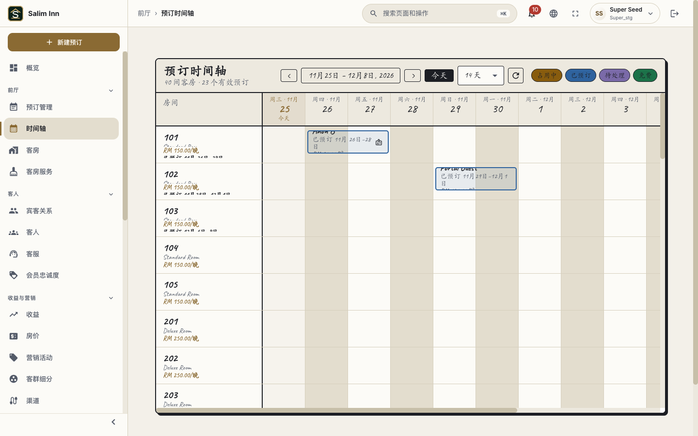

---

### 5.3 客房管理（`/room-management`）

- **访问权限**：`rooms:read`（查看）；状态修改 `rooms:update`；新建预订/入住/退房等联动需相应 `bookings:*` 权限。
- **统计与筛选**：顶部显示`{{count}} 间客房 · {{floors}} · 入住率 {{rate}}%`与`实时状态`徽章；包含 5 张可点击状态统计卡（`可售`、`占用中`、`已预订`、`待清洁`、`维修中`）、属性筛选（`吸烟房`、`每日清洁`、`无需清洁`）、楼层筛选、`优先处理`排序（优先排前待清洁、维修与已预订客房）以及搜索框（`/` 聚焦，支持搜房号与住客）。
- **逾期未退房警报**：当存在超过退房日期仍在住的房间时，顶部出现黄色警示横幅`{{count}} 间客房超过应退房日期`，点击`查看`可打开`逾期未退房`列表直接`延长退房日期`或`退房`；对应房卡亦显示`逾期{{count}}天`徽章。

#### 8 个数据库合法房态及手动流转规则

| 房态代码 | 中文名称 | 含义与进入/退出方式 |
|---|---|---|
| `available` | `可售` / `空房/已清洁` | 干净空闲，可立即安排入住 |
| `occupied` | `占用中` | 当前有客在住 |
| `reserved` | `已预订` | 当日或近期存在保留预订等待入住 |
| `reserved_dirty` | `已预订待清洁` | 前客退房后尚待打扫，但当天已有新预订等待入住 |
| `cleaning` | `清洁中` | 保洁人员已点击开始清洁 |
| `dirty` | `待清洁` | 退房后待清扫 |
| `maintenance` | `维修中` | 存在维修任务（仍可按规则恢复或转停用） |
| `out_of_order` | `维修停用` | 严重故障彻底封锁，不可售卖 |

> [!NOTE]
> 在客房与客房服务共用的`更新状态 / 停用`（`RoomStatusUpdateDialog`）弹窗中，只能手动切换到非预订驱动的目标状态：例如 `可售` 可转 `待清洁`/`维修中`/`维修停用`；`待清洁` 可转 `可售`/`维修中`；`维修中` 可转 `可售`/`待清洁`/`维修停用`；`维修停用` 可转 `可售`/`待清洁`/`维修中`。切勿强行用手动改态绕过正常的入住或退房流程。

- **房卡快捷操作与右键菜单**：支持直接触发`退房`、`办理入住`、`标记已清洁`、`新建预订`、`即将到来的预订`、`换房`（`ChangeRoomDialog`）、`延长退房日期`、`客人详情`、`编辑预订备注`（含切换客人`每日清洁`偏好）、`标记为免费`、`更新状态 / 停用`、`客房历史`、`编辑备注`与`属性…`（如修改吸烟属性）。

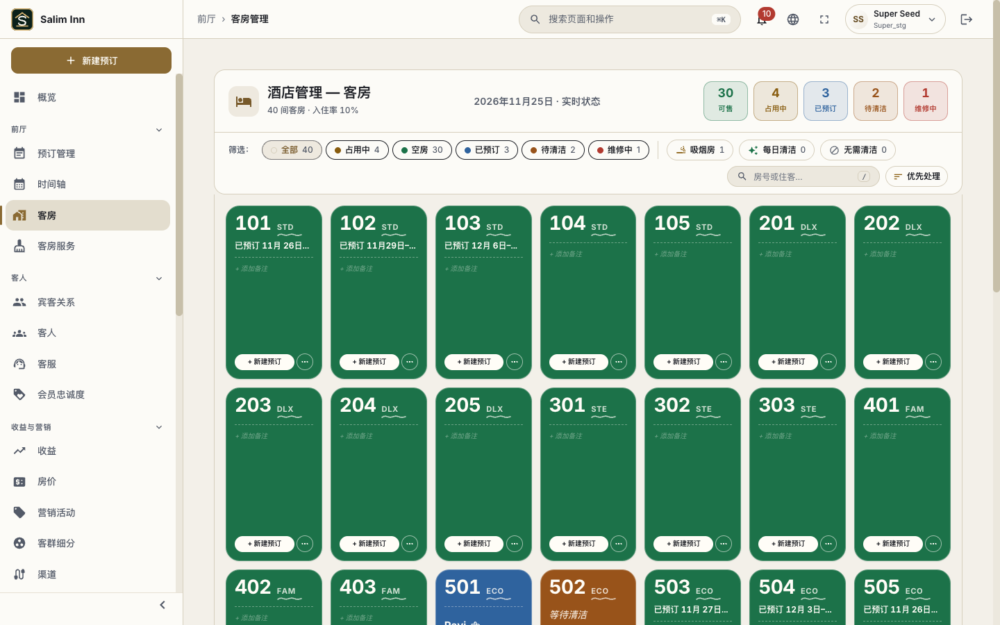

---

### 5.4 客房服务与维修（`/housekeeping`）

- **访问权限**：查看与菜单 `housekeeping:read`；创建任务 `housekeeping:create`；开始/完成/指派/编辑 `housekeeping:update`；`同步房态`需 `rooms:update`；`维修`选项卡需 `maintenance:read`（新建/处理工单需 `maintenance:write` 或 `maintenance:manage`）。
- **顶部统计与动作**：6 张可点击 KPI 卡片（`需注意`、`待清洁`、`进行中`、`未分配任务`、`已封锁客房`、`已就绪`），右上角提供`刷新看板`、`同步房态`、`新建任务`。
- **3 个核心选项卡**：
  1. **`看板`**：按紧急优先级排列房态泳道（`已预订待清洁` → `待清洁` → `清洁中` → `维修中` → `维修停用` → `可售` → `已预订` → `占用中`），支持按楼层、房态、优先级、关键词搜索；卡片内一键`开始`、`完成`、`分配给我`、`添加任务`、`更新房态…`、`报告维修…`。在`已预订待清洁`客房上新建任务时默认选中`退房清洁`与`高`优先级。
  2. **`任务`**：支持筛选`未完结`/`分配给我`/`未分配`/`今日到期`/`已完成`/`所有任务`，以及 4 种任务类型（`清洁`、`退房清洁`、`检查`、`维修跟进`）与 4 级优先级（`低`/`普通`/`高`/`紧急`）。计划日期早于今天营业日的未完结任务标红`已逾期`。
     - **任务状态流转**：`pending` → `in_progress` 或 `void`；`in_progress` → `completed` 或 `void`；`completed` 与 `void` 为终态（检查任务通过选`检查`类型并填写`检查备注`完成）。
     - **联动房态自动更新规则**：仅当完成**`清洁`**或**`退房清洁`**任务且客房当前为 `dirty`、`cleaning` 或 `reserved_dirty` 时，系统自动记录最近清洁时间并把房态变为 **`reserved`**（若当天有待入住保留）或 **`available`**；完成`检查`或`维修跟进`任务**不会**自动修改房态。
  3. **`维修`**（无 `maintenance:read` 权限时不显示此选项卡）：
     - 支持按状态（`全部` / `待处理` / `进行中` / `已挂起` / `已解决` / `已关闭`）、类别（`电气`/`管道`/`暖通空调`/`家具`/`电器`/`结构`/`其他`）与优先级（`低`/`中`/`高`/`严重`）过滤；点击`新建工单`创建，点击工单可`重新分配`、记录费用或填`解决备注`并`标记已解决`。
     - **重要提示**：创建或关闭维修工单**不会自动变更客房状态**。若某房间需暂停售卖维修，务必在`看板`或`客房管理`菜单中手动执行`更新房态…`将其设为`维修中`或`维修停用`。

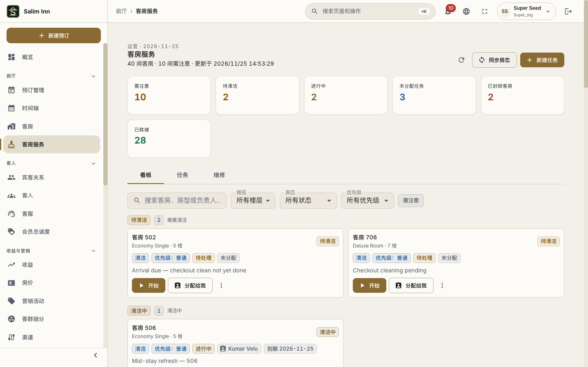

---

## 第 6 章：客人关系、客服与会员忠诚度

### 6.1 宾客关系看板（`/guest-relations`）与跟进队列（`/guest-relations/follow-ups`）

- **访问权限**：`guests:read` 或 `guests:manage`（其中支持请求与评价卡片分别额外检查 `support:read` 与 `reviews:read`）。
- **看板内容（`客户关系`）**：右上角`客人名录`按钮直达客人列表；主体展示统计条与 7 个实时预览卡片（每卡最多展示 5 条）：`今日到店`、`在住客人`、`今日离店`、`今日贵宾到店`、`待处理支持请求`、`待回复的评价`、`待跟进事项`（自动屏蔽他人私密跟进）。

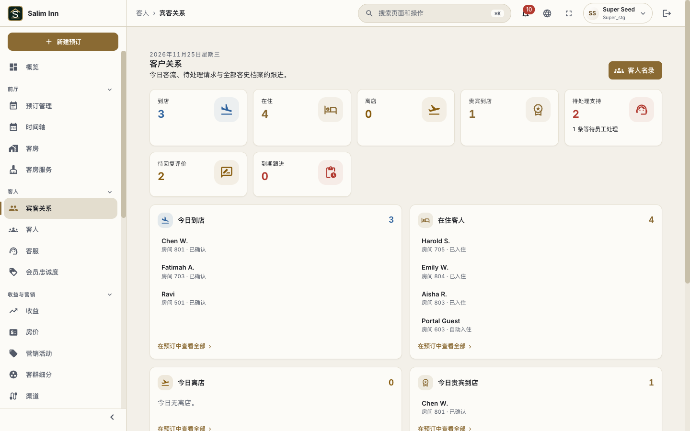

- **跟进队列（`/guest-relations/follow-ups`）**：非侧边栏页面，从看板点击进入。按酒店营业日分为 `已逾期`、`今天`、`即将到来`、`全部` 四个筛选桶，按`最早优先`排序，支持一键`标记完成`；私密跟进记录仅创建者本人或持有 `guests:manage` 的管理者可见。

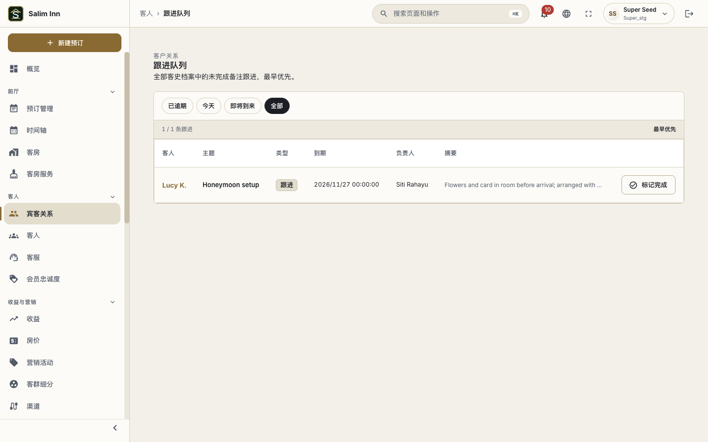

### 6.2 客人目录（`/guest-relations/guests`）与客人 360° 档案（`/guest-relations/guests/$guestId`）

- **访问权限**：列表与档案读取 `guests:read`；新增 `guests:create`；编辑/设偏好/转移门户账户 `guests:update`；删除 `guests:delete`；查看敏感证件信息 `guests:reveal`；直接创建已批准 eKYC 需 `ekyc:approve`。
- **客人目录（`客人`）**：
  - 9 张统计卡 + **13 个细分筛选芯片**：`全部客人`、`会员`（指房价折扣类型标记，区别于会员忠诚度积分计划）、`非会员`、`游客`（外籍旅客）、`资料不全`（同时缺少邮箱和电话，**或**缺少证件号）、`缺少旅游信息`、`VIP`、`黑名单`、`待处理请求`、`回头客`（至少 2 次已退房/已完成入住）、`在住`、`即将到店`、`不活跃`（近 365 天无完成住宿）。
  - 支持按 ID、姓名、电话、邮箱、证件号、公司实时搜索与`导出 CSV`、`添加客人`。
  - **右侧 `GuestDetailDrawer`**：展示`资料不全`提示、入住汇总、`快速编辑`、快捷操作（`新建预订`、`入住历史`、`免费房晚额度`、`按上次入住设置旅游类型`、`转移门户账户`、`创建 eKYC`、`编辑`、`删除客人`）。**注意**：当前在住客人的档案禁止删除；删除档案会级联影响历史关联。
- **昵称唯一性与公司关联**：
  - 数据库对客人`nick_name`强制不区分大小写唯一。员工新建/修改客人若发生重名，系统提示冲突并返回原客人 ID 供直接打开定位，避免重复建档。
  - 在客人表单的`公司名称`框中可搜索关联已启用的企业账户。
  - `转移门户账户`可将某个宾客登录用户名从旧档案重绑至当前客人档案（并按条件补发欢迎礼券，写入审计日志）。

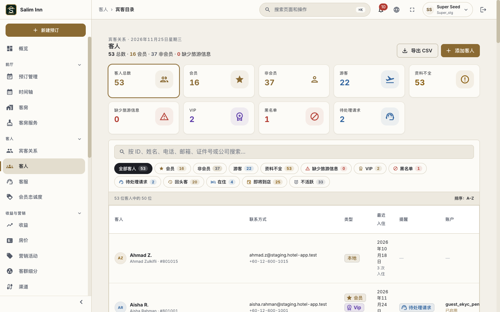
- **客人 360° 全景档案（7 个选项卡，无读权限自动隐藏）**：
  1. **`概览`**：4 项关键指标（`已完成入住`、`总晚数`、`累计房费收入`、`未结余额`）、当前住宿状态、提醒、个人资料、偏好预览、待办事项、疑似重复档案警告；持有 **`guests:reveal`** 权限时额外显示`敏感身份信息`（出生日期、证件类型/号码/有效期/签发国）。
  2. **`入住记录`**：历次预订清单，点击可直达对应订单详情。
  3. **`偏好`**：7 大类结构化偏好（`客房`/`床型`/`楼层`/`饮食`/`沟通`/`特殊场合`/`其他`）及历史备注整理。
  4. **`互动记录`**：按时间记录`备注`/`电话`/`邮件`/`当面`/`跟进`，可关联预订、设置跟进提醒日期与负责人，并勾选`私密——仅作者和管理者可见`。
  5. **`忠诚度与优惠券`**：只读展示会员等级、积分与持有优惠券，提供跳转`/loyalty`与`/campaigns`的管理链接。
  6. **`客服与反馈`**：查看该客人发起的客服会话与`新建会话`（`support:write`），查看并回复客人评价（`reviews:update`）。
  7. **`沟通`**：查看邮箱可达性与屏蔽状态、订阅主题同意记录，持有 `communications:manage` 时可点`编辑同意设置`代客人调整`酒店公告`/`促销与优惠`/`生日礼券`订阅偏好。

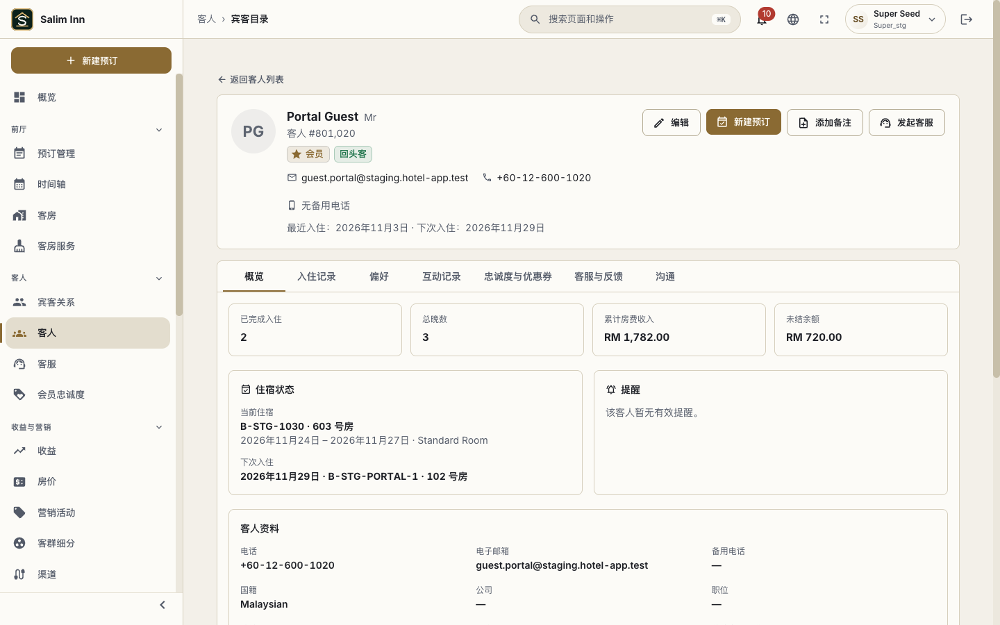

### 6.3 客人支持 / 客服（`/support`）

- **访问权限**：页面打开 `support:read`；回复与写内部备注 `support:write`；认领/指派/退回 `support:assign`；升级 `support:escalate`；改优先级/关闭/重新打开 `support:manage`。
- **工作台结构与队列**：
  - 左侧 6 个队列选项卡：`未分配`、`我的`、`待回复`（默认）、`等待客人`、`有风险`（显示 SLA 临期或已超时数量）、`已解决`。
  - 支持按关键字（客人/预订/会话编号）、4 种状态（`等待客服回复`、`等待客人回复`、`已解决`、`已关闭`）与 4 级优先级（`低`/`普通`/`高`/`紧急`）筛选。
  - 8 个业务分类：`服务请求`、`投诉`、`预订`、`住宿`、`账单`、`忠诚度`、`技术支持`、`其他`。
- **SLA 时效标准**（可在`酒店设置 → 客人政策`自定义，默认首次响应 / 解决）：`紧急` 5 分钟 / 30 分钟、`高` 15 分钟 / 2 小时、`普通` 1 小时 / 8 小时、`低` 4 小时 / 24 小时。超标将显示`SLA 有风险`或`SLA 已超时`徽章。
- **操作流与并发控制**：
  - **`认领` / `指派` / `退回队列`**：由持有 `support:assign` 的员工分派（可附`交接备注`）。只有指派给自己的会话（或未分配但持有 `support:assign`，或持有 `support:manage`）才允许回复或解决。
  - **`回复客人` vs `内部备注`**：回复框支持切换页签。`内部备注`带有琥珀色提示条「`内部备注仅酒店员工可见，不会出现在宾客门户中。`」，放心用于交接，客人完全不可见。
  - **`升级`**：需填写`升级原因`。
  - **`解决`**：需选定`解决代码`并填写客人可见的`解决摘要`。客人可在解决后`support_reopen_window_days`（默认 **7 天**）内自行重新开启会话；超过窗口或被员工`关闭`后，仅持有 `support:manage` 的人员可`重新打开`。
  - 所有操作均带有乐观锁（`expected_version`）和幂等键，防止两位客服同时操作同一会话造成覆盖。
- **已支付预订的取消申请处理**：
  - 当客人在宾客门户申请取消**已付款**（或银行转账待确认）的单房/多房预订时，系统**不会**自动取消或退款，而是自动生成一条**`高`优先级、`预订`分类**的客服会话，并将预订标记为取消待审。客服人员核实 3 天免退政策与财务状况后，在`/bookings`协调退款或作废，再回复并解决此客服单。

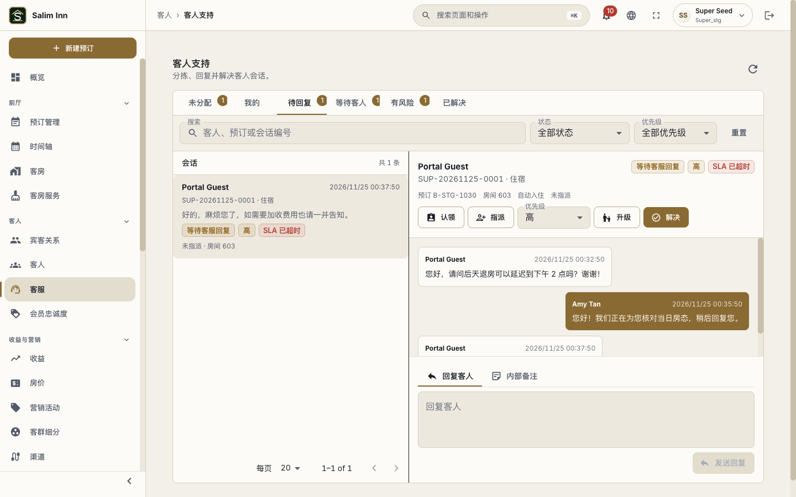

### 6.4 会员忠诚度管理（`/loyalty`）

- **访问权限**：页面访问策略为 `analytics:read`（接口层读操作同时认可 `loyalty:read` / `loyalty:manage`）；**所有写操作（赠分、建/改奖励、审批/拒绝兑换、改规则）均必须持有 `loyalty:manage`**。支持独立实时推送 `/api/admin/loyalty/socket`。
- **5 个管理选项卡**：
  1. **`概览`**：4 张核心统计卡（`会员总数`、`可用积分`、`累计积分`、`待处理兑换`）及 4 个等级（`青铜`、`白银`、`黄金`、`铂金`）的人数占比分布。*(注：会员等级结构在数据库中固定，管理界面不提供增删等级功能。)*
  2. **`会员`**：按姓名/邮箱/会员号与状态（`全部`/`有效`/`已关闭`）查询会员；点击行打开`会员详情`可查看等级进度条、最近 100 笔积分流水，以及执行**`赠送积分`**（输入正整数积分及 ≥5 字必填原因，同步增加`可用积分`与`累计积分`并写入审计与实时推送；界面仅开放正向赠分）。
  3. **`奖励`**：支持开关`显示已停用`，点击`新建奖励`或行内`编辑奖励`配置：名称、描述、类别（`服务`/`客房升级`/`餐饮`/`水疗`/`折扣`/`礼品`/`体验`/`通用`）、`积分成本`、`库存（可选）`、`最低等级 ID（可选）`、生效/失效日期、条款、**`需审批`开关**与**`启用`开关**（通过停用下架奖励，不直接物理删除）。
  4. **`兑换`（积分兑换审批工作流）**：
     - 可按`全部`/`待处理`/`已批准`/`已拒绝`筛选；当奖励勾选了`需审批`或规则开启了全局`兑换需审批`时，客人提交兑换后状态为`待处理`（此时积分已在提交瞬间扣除，有限库存亦已扣减）。
     - **`批准`**：通过后状态置为`已批准`并记录审核人与时间（**`已批准`即为最终态，无二次“核销”步骤**）。
     - **`拒绝`**：必须填写至少 5 个字符的`原因`，系统在同一事务内将状态置为`已拒绝`并自动插入`已冲销`流水把所扣积分全额退还客人。**重要提示**：拒绝兑换**不会自动加回先前扣减的奖励库存数**，如有需要请到`奖励`页手工调整库存。
  5. **`规则`（`计划规则`）**：配置`每货币单位积分`、`等级资格指标`（`积分`/`间夜`/`消费额`）、`积分有效期（月，留空=永久）`、`最低合格金额`（低于该金额的住宿不累积积分）、`启用积分累积`总开关与全局`兑换需审批`开关，点击`保存规则`生效。

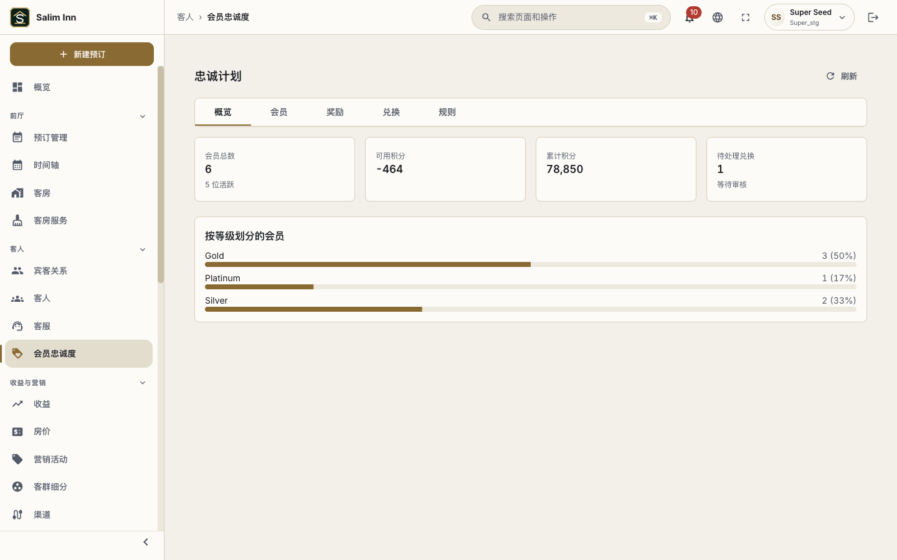

---

## 第 7 章：收益与营销（7 大模块）

### 7.1 收入概览（`/revenue`）

- **访问权限**：`revenue:read`。
- **筛选与周期对比**：
  - 4 个筛选器：`开始（住宿日期）`、`结束（最后一晚）`（默认近 30 天，跨度上限 **366 天**且起止日期须成对填写）、`房型`、`渠道`。
  - 系统自动将所选区间与紧邻前一个等长周期对比，标注 `较上期` 涨跌幅；若上期基线为 `0`，展示 `· 无上期`，避免失真百分比。
- **7 张 KPI 卡片**：`客房收入`、`入住率`（附已售房晚数）、`ADR`（每已售房晚）、`RevPAR`（每可售客房）、`平均住宿`（晚数）、`新增预订`（附取消 % 与未入住 %）、`直销占比`（纳入 `direct`、`website`、`walk_in`、`phone` 渠道类型）。
- **核心图表与口径**：
  - **`入住率与房晚`**：按住宿日期展示上下独立坐标系的`房晚`柱状图与`入住率`（0–100%）面积折线图。
  - **`渠道贡献`**：列示`渠道`、`类型`、`预订`、`净收入`、`占比`。
  - **统计口径提示**：上方 KPI 按**住宿日期**统计，渠道贡献按**预订创建日期**统计；已取消与未入住住宿不计入已售指标。
  - *(注：当前 `/revenue` 页面不渲染应收账龄图；应收/公司账龄请在`/`管理仪表盘的`未结账龄`或`/insights`的`公司账册对账单`中查看。)*

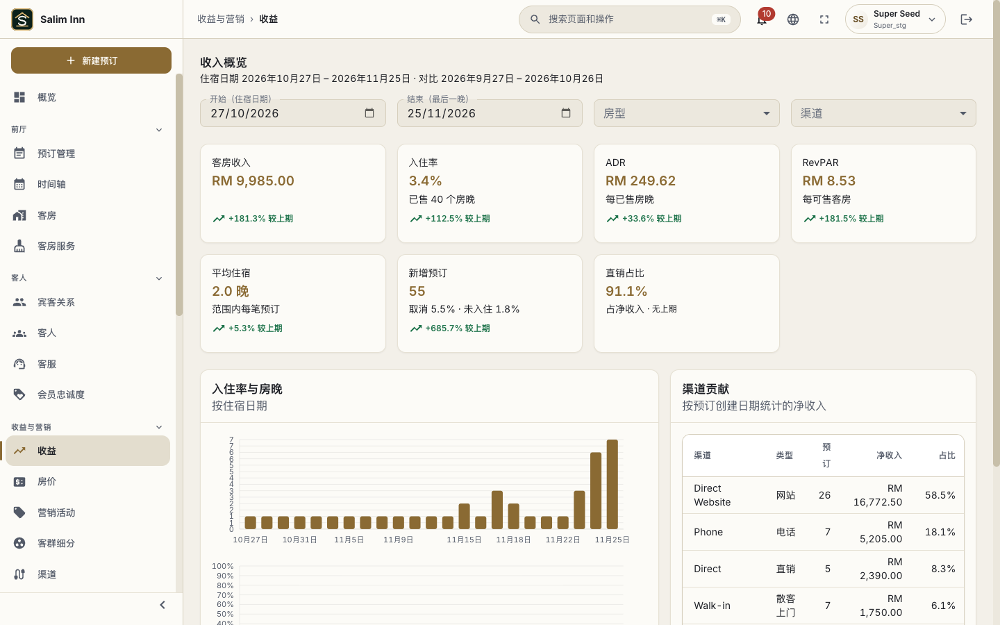

---

### 7.2 房价管理（`/rates`）

- **访问权限**：查看日历 `revenue:read`；读取计划与区间 `rooms:read`；新建/删除/批量写 `rooms:write`；编辑计划或单区间 `rooms:update`（`rooms:manage` 蕴含所有写操作）。
- **2 个选项卡**：
  1. **`房价日历`（只读视图）**：展示未来 **14 天**（可通过`上一页`/`下一页`按 14 天步进翻页）各启用房型的解析生效价、入住率进度条（<70% 绿、70–89% 橙、≥90% 红）、`已售/物理房数`。紫色圆点表示存在线上覆盖价，`关闭`表示停售线上。**日历格不可直接修改**，点击格子弹出浮层可核查来源（`基础房价兜底`或对应`房价计划`）、计划价、线上覆盖价、生效价、上门客保留与线上开放状态。
  2. **`房价计划`**：
     - 点击右上角`新建计划`或行内`编辑计划`设置：`名称`、`代码`（自动大写唯一编码）、`描述`、`计划类型`（`标准`/`季节性`/`促销`/`公司协议`/`团体`/`套餐`）、`调整类型`（`百分比`/`固定值`/`覆盖`）与`调整值`、`优先级`（计划重叠时数值大者优先生效）、`生效/失效日期`、`最少/最多晚数`、`最少/最多提前预订天数`、**`不适用日期`**（逗号分隔 `YYYY-MM-DD`，**仅新建时可填写**，编辑时不回显以免误覆）以及`适用星期`。*(注：房价计划中不包含取消政策或餐食选项。)*
     - 编辑已有计划时，弹窗底部显示**`房价区间编辑器`**：按`房型`、`价格`、`生效日期`、`失效日期`（可留空表示无限期）维护区间价格；无匹配区间时回退房型基础价。删除计划会连带删除其下的房价区间。
- **`批量房价`更新**：点击顶部`批量房价`，选择 1 个房价计划、多选房型、起止日期与统一价格（>0），点击`应用房价`在单事务内批量更新并写入审计日志（起止日完全一致的原地覆写，其余新建区间，重叠以最新写入为准）。
- **房价代码、市场代码与税费归属**：
  - `房价代码`（`rate_codes`）与`市场代码`（`market_codes`）在**`酒店设置`（`/settings`）→ `代码列表`** 中维护，不在此页配置。
  - **含税与旅游税**：房型基准价与加床价均为**含 SST（默认 8%）**价格；**旅游税（默认 RM 10/晚）**对外籍游客另行外加。
  - 渠道加价与净收入预览请在`/channels`（`价格矩阵`）与渠道详情的`预览`中进行。

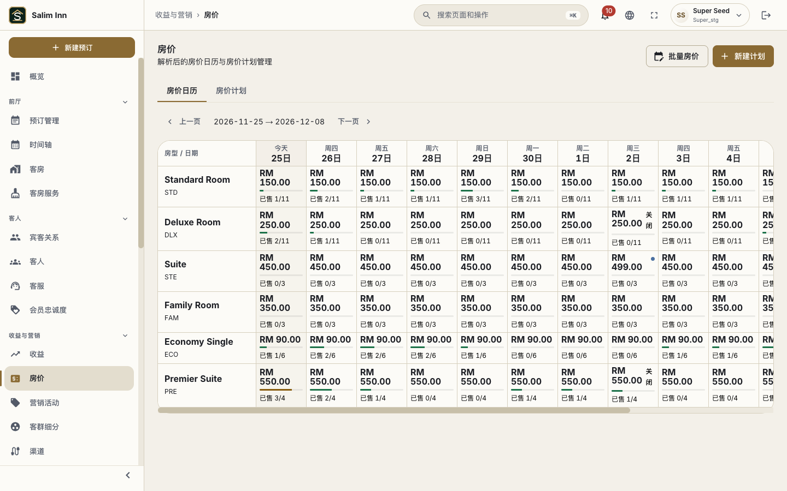

---

### 7.3 预订渠道（`/channels` 与 `/channels/$channelId`）

- **访问权限**：查看 `channels:read`；新建/编辑渠道、定价规则、佣金覆盖与映射 `channels:write`；停用渠道与删除规则 `channels:manage`。
- **列表页（`/channels`）2 个选项卡**：
  1. **`渠道`**：管理所有销售渠道（`直订`/`OTA`/`企业`/`上门客`/`电话`/`网站`/`渠道管理器`/`其他`），可设定`缩写`（≤8 字符，用于报表与夜审房单缩写如 `B.C`、`A.C`）、`代码`、`集成模式`（`手动`/`渠道管理器`/`API`）、`默认佣金类型`（`无`/`百分比`/`固定金额`）与`佣金范围`（`每笔预订`/`每晚`）及`启用`开关。停用渠道不影响历史预订快照。
  2. **`价格矩阵`**：选定具体`日期`后，以「房型 × 渠道」矩阵直观核对各渠道计算后的最终售价与预计净收入（净房价模式标注 `净价`）。

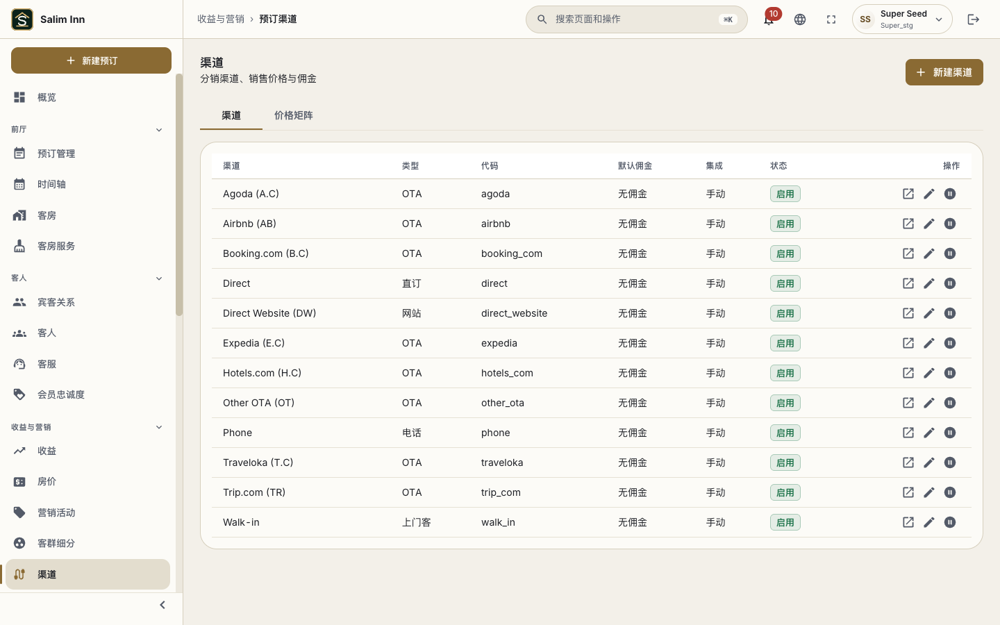

- **渠道详情页（`/channels/$channelId`）4 个选项卡**：
  1. **`定价规则`**：新建或维护按日期、房型（可空=全房型）、房价计划（可空=任意计划）生效的加减价规则，支持 5 种类型：`加价 %`、`加价（固定）`、`折扣 %`（0–100）、`固定价格`、`净房价`（酒店按净额结算、对外售价由渠道自定）。可设`最低价`/`最高价`钳制区间与`优先级`；百分比波动超过 30% 时页面会给出警告提示。
  2. **`佣金`**：在渠道默认佣金基础上添加按生效/结束日期与优先级生效的佣金覆盖规则。
  3. **`映射`**：维护`房型映射`与`房价计划映射`的`外部 ID`、`外部名称`与启用开关。**界面提示**：当前仅用于保存外部标识符以备后续渠道管理器集成，**目前不会自动向外同步**。
  4. **`预览`**：不写库的逐晚价格试算器——选择房型、房价计划与入离店日期，即可预览每晚源房价、命中规则、售价小计、预计佣金与预计净收入。
- **重要财务规则——结算支付方式锁定（`settlement_payment_methods`）**：
  - 各线上渠道允许结清房费的支付方式在数据库通道表中预设（例如 `Booking.com` → `Booking.com`、`Agoda` → `Agoda.com`、`Traveloka` → `Traveloka`、`Expedia` → `Expedia.com`、`Direct Website` → `Bank Transfer` / `PayPal`；目前渠道弹窗界面不开放修改该列表）。
  - 在房费结清前，前台只能按通道指定方式登记房费；**待通道房费入账完成后，若前台发生升级房型等补差余额，前台现场收款方式自动解锁**（仍禁止选为其他 OTA 方式）；押金退款强制原路退回原押金方式。

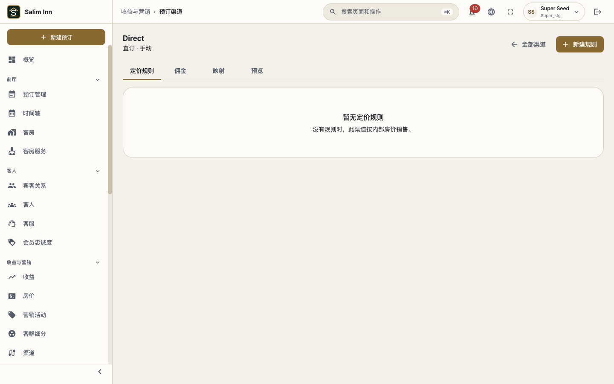

---

### 7.4 线上库存控制（`/online-inventory`）

- **访问权限**：查看页（只读提示`仅可查看——您可以查看线上可售情况，但不能修改。如需修改，请联系管理员或经理。`）：`rooms:update` 或 `rooms:manage`；**提交保存必须具备 `online_inventory:manage`**（默认仅管理员与经理拥有）。
- **网格操作（每次 14 天，支持范围：今天前 365 天至未来 730 天）**：
  - 工具栏支持 `后退 14 天`/`前一天`/`开始日期`/`后一天`/`前进 14 天`/`今天`、`仅覆盖项`切换与`刷新`；移动端支持点`选择`批量点选并使用底部编辑抽屉。
  - 汇总条实时统计`可见窗口`或`所选单元格`的 `实际可用`、`上门客保留`与 `线上可售` 间夜数。
- **暂存式单格与批量编辑**：
  - **单格编辑**：开关`可线上预订`（关闭即停售线上并标示 `已关闭`）、调整`为上门客保留`（若高于该日实际可用房数会标红警示并使线上可售归 0）、设定`自定义线上价格`（留空则遵循标准房价）或`重置为标准规则`。
  - **批量编辑**：支持按行、按列、全选或拖拽框选多格，先限定生效星期（`周一`–`周日`），再一键执行`开放线上`、`关闭线上`、`设置保留`、`设置价格`、`±%` 调价、`± 金额`调价（导致 ≤0 元的单元格自动跳过）或`清除覆盖`。
- **`检查并应用`与乐观并发冲突处理（`expected_updated_at`）**：
  - 所有更改先留在本地暂存区（底部悬浮条显示`已修改 {{count}} 个单元格`、`放弃`、`检查并应用`）。切换日期或离开页面前如有未保存修改会弹窗确认。
  - 点击`检查并应用`打开`检查修改`确认单，采用单事务原子提交并即时广播更新线上预订房态。
  - 若在此期间有其他同事先一步修改了同一房型日期格，后端返回冲突拦截并展示顶部警示`您的修改未保存`（列出冲突格）。点击**`重新加载`**会拉取最新数据并**仅丢弃发生冲突单元格上的修改，为您保留其余无冲突日期的暂存修改**，避免心血全部作废。

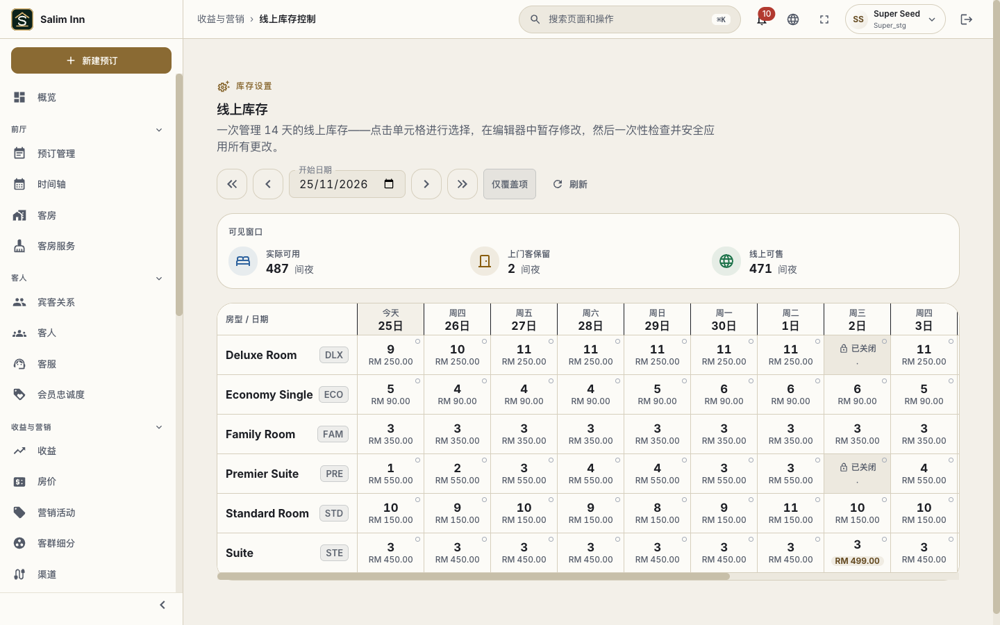

---

### 7.5 营销活动与代金券（`/campaigns`，`/promotions` 自动重定向至此）

- **访问权限**：查看活动 `promotions:read`；新建/编辑/暂停/取消/归档活动 `promotions:manage`；**发布活动必须持有独立权限 `promotions:approve`**（`promotions:manage` 默认蕴含该权限）；查看代金券 `vouchers:read`；发放/吊销代金券 `vouchers:manage`。
- **选项卡 1：`营销活动`**：
  - 顶部统计条：`营销活动`、`已发放代金券`、`兑换`、`已让利金额`。
  - **7 个运营生命周期态**：`草稿`（新建保存的初始状态）、`已排期`（已发布但认领开始时间未到）、`进行中`（已发布且处于认领窗口内）、`已暂停`、`已过期`（已发布且认领截止时间已过）、`已取消`（不可逆，需填原因，停止认领且未用代金券作废）、`已归档`（从默认列表隐藏且不可编辑）。*(注：系统没有“待审批”中间态，审批门控体现为发布按钮的 `promotions:approve` 权限校验。)*
  - **6 分区活动编辑器**：①`优惠基本信息`（名称、URL 唯一优惠代码、描述）；②`折扣`（类型：`优惠` deal 或 `代金券优惠` voucher；折扣方式：`百分比`或`固定金额`；百分比`最大折扣`封顶；货币）；③`可用性`（认领起止时间、入住起止日期）；④`资格与上限`（最少/最多晚数、认领总量上限、每位客人上限、最低预订小计、限定房型）；⑤`活动定向`（内部代码、目标标签、限定`预订渠道`与限定`会员等级`）；⑥`客人体验`（条款与条件、`使用此优惠的预订可由客人取消`开关、`在公开优惠目录中显示`开关）。
  - **效果分析**：点击行内`表现`打开`活动表现`抽屉，查看`代金券漏斗`（已发放/客人认领/管理员发放/可用/已兑换/已吊销/已过期）、`兑换`（已使用/已冲销）、`转化率`、`预订总额`、`已让利`、`净收入`与`渠道构成`。

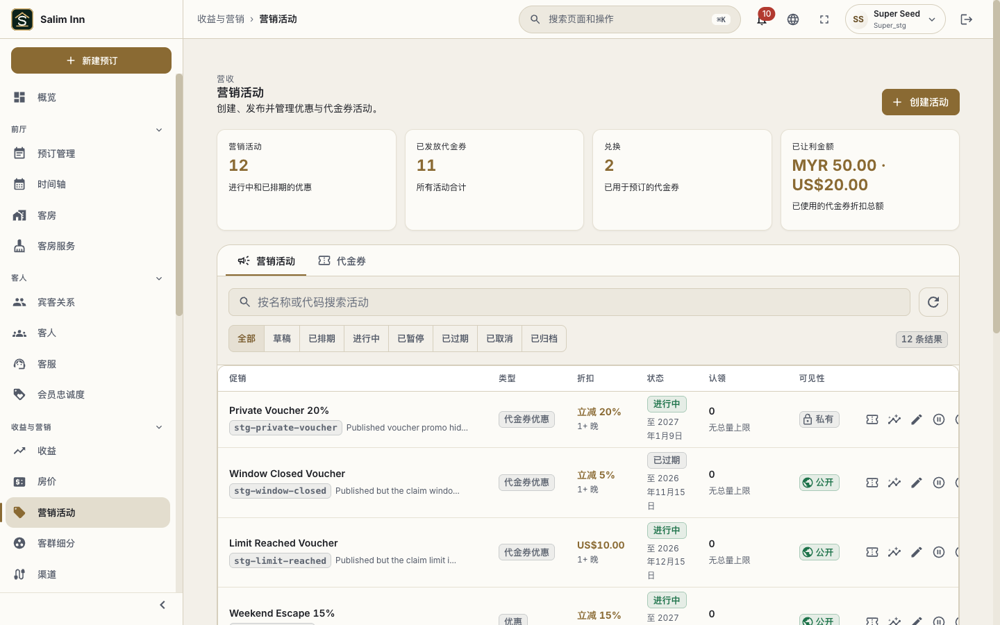

- **选项卡 2：`代金券`**：
  - 6 张可点击筛选的状态统计卡：`代金券总数`、`当前可用`、`即将到期`（7 天内）、`已过期`、`已兑换`、`已让利金额`。
  - **`发放代金券`**：选择处于进行中且未达上限的优惠、选定目标客人、可选填自定义代码（8–64 位字母数字，留空自动生成安全代码）与可选到期时间，点击发放。
  - **详情与吊销**：查看来源（`客人认领`/`员工发放`）、优惠规则、不可取消警示与时间线，可执行不可逆的`吊销代金券`。
  - **单房 vs 多房团订代金券分摊规则**：单房预订按整单计算后分摊到每晚；多房团订中无封顶百分比券按房独立算，**固定金额券与封顶百分比券按各房间小计精确到分按比例分摊**。团订中途取消未付款房间时，其优惠份额按比例重分给剩余未付房间；**已付款或已入住的房间份额永远冻结不变**；取消已付款房间时其份额直接丢弃不转嫁。

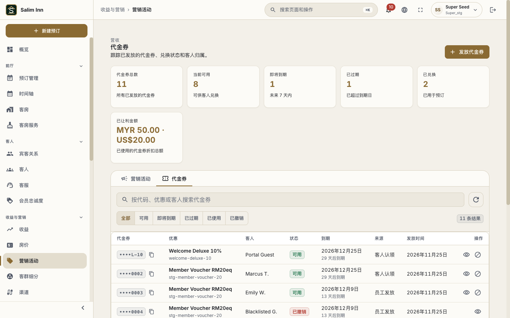

---

### 7.6 客群细分（`/segments`）

- **访问权限**：查看与实时预览 `segments:read`；创建/编辑/启停/删除 `segments:manage`。
- **动态实时评估原理**：客群细分只保存 JSONB 规则，**永不预先物化储存静态名单**。每次打开列表统计、点`预览`或发送邮件活动时，后端将校验后的白名单字段动态编译为严格参数化 SQL，实时计算命中的活跃客人。
- **逻辑构造规则**：采用**组间「或」（OR）、组内「且」（AND）**（界面提示：`任一组匹配即算命中；组内所有条件必须全部匹配。`）；可通过`添加条件`与`添加“或”组`自由组合，支持在保存前直接点击`预览成员`实时查看命中人数与示例客人。
- **全部 14 个可用筛选字段与支持条件**：
  1. `国家`（下拉枚举：是 / 不是 / 是其中之一 / 已设置 / 未设置）
  2. `国籍`（下拉枚举：同上）
  3. `语言偏好`（下拉枚举：同上）
  4. `通讯偏好`（下拉枚举：同上）
  5. `贵宾状态`（下拉枚举：同上）
  6. `客人类型`（会员 / 非会员：是 / 不是 / 是其中之一）
  7. `营销订阅`（是 / 否：是）
  8. `客人标签`（包含标签 / 不包含标签）
  9. `总入住次数`（恰好为 / 至少 / 最多）
  10. `总消费`（至少 / 最多）
  11. `年龄（岁）`（按出生日期实时计算：至少 / 最多）
  12. `距上次入住天数`（按最近已完成/已退房住宿计算：至少 / 最多）
  13. `会员等级`（活跃等级下拉：是 / 是其中之一）
  14. `会员身份`（是 / 否：是）
- 列表支持按名称搜索、按`全部`/`启用`/`停用`筛选、一键启停或删除（仅启用状态的细分可在新建邮件活动时选取）。

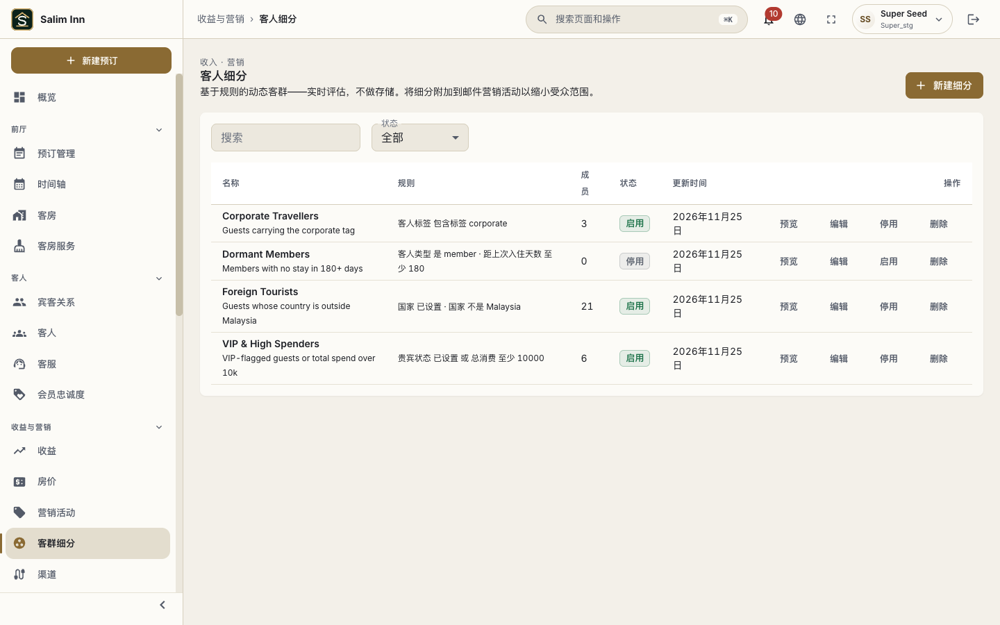

---

### 7.7 通信管理（`/communications`）

- **访问权限**：查看活动/模板/投递与受众预览 `communications:read`；创建/编辑活动与模板 `communications:compose`；测试发送/排期发送/取消 `communications:send`；停用模板、管理屏蔽名单与调整同意 `communications:manage`。
- **3 个选项卡**：
  1. **`邮件活动`**：创建或编辑群发邮件，指定`名称`、`类型`（`公告` / `促销`——选`促销`时须关联一个进行中的已发布优惠）、可选的`客人细分`（留空则面向所有符合条件客人）、`主题`与`正文 (HTML)`（上限 20 万字符）。界面实时提示有效受众数及被细分排除的人数。
     - **发送与追踪**：草稿支持`测试发送`（填测试邮箱立即验证排版）、`发送`（排入后台投递队列，状态流转 `草稿` → `已排期` → `进行中` → `已完成`，发送前支持`取消`）；点击`预览`可核查详细排除统计（`无邮箱`/`未激活`/`已退订`/`已屏蔽`/`不在细分内`）；点击`投递记录`可按脱敏收件人查看每封邮件的投递状态、重试次数与最近错误。
  2. **`模板`**：维护可复用 HTML 邮件模板（`代码`仅限小写字母/数字/下划线 ≤50 字符、`名称`、`主题`、`允许的变量`如 `guest_name,booking_number` 与 `正文 (HTML)`）。所有 `{{variable}}` 插入时均会强制 HTML 转义防注入；支持编辑与`停用`。
  3. **`屏蔽名单`**：记录了因`退订`、`退信`、`投诉`或`手动`原因被拦截的邮箱及来源（`客人门户`/`员工`/`退订链接`）。顶部可输入邮箱手动点击`屏蔽`，亦可从名单`移除`。凡在屏蔽名单内的地址，即使重新订阅也不会收到营销邮件。
- **两层邮件规则与异步投递队列**：
  - **事务型邮件（6 类）**：`booking_confirmation`（预订确认）、`online_room_assignment`（线上客房分配）、`payment_receipt_request`（补传转账凭证）、`payment_rejected`（付款被拒与恢复链接）、`checkout_receipt`（退房收据）、`pre_arrival_reminder`（入住前提醒）。**系统会自动绕过营销订阅检查**确保业务通知触达，但仍尊重硬退信/手动屏蔽。
  - **营销型邮件（2 类）**：`campaign`（邮件活动）与 `birthday_voucher`（生日券）。必须客人活跃有邮箱 + 持有对应主题有效同意 + 不在屏蔽名单 + 命中细分。
  - **异步队列与投递状态**：后台基于 `lettre` SMTP 工作进程每 **15 秒**轮询、每次认领 10 封并持有 5 分钟租约；失败按指数退避（$2^{\text{attempts}}$ 分钟，最长 60 分钟）重试，且**实际发信前一刻会二次核对订阅与屏蔽状态**。投递状态共 6 种：`排队中`（`queued`）、`发送中`（`sending`）、`已发送`（`sent`）、`发送失败`（`failed`）、`已抑制`（`suppressed`）、`已取消`（`cancelled`）。

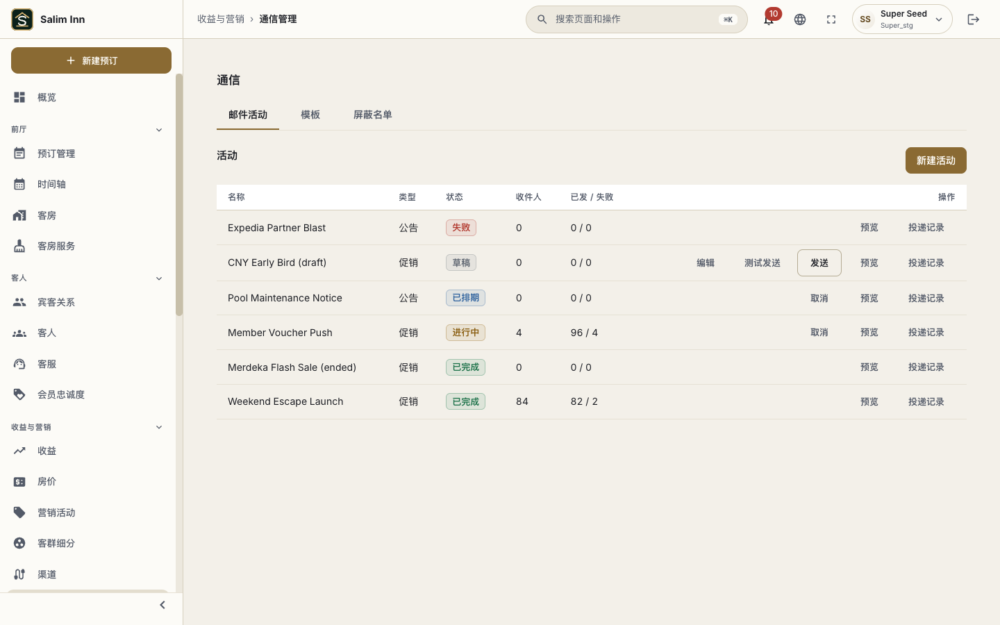

---

## 第 8 章：财务管理（4 大模块）

### 8.1 公司台账（`/company-ledger`）

- **访问权限**：读取台账 `ledgers:read`；新建条目与登记公司付款 `ledgers:create`；编辑条目与修改付款日期 `ledgers:update`；作废与开具贷记单冲销 `ledgers:void`；删除条目或删除付款记录 `ledgers:manage`；企业客户资料维护需 `companies:read|create|update|delete`。
- **界面结构**：
  - 顶部汇总条：`账单总额`、`已收款`（含回款率）、`未结余额`（含待结项目数）、`逾期`（存在逾期时展示）。
  - 左侧公司栏：搜索（公司名/联系人/电话）、按`全部`/`有余额`/`已结清`筛选、点击`注册公司`建档、或点击`公司入住`直接为企业客办理记账入住。
  - 右侧选中公司区：显示联系人、账期（`账期 {{days}} 天`，默认 30 天）、信用额度（`限额 {{amount}}`）、`打印对账单`与`删除公司`（有在住企业预订时禁用）；下方提供快捷`在住客人`退房栏以及 **2 个选项卡**：
    1. **`账本项目`**：支持状态筛选、搜索账本号/说明/发票号与分页。支持操作：`新建账本项目`（自动按公司+房间+日期+金额查重，发现疑似重复会弹出确认）、`记录付款`、`开具贷记单`、`生成发票`；单行支持`付款`、`编辑条目`、`作废条目`、`查看发票`、`打印收据`。
    2. **`公司信息`**：编辑企业全称、商业注册号、联系人、邮箱、电话、信用额度、付款期限（天）、账单地址与内部备注。
- **核心账务规则与数据完整性**：
  - **自动入账与联动**：选择公司挂账的预订在退房或完成时自动生成 `room_charge` 借方台账条目（幂等防重）；若后续调整未结预订房费，会同步增量更新处于 `pending`/`partial` 的关联行；若作废预订，未付（`paid_amount = 0`）台账行随之自动作废，已收款行保留供人工对账。
  - **费用类型与状态**：支持`住宿`、`会议`、`餐饮`、`服务`、`其他` 5 类；状态为 `待处理`（`pending`）、`部分支付`（`partial`）、`已支付`（`paid`）、`已逾期`（`overdue`）、`已作废`（`void`）。禁止在`编辑条目`中将尚有未结余额的行直接硬改为`已支付`——必须通过`记录付款`核销。
  - **单事务多条目付款核销（`记录付款`）**：在同一次付款弹窗中，可**多选该公司的多笔未结账本项目**，填写实付金额、付款日期、付款方式（`银行转账`/`信用卡/借记卡`/`现金`/`支票`/`DuitNow`/`网上银行`/`PayPal`）、参考号与唯一收据号。系统在**单个数据库事务**中按选定顺序逐笔冲减余额并更新各条目状态（支持幂等键防重，且实付金额不可超过所选条目未结总额）。弹窗内的`付款历史`选项卡允许修改付款日期（`ledgers:update`）或删除错误付款（`ledgers:manage`）。
  - **作废 vs 开具贷记单（冲销）**：
    - `作废条目`：**仅允许已付金额为 `0`（`paid_amount = 0`）的条目作废**，防止已收现金从汇总里蒸发。
    - `开具贷记单`：用于**已开票或已收款**条目的更正冲销。系统生成一条借贷方向相反、说明以 `REVERSAL: ` 开头、关联原交易且状态为 `paid` 的冲销分录（可选原因：`账单错误`/`善意 / 折扣`/`退款 — 提前退房`/`房间降级`/`服务未提供`/`其他`）；**严禁对冲销分录再次冲销**。
  - **净额汇总口径**：计算公司汇总时，自动排除 `void` 行，贷方记负额，**且明确将合成冲销分录排除在`已收款`（`collected_amount`）之外**，确保冲销不会虚增实收现金。
  - **发票生成**：仅允许选取尚未开票的未结条目（已开票条目受保护不可重复入票），生成后可`预览发票`与打印/另存 PDF。

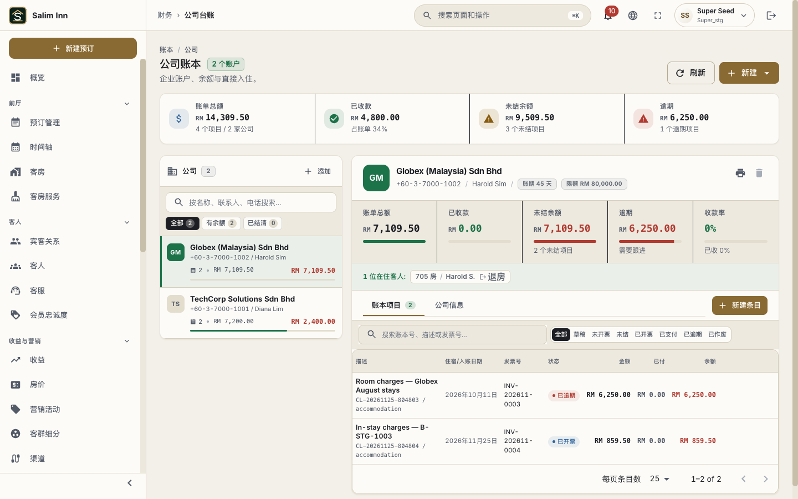

---

### 8.2 付款审批与作废（`/payment-approvals`）

- **访问权限**：查看队列与 PayPal 冲突横幅 `payments:read`；批准/拒绝/请求补充收据 `payments:approve`；预订账单内付款作废 `payments:delete`（已于补丁 `0020` 授予`前台接待`）；退款与没收押金 `payments:refund`；撤销没收押金或撤销退款 `payments:manage`。

#### 页面结构与全站紧急提醒

- **全站`紧急转账提醒`**：只要持有 `payments:approve` 权限的员工在系统任意页面工作时存在待审核的官网银行转账申请，画面即持续显示不可关闭的红色紧迫横幅并弹出审核窗，直至全部处理完毕。

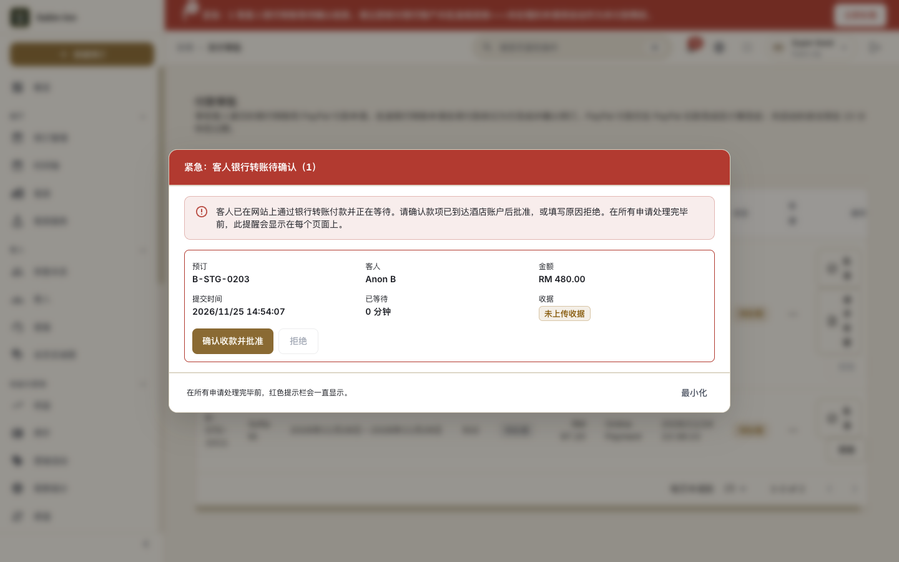
- **顶部 PayPal 冲突警示横幅**（非独立选项卡）：当近 30 天内存在 `paypal_webhook_conflict` 或 `paypal_capture_conflict` 事件时，页面顶部显示黄色警告横幅`过去 30 天内有 {{count}} 起 PayPal 付款冲突`（最多列出 10 条并提醒切勿重复向客人收费；持有 `audit:read` 者可一键跳转 `/audit-log?q=paypal` 排查）。
- **2 个核心选项卡**：`待处理申请` 与 `审批历史`（历史页展示`审核时间`、审核人姓名与决策原因），均支持 10/25/50/100 分页。

#### 银行转账审批与 PayPal 规则

1. **查看凭证**：点击行内`收据`/`查看`在线预览或下载客人上传的转账凭证（支持 PDF、JPG、PNG、WebP；图片文件会自动内嵌生成清晰可缩放弹窗并支持原文件下载）。
2. **批准（`批准`）**：二次确认窗展示客人、预订、金额、住期及收据状况；若客人未附收据，弹窗会显眼提醒「`未上传收据。只有在银行账户中确认已收到转账时才可批准。`」。
   - 批准后付款标记为 `completed`，预订自动变为`已确认`并发送付款确认邮件。
   - **多房团体申请原子审批**：审核通过团订汇总转账申请时，系统在单事务内一次性完成全组房间确认并发送汇总确认邮件。
   - 若员工此前已手工将预订推进到已确认或已入住状态，仍可批准补记付款，但禁止再拒绝。
3. **请求补充收据（`请求收据`）**：可输入补充留言发送通知邮件请客人补传凭证；若客人在 **24 小时**内未补传，后台定时任务将自动拒绝该申请。
4. **拒绝（`拒绝`）**：必须填写`拒绝说明`（≤1,000 字）。拒绝后该申请变为 `void`，关联单房或整组预订退回 `待支付`，同时系统**自动签发一条有效期 60 分钟、仅限单次使用的支付恢复链接（`/booking/recover-payment/{token}`）**随驳回原因一并发送至客人邮箱。
5. **PayPal 严格禁令**：
   - **禁止人工批准 PayPal 付款**——系统隐藏批准按钮并在后端强拦截返回 400。PayPal 扣款仅能在 PayPal 官方确认（Capture/Webhook）后自动入账。
   - 若遇到客人卡住未完成的 PayPal 尝试，页面仅提供 **`取消 PayPal 尝试`**（填写说明后作废该次尝试；完全未启动的 PayPal 尝试会在 **10 分钟**后由后台任务自动过期释放）。

#### 预订付款作废（Void）与已关账夜审跨日冲销机制

在前台结账或预订详情中作废一笔已入账付款时（`payments:delete`）：

- **软作废与强审计**：系统永不物理删除付款行，而是要求**必填作废原因**，在同一事务内将状态改为 `void` 并把完整作废前快照写入审计日志 `payment_voided`。
- **关账跨日自动冲销（`void_reversal_date`）**：点击作废前，前端会自动预览该付款所属营业日是否已完成夜审关账：
  - 若原营业日**尚未夜审**：直接清空 `void_reversal_date`，该付款从当日夜审中剔除。
  - 若原营业日**已被夜审关账**：系统弹窗警告（提示当天夜审已关账，**不会篡改历史已关账报表**，系统将自动把冲销日期 `void_reversal_date` 记入**下一个未关账营业日**的夜审日记账中，**切勿再去人工调账**）。

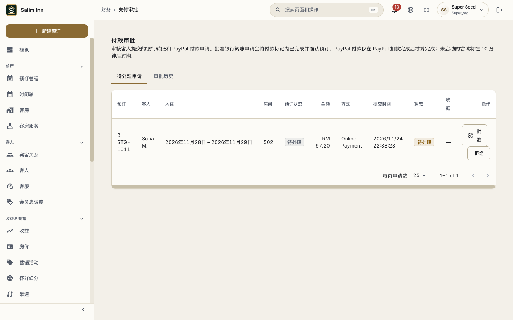

---

### 8.3 夜审（`/night-audit`）

- **访问权限**：查看预览与历史 `night_audit:read`；手动执行或强制重跑 `night_audit:execute`。
- **2 个选项卡**：
  1. **`运行审计`**：选定`审计日期`并点击`加载预览`。
     - **未运行态**：展示 4 张汇总卡（`待过账预订`、`预计收入`、`已入住客房`、`入住率`）、当日`客房状态`计数、`预计收入`拆分表（按支付方式、按渠道）、`待过账预订`明细及`今晚将过账的内容`（`日记账分录`与`宾客分类账`）。若`待过账预订 = 0`，`运行夜审`按钮置灰禁用。
     - **执行确认**：可填`备注（可选）`，确认弹窗列明 4 项不可逆后果：标记预订为已过账、锁定这些预订禁止再修改、保存房态历史快照、操作无法直接撤销。
     - **已完成态**：展示结果统计（`已过账预订`、`入住`、`退房`、`入住率`）、房态快照、按需展开的`日记账分录`、`宾客分类账`与`按日期已售客房明细`（含渠道缩写），以及`导出 PDF`、`导出 CSV`、`重新运行审计`（需 `night_audit:execute` 二次确认，将清空当日过账重建）。
  2. **`审计历史`**：按`年份`（近 6 年）与`月份`检索历次夜审记录（自动夜审在`运行人`列显示为`系统`），随时展开日记账、导出文件或对历史日期重跑。
- **夜审过账内容与自动/手动机制**：
  - **过账计算规则**：对当日在住过夜（及当日钟点退房）的未过账预订写入 `night_audit_posted_nights`；按 `service_tax_rate`（默认 8%）内含提取房费净额与服务税、加床净额与税额；外加外籍游客每晚旅游税；同步汇集当日实收付款、押金退款、**到期跨日作废冲销分录（`void_reversal_date = audit_date`）**、公司台账实收与当夜房态快照，并自动补齐缺失的发票编号。
  - **后台自动夜审**：默认**关闭**，需在`酒店设置 → 酒店`开启`自动运行夜审`并配置`night_shift_time`（默认 `23:00`）。调度器每 60 秒按酒店时区检查，若过去 7 天内有遗漏营业日（`night_audit_catchup_days = 7`）会按最早未关账日依次补跑；自动夜审绝不覆盖已存在的历史夜审（不用 `force`）。
- **多语言导出说明**：
  - **`导出 PDF`**：生成 2 页纵向报告（第 1 页汇总与日记账分录，第 2 页宾客分类账与逐日已售客房明细）。当界面语言为简体中文或繁體中文时，系统自动按需加载内嵌 **`NotoSansCJKsc-Regular.ttf`** 字体，确保中文客名与项目名称导出不乱码。
  - **`导出 CSV`**：导出结构化表格文件 `night_audit_{date}.csv`。

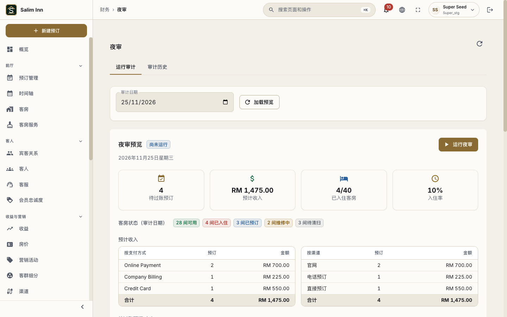

---

### 8.4 免费房晚管理（`/complimentary`）

- **访问权限**：页面与查看免费预订 `bookings:read`；调整/移除预订免费状态 `bookings:update`；查看客人额度 `guests:read`；**新增、修改、删除客人免费房晚额度需 `guests:manage`**。
- **顶部 4 张汇总卡**：`免费预订`、`累计赠送晚数`、`可用免费房晚（按房型的免费房晚）`、`已赠价值`。
- **2 个选项卡**：
  1. **`免费预订`**：按客人/预订号/客房搜索已应用免费房晚的订单，支持`编辑免费详情`（修改住期内的免费起止日期与原因）或`移除免费状态`（恢复原房费总额）。
  2. **`客人额度`**：按「客人 × 房型」汇总持有的可用免费房晚数与备注。点击`添加免费房晚`选择`客人`、`房型`、`晚数`（≥1）并填写**必填`原因`**（≤500 字）即可发放；支持`编辑免费房晚`与不可撤销的`删除免费房晚`。
     - *(注：客人免费额度表按 `(guest_id, room_type_id)` 累加，**不设过期日期**，页内也不单独展示额度使用流水表，所有增减均写入审计日志。)*
- **使用与作废自动退回**：客人或前台使用免费额度下单或对未入住预订标记免费时扣减额度；**当任意免费预订被`作废`时，系统在同一事务内自动将已使用的免费房晚全额退回客人在对应房型的可用余额中**（`complimentary_nights_restored`）。

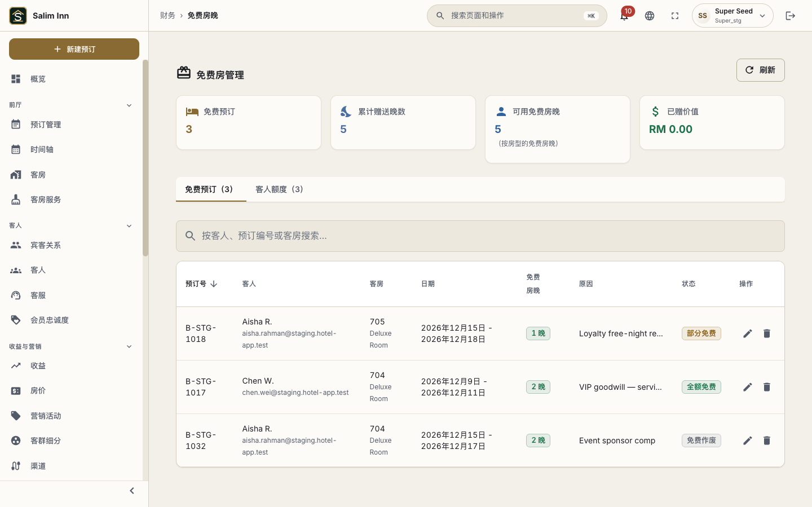

---

## 第 9 章：经营分析与报告库（`/insights`）

访问 `/insights`（旧地址 `/reports` 自动永久重定向至此）。

- **访问权限**：`analytics:read` 或 `reports:execute`。
- **使用方式**：进入报告库卡片视图后，选择任意一份报告即可通过统一的筛选工具栏设置`开始日期`、`结束日期`（以及部分报表专用的`班次`/`抽屉`/`公司`条件）并点击`生成报告`；所有报表均沿用`酒店设置 → 报表`的字体大小预设，点击右上角打印机图标即可调用`打印报告`输出纸质或 PDF 报表。

### 全部 16 份标准报表完整目录

| 序号 | 报告名称（中文） | 分类 | 日期口径 | 专用筛选条件与用途说明 |
|---:|---|---|---|---|
| 1 | `每日运营` | 运营 | 住宿日期 | 取`开始日期`单日营业日的`到店`、`离店`、`在住`、`客房状态`全量名单与今晚预计入住率。 |
| 2 | `入住率` | 运营 | 住宿日期 | 按选定住宿日期范围，分每日及分房型统计入住率、ADR 与 RevPAR。 |
| 3 | `已售客房` | 运营 | 住宿日期 | 逐日列出已售客房明细、房型、房价与实际收入。 |
| 4 | `客房表现` | 运营 | 住宿日期 | 按单间客房与房型对比收入与利用率，自动标出`表现不佳`房源。 |
| 5 | `班次报告` | 运营 | 住宿日期 | 支持额外按`班次`（`早班`/`晚班`/`夜班`/`所有班次`）与`抽屉`筛选单日变动、收款与房态。 |
| 6 | `免费房晚` | 运营 | 住宿日期 | 统计全额及部分免费住宿的原价、实收金额、已给折扣及按原因汇总。 |
| 7 | `收入` | 财务 | 住宿日期 | 按`房型`、`来源`与`付款状态`拆分选定住宿期内的收入构成。 |
| 8 | `渠道净收入` | 财务 | 住宿日期 | 核算各预订渠道扣除佣金后的毛收入到净收入（后端接口支持按渠道过滤）。 |
| 9 | `OTA 佣金` | 财务 | 住宿日期 | `渠道净收入`的佣金对账视角，汇总应付各 OTA 平台的佣金金额。 |
| 10 | `OTA 月度对账单` | 财务 | 住宿日期 | 出具各 OTA 渠道在所选周期内的逐笔预订、佣金与净结算对账单。 |
| 11 | `付款状态` | 财务 | 住宿日期 | 按付款状态（已付/部分/未付/逾期等）分类统计收款情况与逾期未结余额。 |
| 12 | `客人统计` | 分析 | 住宿日期 | 统计独立客人/新客人/回头客人数、国籍分布及高消费客人排名。 |
| 13 | `总日记账` | 会计 | 记账日期 | 列出记账期间内全部会计日记账分录明细（含借方、贷方与参考号）。 |
| 14 | `按类型日记账` | 会计 | 记账日期 | 将记账分录按交易类型归类汇总，便于财务复核各科目发生额。 |
| 15 | `资产负债表` | 会计 | 记账日期 | 汇总展示选定记账期间的资产、负债与权益状况。 |
| 16 | `公司账册对账单` | 会计 | 记账日期 | 支持输入`公司`筛选特定企业对账单与账龄桶（`31–60 天`、`61–90 天`、`91–120 天`、`超过 120 天`）；留空时汇总列出所有公司余额。 |

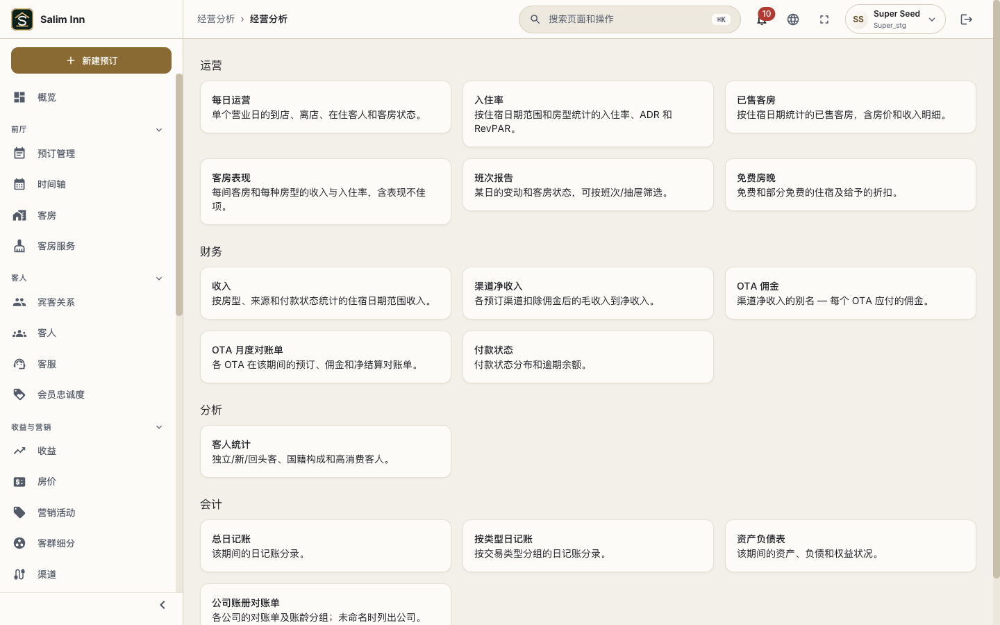

---

## 第 10 章：系统管理（8 大模块）

### 10.1 访问控制（`/rbac`）

- **访问权限**：页面策略为 `roles:read | roles:manage | permissions:manage | users:read | users:manage`。自补丁 `0031` 起，**仅`超级管理员`（`super_admin`）与`经理`（`manager`）拥有访问与管理权**，普通`管理员`（`admin`）不再可见此菜单。
- **包含 3 个选项卡** *(注：团队管理目前仅保留后端 `/api/teams` 接口，前端访问控制页不提供单独的团队选项卡)*：
  1. **`角色与权限`**：
     - 左侧浏览系统内置角色（标记`内置`）与自定义角色（标记`自定义`），可搜索、查看绑定人数与权限覆盖率；持有 `roles:manage` 可点击`新建角色`。
     - 右侧面板展示角色描述、成员头像栈、操作按钮（`重命名`、`复制`生成 `<角色>（副本）`、`删除`——内置角色或尚有成员绑定的角色禁止删除）。
     - 下方权限矩阵支持搜索、按`全部`/`已启用`/`已停用`筛选、`隐藏空模块`、`全部展开`/`收起`以及单模块一键`全部启用`/`全部停用`；每条权限会标出同时持有该权限的其他角色（或`仅此角色`）。修改后底部弹出保存栏`未保存的更改 — N 项权限已修改`，支持`放弃`或`保存更改`。
     - **越权防护**：`经理`只能创建或修改优先级**严格低于 150** 的自定义角色，且只能勾选**自身已持有**的权限；**修改 12 个系统内置角色的权限仅`超级管理员`可执行**。
     - **自定义权限（`新建权限`）**：仅限`is_super_admin = true` 的超级管理员创建（格式 `<resource>:<action>`，供下方`页面访问`精细路由控权使用，不会解锁内置业务 API）。系统内置权限禁止改删，已被角色或页面策略引用的自定义权限禁止删除。
  2. **`用户`**：
     - 显示全量账号列表（`用户名`、`电子邮箱`、`姓名`、`角色`、`状态`、`创建时间`）。
     - 点击`添加用户`或点击行内编辑（编辑时`用户名`锁定不可改）：配置邮箱、姓名、密码（重置新密码会**自动撤销该用户全部活跃会话与通行密钥**）、多选`角色`（受优先级与权限超集限制）及**`活跃`开关**（关闭后立即吊销该用户全部在线会话，且不可停用自身或最后一个活跃超级管理员）。
     - 删除用户为软删除并吊销会话。
  3. **`页面访问`**：
     - 维护 `route_access_policies` 表，按导航分组及`菜单以外的页面`（如`宾客资料`、`宾客跟进`）展示每张页面当前的`可打开`与`菜单中可见`角色列表。
     - 点击编辑（需 `permissions:manage`）可配置`谁可以打开此页面`（`以下任一权限`、`或以下任一角色`、`始终禁止这些角色`）与`谁能在菜单中看到`，右侧实时预览最终命中角色，并自带防误锁提示（若保存后会导致您本人被锁在 `/rbac` 外，系统会硬性拦截保存）。
     - **重要安全边界**：顶部提示明确强调——页面访问规则仅控制前端菜单显示与路由放行，**不授予后端 API 数据访问权限**；策略变更在用户下次登录或刷新后生效。

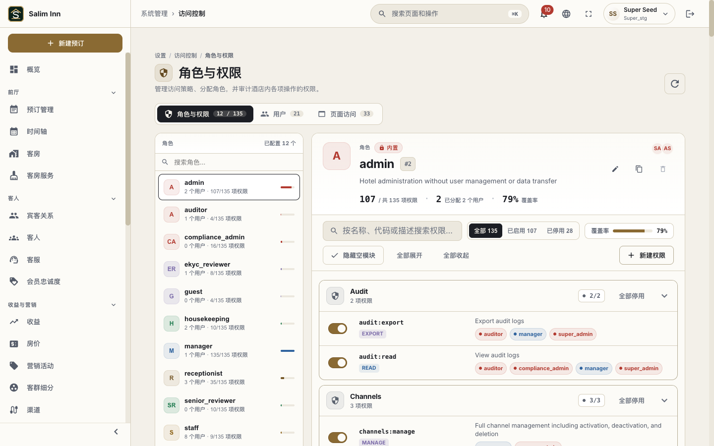

---

### 10.2 eKYC 管理（`/ekyc-admin`）

- **访问权限**：进入队列 `ekyc:read`；导出 CSV `ekyc:export`；认领 `ekyc:assign`；审核操作对应 `ekyc:{review,approve,reject,escalate,request_resubmission,override}`；下载/查看证件原图 `ekyc:download_documents`；**解密查看敏感字段必须持有 `ekyc:reveal_sensitive`**（`超级管理员`/`经理`/`管理员`/`合规管理员`持有，`高级审核员`与`eKYC 审核员`均无权解密）；前台现场创建 `ekyc:approve`。
- **顶部操作与统计**：
  - 6 张 KPI 卡片：`已提交`、`待处理`、`人工审核`、`已批准`、`高风险`、`平均分钟数`。
  - **`CSV` 导出**：导出当前筛选队列 `ekyc_applications.csv`。
  - **`创建 eKYC`（前台现场核验）**：为面对面核对过证件的住客直接建档——搜索已有客人、核填身份与证件信息、上传必填的`证件正面`与`自拍照`（及可选`证件背面`/`住址证明`），可勾选`为此客户启用自助/ kiosk 入住`，提交后**直接进入`已批准`状态**。
- **队列筛选与 SLA 标识**：支持按搜索词、11 种状态（`submitted` / `automated_review` / `pending_manual_review` / `in_review` / `additional_information_required` / `approved` / `rejected` / `escalated` / `expired` / `void` / `on_hold`）、排序方式（`最新提交` / `最早到店` / `最高风险`）、风险等级（`低`/`中`/`高`/`严重`）、国家与证件类型过滤；列表突出展示`已逾期`、`接近 SLA`与`即将到店`徽章。
- **审核详情弹窗**：
  - **信息区（默认全部脱敏）**：`客户`、`身份信息`与`提交信息`卡片，支持展开`信号`（证件真伪、人脸比对分、活体分、重复/监控名单命中与风控规则）及`差异`（客人填报值与 OCR 识别值对比）。
  - **`显示敏感字段`**：持有 `ekyc:reveal_sensitive` 的人员可点击解密特定字段（`证件号码`/`全名`/`出生日期`/`电子邮箱`/`电话`/`地址`/`IP 地址`），但**必须填写至少 5 个字符的查看原因**，每次解密写入多表强制审计日志。
  - **`文件`查看器**：需要 `ekyc:download_documents`，通过防缓存私人通道加载`证件正面`/`证件背面`/`自拍照`/`证明`，支持 `缩小`（0.5×）、`放大`（2×）与 `旋转`（90° 步进）。
  - **审核动作栏**（终态 `approved`/`rejected`/`expired`/`void` 不可再操作；`on_hold` 显示`解除暂缓`）：支持`认领`、`批准`（可选勾选`启用自助入住`）、`拒绝`、`上报`、`请求补充资料`（可输入发往客人界面的`客户消息`）与`暂缓`；均使用乐观锁与幂等键，且可附带`原因代码`、强制原因说明及`内部备注`；底部展示完整`决定历史`时间线与`备注`。
  - *(注：PDPA 第 40 条生物识别明确同意是在客人提交阶段由界面与后端强校验并留存于 `consent_records`，后台审核弹窗内不设单独的同意书展示区。)*

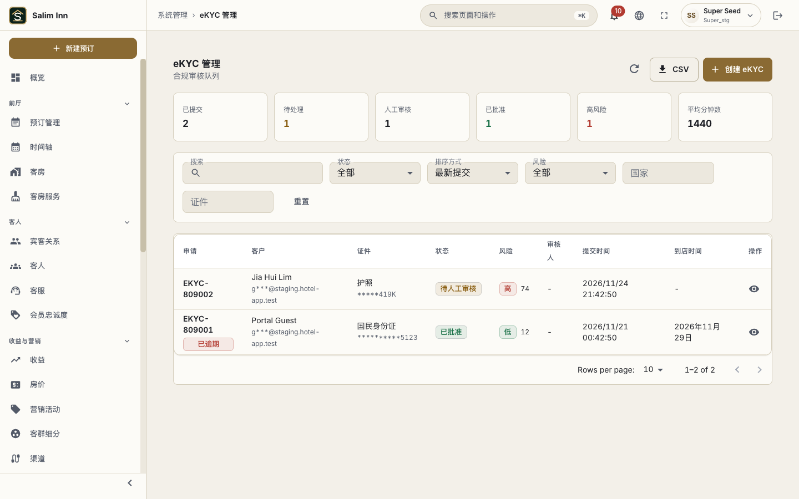

---

### 10.3 酒店设置（`/settings`）

- **访问权限**：查看需 `settings:read`（如`前台接待`只读）；修改一般设置需 `settings:update` 或 `settings:manage`；**修改`安全`选项卡必须持有 `settings:manage`**（`new_reservation_visible_time` 亦单独放行`经理`）。所有保存操作均记录新旧值至审计日志；每张数据库驱动页签底部提供`恢复默认值`（重置该页签至系统默认）。

#### 全部 7 个可视化选项卡及配置项明细

| 选项卡 | 分组 / 设置键 | 默认值 | 功能与影响说明 |
|---|---|---|---|
| **1. `酒店`** | `hotel_name`、`hotel_email`、`hotel_phone`、`hotel_address`、`hotel_business_number` | `SA2012724` 等 | 显示于顶栏、打印单据、邮件页脚及公开法律条款法定披露。 |
| | `check_in_time` / `check_out_time` | `15:00` / `11:00` | 判定前台`提前入住`提示线与标准退房节点（注：官网对客公示为 14:00 起入住 / 12:00 前退房，酒店设置可按实际物业口径调整）。 |
| | `new_reservation_visible_time` | `07:00` | 仅控制仪表盘`新预订`条何时显现今日抵店订单，不影响其他列表。 |
| | `night_shift_time` / `night_audit_auto_enabled` | `23:00` / `false` | 控制审计日志`本班次`起点及后台自动夜审每日触发时间与开关。 |
| | `currency` / `timezone` / `default_locale` | `MYR` / `Asia/Kuala_Lumpur` / `en` | 统一驱动全库币种（`hotel_currency()`）、营业日计算（`CURRENT_DATE`）与默认界面/宾客邮件语言（`en`/`ms`/`zh`/`zh-TW`）。 |
| **2. `费用与税费`** | `service_tax_rate`（0–100%） | `8`% | 房费与加床费内含 SST 服务税提取比例。 |
| | `tourism_tax_rate` | `10` / 晚 | 外籍游客每房每晚外加旅游税。 |
| | `deposit_amount` | `50` | 前台办理入住默认押金参考额。 |
| | `unpaid_hold_release_hours` | `24` 小时 | 线上未付款保留自动释放小时数（设 `0` 为禁用，不影响前台自建预订）。 |
| | `default_payment_terms_days` | `30` 天 | 新建企业挂账客户的默认付款账期。 |
| **3. `报表`** | `报表字体预设`（`特小`–`特大`/`自定义`）+ `report_font_family` + 6 个字号像素键 | `Arial...` / `14px` 等 | 统一控制`/insights`全套报表的排版字号与打印输出样式。 |
| **4. `客人政策`** | `guest_booking_cancellation_enabled` | `false` | 门户未付款订单取消策略控制开关（不可取消促销与已入住仍始终拦截）。 |
| | `support_enabled` + 6 个分类开关 | 启用 | 启停宾客门户支持聊天及勾选可用咨询分类（至少保留 1 项开启）。 |
| | `首次响应目标` / `解决目标`（4 级优先级分钟数） | 低240/1440 · 普60/480 · 高15/120 · 急5/30 | 驱动`/support`客服工单 SLA 逾期倒计时与告警徽章。 |
| | `support_reopen_window_days` | `7` 天 | 已解决客服会话允许客人自助`重新开启`的天数窗口。 |
| **5. `安全`** *(需 `settings:manage`)* | `max_login_attempts`（1–20） | `5` | 连续密码或 2FA 错误触发 30 分钟锁定的阈值。 |
| | `totp_issuer_name` / `passkey_relying_party_name` | 留空回退酒店名称 | 验证器应用展示的签发机构名称与通行密钥依赖方显示名。 |
| **6. `外观`** | `主题模式`（`浅色`/`深色`）、`背景模糊`滑块 | 浅色 | **仅保存在当前本地浏览器/设备**，即时生效，不入库、无`恢复默认值`。 |
| **7. `代码列表`** | `房价代码`（`rate_codes`）、`市场代码`（`market_codes`） | `RACK, CORP...` / `WKII, OTA...` | 维护预订/入住下拉代码列表。 |
| | `线上预订渠道` | **只读镜像** | 同步展示 `booking_channels` 表；点`管理渠道`跳转`/channels`编辑。 |
| | `支付方式`（`payment_methods`） | Cash, Visa... | 维护前台可选收款方式列表。 |

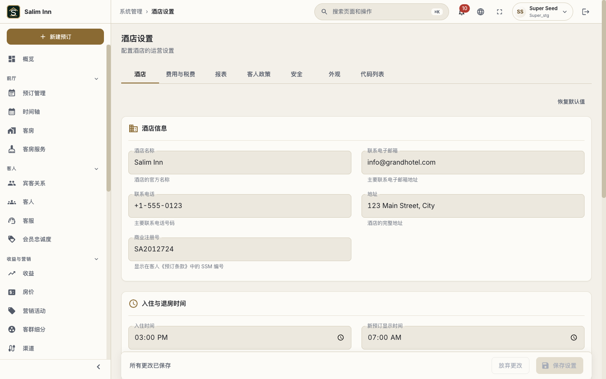

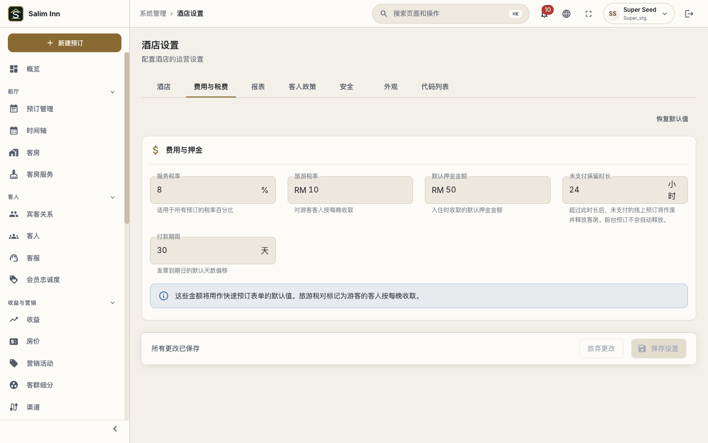

#### 仅在数据库或后端环境变量维护的高级设置（`/settings` 页面不显示输入框）

- **会话保留与并发上限（补丁 `0017`）**：`session_purge_expired_days`（7 天）、`session_purge_revoked_days`（7 天）、`session_max_active_per_user`（每账号最多 10 个活跃设备，超出自动淘汰最久未用会话）、`session_idle_days`（0=关闭空闲淘汰，刷新令牌 30 天有效期）、`session_timeout`（3600 秒）。
- **强制 2FA 策略**：`require_two_factor_roles`（默认空=不强制）、`require_two_factor_grace_days`（默认 14 天）。
- **其他后台开关**：`enable_2fa`、`enable_email_verification`（桌面版自动旁路跳过）、`auto_checkin_requires_ekyc`（`true`）、`pre_arrival_reminder_enabled`（`false`）、`pre_arrival_reminder_hours_before`（`48` 小时）、`guest_titles`。

---

### 10.4 客房配置（`/room-config`）

- **访问权限**：进入页面 `rooms:update` 或 `rooms:manage`；**新建/删除房型与单间客房需 `rooms:write`**；编辑房型、编辑单房、上传照片与批量调价/撤回需 `rooms:update`。
- **界面总览**：4 张统计卡（`客房总数`、`可售`、`不可用`/`维修中`、`房型数`）、状态芯片、关键词搜索与`按房型`/`按楼层`视图切换。
- **房型管理（抽屉 5 大分区）**：
  1. `基本信息`（名称、2–10 位字母代码、描述）
  2. `床位设置`（床型：`Single`/`Twin`/`Double`/`Queen`/`King`/`Super King`/`Bunk` 与床位数）
  3. `可住人数`（最大入住人数、是否允许加床、加床上限、加床费/晚）
  4. `定价`（基础价、平日价、周末价、`可预订`/`已隐藏`开关、排序权重）
  5. `照片`（支持 **JPEG / PNG / WebP，单张 ≤ 10 MB**；房型需先保存才可上传照片；**第一张照片自动作为官网与宾客预订页的房型封面**）。
  - *(注：若某房型下仍有已创建的房间，系统禁止删除该房型，建议改用隐藏停售；本页面不设客房设施勾选表，也不配置 3D 模型。)*
- **单间客房维护**：支持`添加客房`（房号、楼层、楼栋、可选自定义价格覆盖、无障碍标记、吸烟房标记）、`切换可售状态`、`编辑客房`与`删除客房`（存在历史预订的客房不可删除）。**注意**：单间客房创建后，其所属`房型`、`楼层`与`楼栋`即被锁定，如需更改须删除重建。
- **3 步`批量更新价格`向导与一键撤回**：
  1. **`设置`**：选择范围（`所有房型`或`选定房型`）、目标字段（`基础价格`/`平日价格`/`周末价格`）、调价方式（`设为固定价格`/`按百分比上调`/`按百分比下调`/`按金额上调`/`按金额下调`）、数值与取整方式（`不取整`/`取最接近的 1 / 5 / 10`）。调价仅作用于未来新报价，不影响既有预订。
  2. **`预览`**：逐房型逐字段展示服务端计算后的`当前`、`新价格`与`变动`幅度；任意单字段变动超过 **30%** 会标出大额变动警示。
  3. **`确认`**：必填 `原因`（3–500 字，写入审计日志）；若触发 >30% 警示，须额外勾选`我确认此次超过 30% 的变动`方可单事务提交。
  - **一键`撤销上次更新`**：打开弹窗顶部会展示最近一次批量调价的操作人、时间与原因；点击`撤销上次更新`并填写至少 3 个字的理由即可一键恢复原价——**前提是在那之后没有任何相关房型价格被人工单独修改过**。

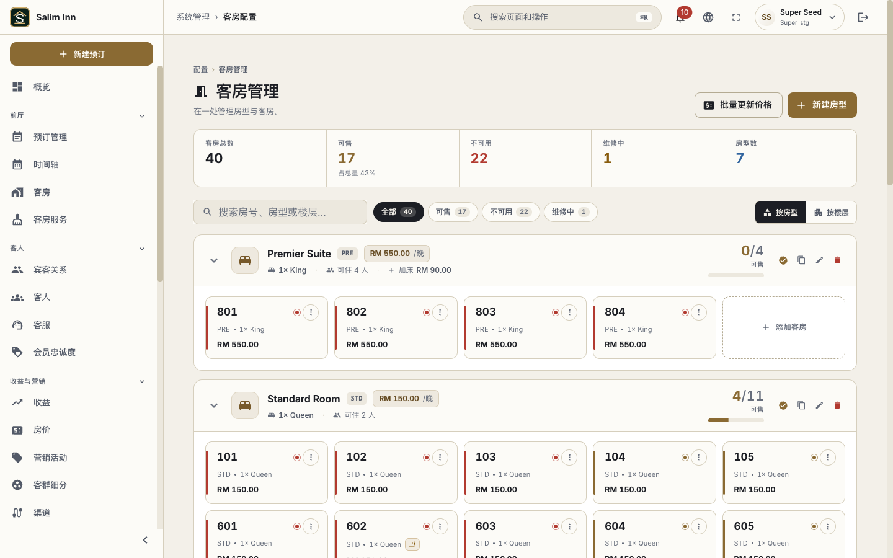

---

### 10.5 审计日志（`/audit-log`）

- **访问权限**：查看 `audit:read`（超级管理员、经理、管理员、合规管理员、审计员）；导出 `CSV` 与 `PDF` 需持有 **`audit:export`**（注：`合规管理员`仅可查看，无导出权限）。
- **数据库级不可篡改保证（补丁 `0022`）**：顶部横幅声明「`只读、仅追加。事件无法编辑或删除。`」。PostgreSQL 在主表及全部月度分区上挂载 `BEFORE UPDATE/DELETE/TRUNCATE` 触发器，即便表所有者也无法修改或清空既有审计记录。所有时间统一按`酒店时区`渲染。
- **筛选与查看**：
  - 7 张带实时计数的活动流过滤卡：`全部活动`、`客房活动`、`客人活动`、`预订活动`、`系统配置`、`报表活动`、`其他`。
  - 支持关键词检索（防抖搜索）、`操作者`、`操作`、`类型`、外部资源深链芯片，以及 **7 个时间预设**（`今天`、`本班次`[自 `night_shift_time` 起]、`上次夜审`、`本月`、`最近 7 天`、`最近 30 天`、`全部时间`）+ 自定义起止时间戳。
  - 每页可选 25/50/100 条并按天分组（`今天`/`昨天`/日期）；展开任一行可查看`字段变更`前后值对比（无字段 diff 的标记`仅操作`）、`事件 ID`、`IP`、`来源`及直达关联资源页面的链接。导出的 CSV/PDF 严格匹配当前筛选条件。

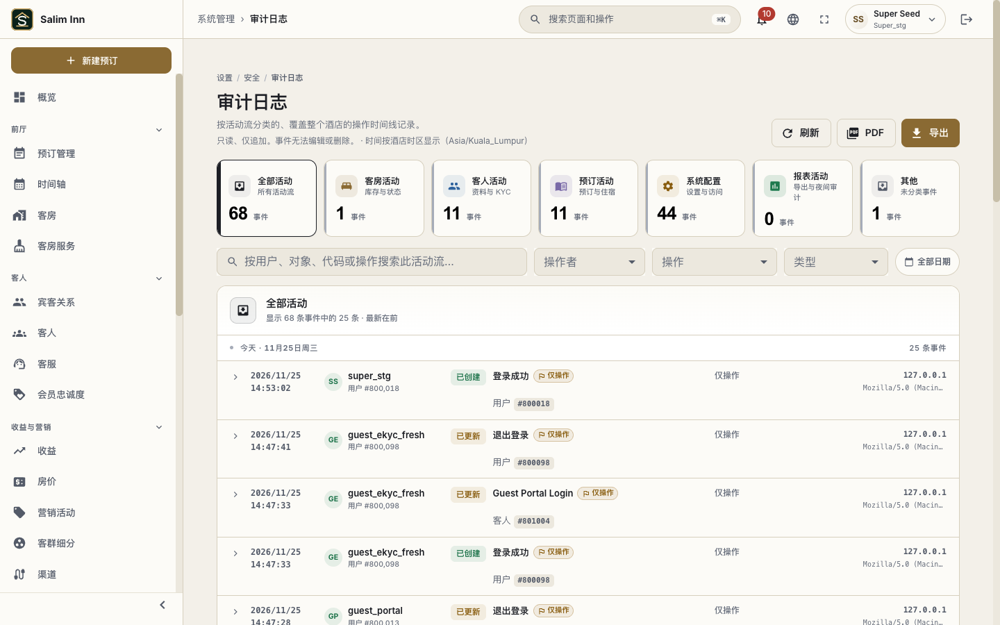

---

### 10.6 数据迁移（`/data-transfer`）

> 完整字段清单、排错与技术契约请同步参阅：[data-transfer.md](data-transfer.md)。

- **访问权限（补丁 `0031` 收紧）**：
  - **普通`管理员`（`admin`）完全无权访问此模块。**
  - **`经理`（`manager`）**可操作**业务数据范围**（`标准导出`/`完整导出`/`迁移备份`导出，以及`合并`/`还原`导入）。
  - **`超级管理员`（`super_admin`）**独享导出与导入 **`完整系统备份`（`system` 范围）** 的权限，该选项对经理完全隐藏。
- **3 个选项卡**（按细粒度权限显示，桌面版在具备导入权限时下方额外显示`本地备份`卡片）：
  1. **`导出`**（基于单快照 PostgreSQL 游标流式生成 `hotel-backup` v1 自描述 JSON 文件，含 `manifest`、表数据与防截断 `integrity` 校验尾块；**不包含 `uploads/` / `private_uploads/` 下的实体图片与证件文件**，仅包含元记录，且全部范围都会剥离 `pre_checkin_token`）：
     - `标准导出`（`standard`，需 `data_transfer:export`，免二次鉴权）：约 25 张非敏感配置与基础表，省略 52 张敏感表。
     - `完整导出`（`full`，标记`受限`，需 `data_transfer:export_sensitive` + **二次鉴权**）：全部 77 张可迁移业务表（预订、客人、付款、台账、客服等），排除 32 张系统安全保护表。
     - `迁移备份`（`backup`，标记`高度受限`，需 `data_transfer:export_sensitive` + **二次鉴权**）：在完整导出基础上附带外键关系拓扑元数据，用于跨环境迁库。
     - `完整系统备份`（`system`，标记`仅限超级管理员`，需超级管理员 + **≥12 位 ASCII 密语** + **二次鉴权**）：在业务数据外额外纳入 32 张系统安全保护表（用户、密码哈希、RBAC、团队、会话、eKYC 申请、审计日志等），在服务端逐块流式采用 **AES-256-GCM**（PBKDF2-HMAC-SHA256 60 万次迭代）加密生成 `.json.enc`。**密语永不存储也无法找回，请离线妥善保存。**
  2. **`导入`（4 步安全向导：`上传` → `预览` → `执行` → `轮询`）**：
     - 上传文件上限 **256 MiB**，暂存文件会在 24 小时后自动清理；加密备份在`预览`与`执行`两步均须输入正确密语。
     - **`预览`阶段**直接解析文件实际表键名（不盲信文件头声明），列出各实体`行数`/`新增`/`现有`/`已跳过`、阻塞执行的`validationErrors`、关联缺失告警、环境/Schema 版本差异提醒，以及动态计算的所需权限。
     - **两种导入模式**：
       - `合并 — 追加到现有数据`（`merge`）：冲突策略可选 `跳过 — 保留现有行`、`更新 — 覆盖现有行`（需 `data_transfer:override`）或`失败 — 遇到首个重复即中止`。若 `bookings`/`booking_groups`/`guests`/`invoices`/`payments` 发生主键 `id` 相同但 `uuid` 不同的身份冲突，系统强制拦截合并。
       - `还原 — 替换现有数据`（`restore`，需 `data_transfer:restore` + **二次鉴权** + 危险确认勾选）：在导入前清空所选表及其下游关联子表。
     - **单事务原子性与全库并发锁**：导入在**单个数据库事务**中完成（停用触发器 → 拓扑序写入 → 校验外键 → 重置序列），任意一步失败则全量回滚；执行期持 PostgreSQL 咨询锁，若他人同时触发导入会直接报错 `409 Conflict` 而非排队。任务完成后轮询状态在内存中保留 1 小时。
  3. **`历史`**：展示近 90 天内所有 `data_export`、`data_import` 与二次鉴权审计记录。
- **二次鉴权（Step-Up）机制**：执行敏感导出、还原导入或系统级导入前，弹窗要求校验当前密码 + 6 位 TOTP 验证码（如有启用），签发一个绑定当前会话且仅有效 **120 秒**的令牌（限流每 5 分钟 10 次）。

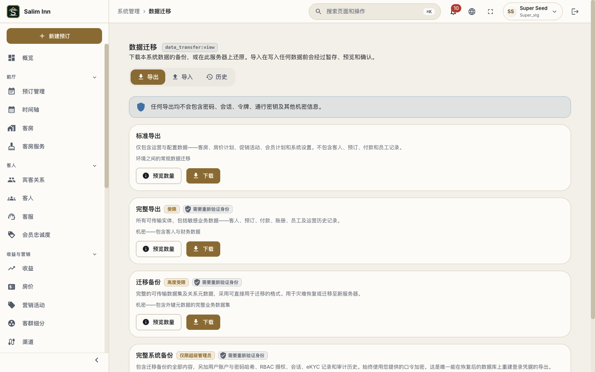

---

### 10.7 系统健康（`/system-health`）与后台任务（`/jobs`）

- **访问权限**：两个页面及后端接口均严格要求 **`settings:manage`**（`超级管理员`、`经理`、`管理员`）。
- **`系统健康`（`/system-health`）**：
  - 副标题提醒进程内统计计数器在后端重启后会清零；展示 6 张实时监控卡：`数据库`（`已连接`）、`运行时长`、`请求数`（含`N 个缓慢`）、`错误`（`4xx / 5xx`）、`已拒绝`（`认证 / 权限`）与`审计失败`（大于 0 时高危高亮`审计记录存在缺失`）。
  - 展示`邮件队列`统计卡（`排队中`/`发送中`/`失败`/`过去 24 小时已发送`）、嵌入式`后台任务`表，并在桌面客户端构建中额外显示**`应用更新`**（手动`检查更新`）卡片。

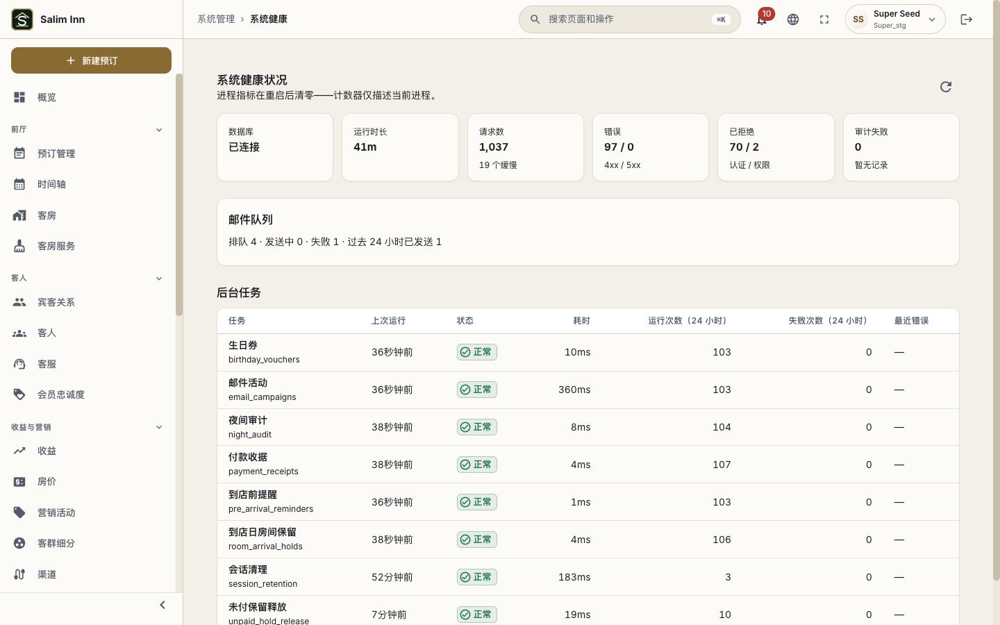
- **`后台任务`（`/jobs`）**：
  - 展示全部 **9 个定时任务**的心跳表（`任务`、`上次运行`、`状态`、`耗时`、`运行次数（24 小时）`、`失败次数（24 小时）`、`最近错误`）及底部的`最近失败`明细表（无失败时显示`暂无失败的迭代记录。`）：
    1. `night_audit`（夜间审计，仅当设置启用自动夜审时运行）
    2. `payment_receipts`（付款收据超时与废弃 PayPal 尝试清理）
    3. `unpaid_hold_release`（未付保留超时自动释放）
    4. `room_arrival_holds`（到店日保留状态切换）
    5. `email_delivery_worker`（外发邮件队列投递进程）
    6. `email_campaigns`（邮件活动群发调度）
    7. `birthday_vouchers`（宾客生日礼券自动发放）
    8. `pre_arrival_reminders`（入住前提醒邮件调度）
    9. `session_retention`（每小时过期/吊销会话与限流桶清理）
  - *(注：手动数据导入执行时也会在任务表中留下 `data_transfer_import` 记录。)*

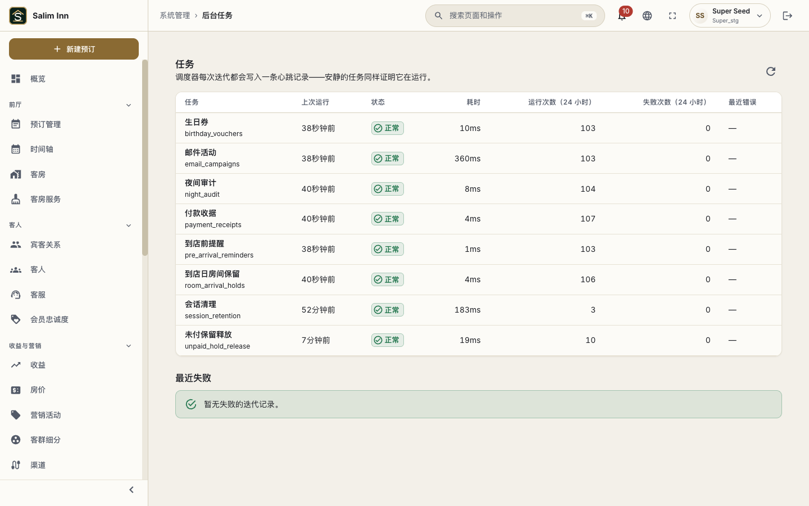

---

## 第 11 章：工具与辅助模块（通知投递与帮助中心）

### 11.1 通知与宾客投递（`/notifications` 与顶栏铃铛）

- **`宾客投递`页面（`/notifications`）**：
  - 侧边栏菜单名为`通知`，进入后页面标题为`宾客投递`（副标题：`发送给宾客的外发消息——员工提醒在顶栏铃铛下`）。
  - 页面内嵌 **`communications:read`** 权限门控（无权限员工将看到`您没有权限查看投递动态。`的友好空状态）。
  - 包含 **`全部`、`事务`、`营销`** 3 个选项卡与 6 种投递状态过滤（`排队中`/`发送中`/`已发送`/`发送失败`/`已抑制`/`已取消`），每页 20 条，自动轮询更新并掩码展示收件人邮箱。

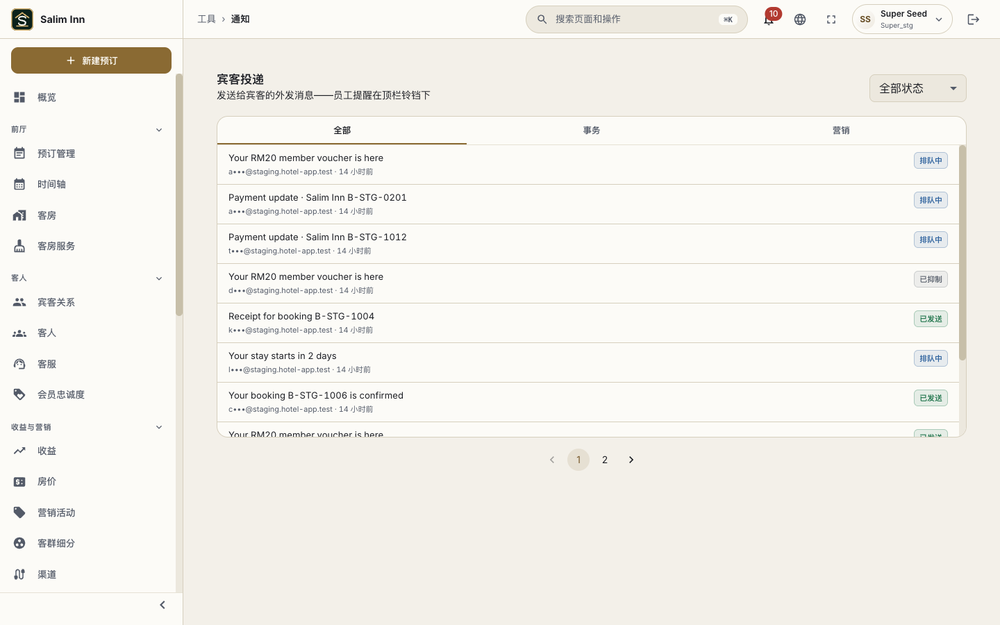
- **顶栏通知铃铛（`NotificationCenter`）**：
  - 红点数字汇总本地即时提醒、未读宾客投递（持有 `communications:read` 时）与系统持久通知（持有 `settings:manage`、`payments:read` 或 `support:read` 时）。
  - 弹窗内含分签：`提醒`（支持单条`忽略此通知`与`全部清除`）、`系统`（读取数据库 `staff_notifications`，点开即标为已读）以及外发投递摘要（`查看全部`跳转 `/notifications`）。
  - **后台持久通知触发源**：① 定时任务失败（通知 `settings:manage`，同任务每小时去重 1 条）；② 官网银行转账申请（通知 `payments:read`，附直达`/payment-approvals`链接）；③ 宾客发起客服会话/已付取消/新回复（推送至 `support:read` 目标组）。

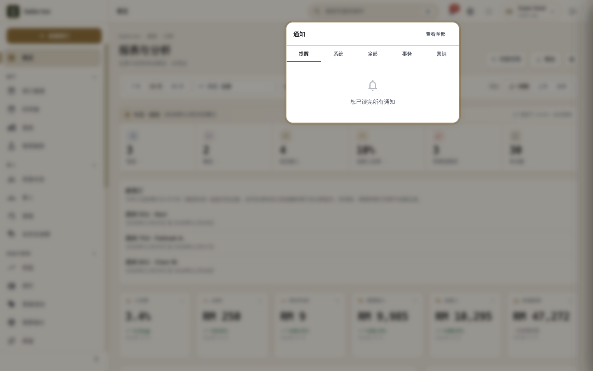

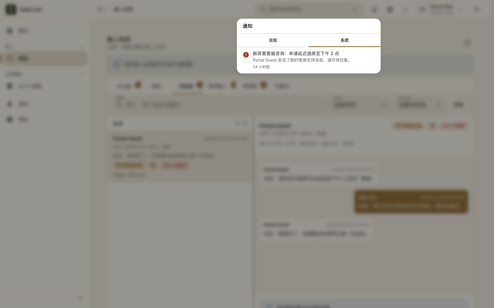

### 11.2 应用内帮助中心（`/help` 与 `/help/$slug`）

- 面向**全部已登录员工开放**，内含 **11 大分类、共 43 篇离线内置简体中文图文步骤文章**（不依赖网络或后端即可加载），并与 `⌘K` 命令面板的`帮助`范围深度联动。
- 首页提供`常用操作`（6 篇高频指南）、`按主题浏览`（11 大分类）、`热门文章`、`遇到问题？`（5 篇排障指南）与`获取更多帮助`上报指引。

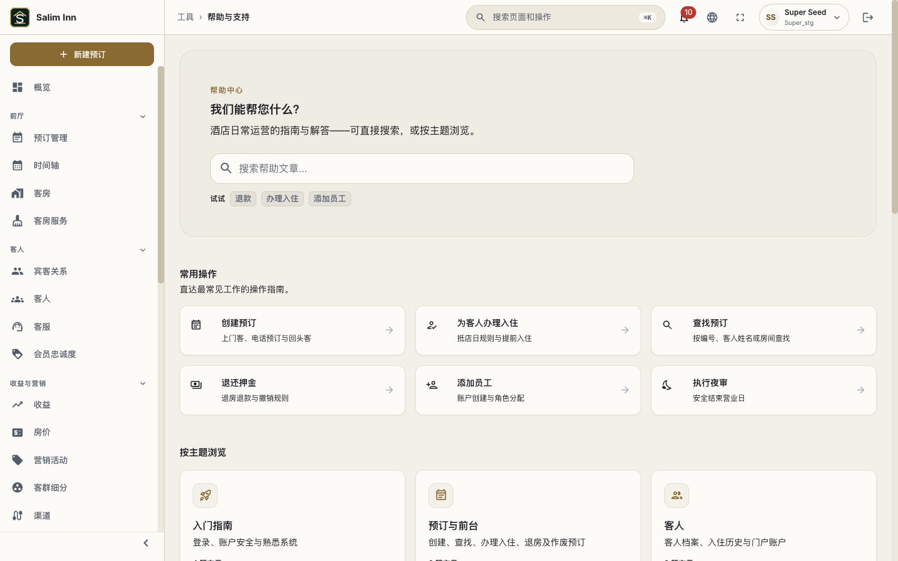
- 单篇文章页标注`最近审核`日期、预计阅读时间、`所需权限`徽章以及**仅在您拥有权限时才显示的`打开对应页面`快捷按钮**，底部提供文章有用性反馈按钮。

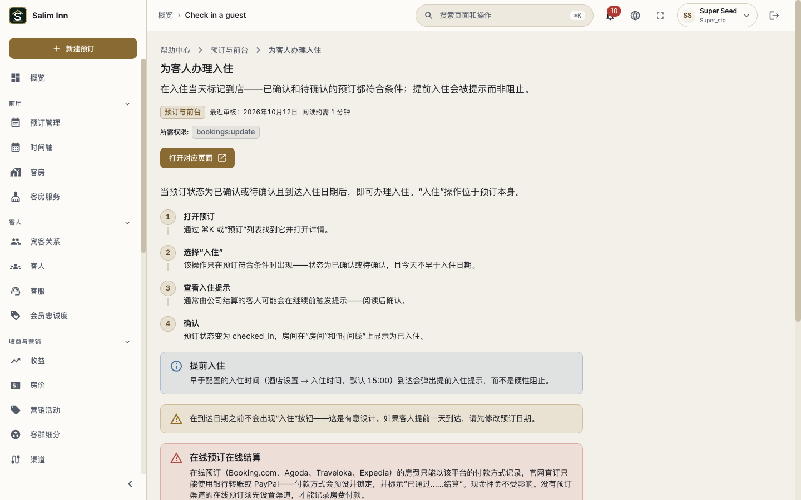

---

## 第 12 章：桌面客户端（Tauri）专项指南

桌面客户端将完整的 Web 管理端、侧车后端服务与嵌入式 PostgreSQL 数据库打包为一个独立本地应用，专为离线单机或门店本地部署设计。

### 12.1 数据目录与重启重登说明

- **本地数据存储目录**：
  - **macOS**：`~/Library/Application Support/HotelApp`
  - **Windows**：`%LOCALAPPDATA%\HotelApp`
  - **Linux**：`~/.local/share/HotelApp`
- **应用重启后需重新登录**：由于桌面版 WebView 与本地回环后端分处不同安全源（Origin），浏览器 `SameSite` 刷新 Cookie 无法跨重启持久携带；因此每次关闭并重新打开桌面应用时需重新输入用户名密码登录（此为安全设计，并非故障）。
- 桌面端启动时自动开启免邮箱验证旁路（`SKIP_EMAIL_VERIFICATION`），方便纯离线门店直接启用新建员工账户。

### 12.2 服务启动门控与数据库升级恢复（`DesktopServiceGate`）

打开应用时，门控屏幕会自动接管启动状态检查：

1. **常规启动与异常恢复**：正常显示`正在启动桌面服务`与进度条；若侧车或数据库意外停止，界面提示`桌面服务不可用`并提供**`重启服务`**与**`打开数据文件夹`**按钮。
2. **PostgreSQL 大版本升级检测**：当您安装了内置更新版 PostgreSQL 的桌面端且无法直接读取旧版 `pgdata` 时，启动页会拦截并弹出**`需要升级数据库`**：
   - 若检测到存在自动备份，提供**`从备份恢复`**、**`不升级，重试`**与**`打开数据文件夹`**；确认恢复后自动将旧版 `pgdata` 重命名为 `pgdata-pg<版本>-retired-<时间戳>` 保留在磁盘上（永不盲目删除），并从最近备份恢复数据库。
   - 若无备份，提示保持原数据不变，指导使用匹配旧版或手动 `pg_upgrade` 迁移。

### 12.3 本地托管自动备份与一键恢复

> 命令行离线恢复与灾难恢复流程详见：[desktop.md](desktop.md#6-managed-local-backup--restore)。

- **与 JSON 数据迁移的区别**：`hotel-backup` JSON 导出仅含表数据（`system` 以外不含系统表，且**均不含 `uploads/` 照片与 `private_uploads/` 凭证文件**）；而桌面**`本地备份`**是整机全量恢复点——每份备份由两个文件配对组成：
  - `hotel-backup-YYYYMMDD-HHMMSS.dump`（`hotel_management` 全库 `pg_dump` 归档，创建时自动校验完整性）
  - `hotel-backup-YYYYMMDD-HHMMSS-uploads.tar.gz`（完整打包 `uploads/` 与 `private_uploads/` 下所有房型图、付款凭证与 eKYC 影像）
- **自动调度规则**：服务就绪约 **2 分钟**后生成首份备份，之后每 **24 小时**自动执行一次，自动保留**最新 14 份**。
- **应用内操作（`/data-transfer` 底部`本地备份`卡片，需具备 `data_transfer:import` 权限）**：
  - **`立即备份`**：在做批量改价、大规模导库或夜审调整前手动触发一次完整快照。
  - **`打开备份文件夹`**：直接打开系统文件管理器中的 `backups/` 目录。**重要**：异机容灾备份请把此目录内的成对 `.dump` 与 `-uploads.tar.gz` 文件定期拷出到外部移动硬盘或云盘。
  - **`恢复` → `恢复并重启`**：点击恢复历史备份时，系统会**先自动创建一份当前状态的 `hotel-backup-<now>.dump` 安全备份**，随后恢复目标快照并重启应用。若恢复后发现选错时间点，可再次恢复该份安全备份实现回滚。
  - **操作警告**：恢复过程（`pg_restore --clean`）非单事务且会覆盖目标时间点之后的所有写入——**正在恢复期间严禁强制退出应用或断电**。

### 12.4 应用自动更新

- **自动静默检查**：桌面版在启动 **15 秒**后及之后每 **6 小时**自动检查 GitHub Releases 的签名更新清单（`latest.json` 并校验 minisign 签名）。发现新版本时，画面弹出提醒条支持点击`安装更新`或`稍后`（选`稍后`将在本次运行周期内暂不再弹窗；安装完成后提示`立即重启`或`稍后`）。
- **手动检查更新**：前往`系统管理 → 系统健康`（`/system-health`）的`应用更新`卡片，点击**`检查更新`**可主动检查并查看错误详情（仅启用更新器的正式桌面安装包展示此卡片）。

---

## 第 13 章：常见场景速查、系统边界与故障排查

### 13.1 高频故障排查速查表

| 常见现象 | 首选核查原因 | 正确处理步骤 |
|---|---|---|
| **找不到某个预订** | ① 在仪表盘`新预订`条受 `07:00` 时间窗过滤；② 预订在`/bookings`视图中已切换为`已作废`或因未付超时被自动释放；③ 搜索关键字范围受限 | ① 按 `⌘K` 切至`预订`范围按 `BK-...` 搜索；② 在`/bookings`点`全部`并清除所有筛选条件；③ 到`/audit-log`搜索预订编号核查是否被作废或释放。 |
| **菜单找不到页面，或打开提示 403 `无权访问`** | 路由策略与权限不匹配（例如补丁 `0031` 后普通`管理员`无 `/rbac` 与 `/data-transfer`；`/loyalty` 需 `analytics:read`） | 请`经理`或`超级管理员`打开`/rbac` → `用户`或`页面访问`核对角色与策略；如昨日可用今日消失，请查`/audit-log`。 |
| **登录或页面提示 423 `资源已锁定`** | 连续输入错误密码或 2FA 验证码达上限（默认 5 次）触发 30 分钟锁定 | 等待 30 分钟自动解锁，或联系持有用户管理权限的`经理`/`超级管理员`在后端执行解锁。 |
| **客人称银行转账了但找不到或没确认** | 未点`我已完成银行转账`提交申报、24 小时未补传凭证被自动拒绝，或卡在`待处理申请`中 | ① 查看全站顶部红条或`/payment-approvals` → `待处理申请`与`审批历史`；② 核对银行流水确认到账后点`批准`，或被拒绝时提醒客人使用邮件中的 60 分钟恢复链接重付。 |
| **PayPal 按钮无法点击批准，或提示付款冲突** | 系统按安全规则**禁止人工批准 PayPal**；冲突可能由重复回调或超时尝试导致 | ① 查看`/payment-approvals`顶部黄色冲突横幅，切勿重复向客人收费；② 跳`/audit-log?q=paypal`核对记录；③ 如客人尝试卡住无法继续，点`取消 PayPal 尝试`释放。 |
| **保存`/online-inventory`报错冲突未保存** | 同一时间有其他同事先提交了其中部分房型日期格（`409 stale_write`） | 点击警示条上的**`重新加载`**刷新最新库存，系统会为您保留未冲突日期上的修改，核对冲突格后重新点`检查并应用`即可。 |
| **外发邮件没有发出或未收到** | 客人无邮箱/未激活、退订了对应营销主题、邮箱在`屏蔽名单`中，或 SMTP 队列失败 | ① 到`/notifications`查看投递状态（`已抑制` / `发送失败`）；② 在`/communications`查对应活动的`预览`排除明细与`屏蔽名单`；③ 在`/system-health`核查`邮件队列`积压与`/jobs`中的 `email_delivery_worker` 失败日志。 |
| **桌面端数据没有刷新，或页面数据陈旧** | 客户端长时间休眠导致 WebSocket 断开、前端缓存未失效，或`客服`处于 5 秒轮询间隔 | 点击页面顶部`刷新`按钮，或重新打开对应标签页触发重拉；若涉及权限变更，请退出重登刷新页面策略。 |

### 13.2 系统功能已知边界一览（当前未交付模块）

依据 [../features.md](../features.md) 登记的真实边界，以下能力在当前版本中**有意未包含或保持人工流程**，请勿误导一线人员在界面寻找不存在的菜单：

1. **无短信（SMS）通知渠道**：当前外发触达仅限电子邮件（SMTP）与站内门户消息，不支持自动发送手机短信。
2. **无员工考勤、排班与薪资（HR/Payroll）模块**：人员架构仅包含用于授权与分组的`用户`与后端`团队`，不包含考勤打卡、排班表或工资核算。
3. **无物资采购与仓储库存（Procurement/Stock）模块**：无供应商、采购单或易耗品出库台账；系统中的`线上库存`专指可供线上预订的客房配额。
4. **无直接对接 LHDN MyInvois 的实时电子发票 API**：系统生成带连续编号（`INV-YYYYMM-XXXX`）与 SST/旅游税明细的合法发票与收据供打印/归档；需要向马来西亚内陆税收局报税时请通过 MyInvois 门户线下填报开具。
5. **PayPal 退款与争议 Webhook 需人工核销**：系统会校验并审计记录来自 PayPal 的退款/争议通知，但**不会自动反向冲减账单或预订收款**，需由财务人员核实后手工处理作废或退款。
6. **团队管理（Teams）无独立前端页面**：`route_access_policies` 虽预置路由标识，但目前团队分组成员管理仅通过后端 API 提供。
7. **无独立的“前台模块”菜单**：前厅日常柜台业务均统一在`概览`、`预订管理`、`时间轴`、`客房`与`客房服务`中完成。
