# 酒店管理系统普通用户（宾客）使用指南（简体中文）

> **适用对象**：浏览 Salim Inn 酒店官网的访客、免注册快速下单的散客、注册会员及即将入住或已入住的宾客。  
> **关联文档**：
> - 管理员与酒店员工操作指南：[admin-user-guide-zh.md](admin-user-guide-zh.md)
> - 国际化和术语规范（中英马三语对照）：[i18n-glossary.md](i18n-glossary.md)
>
> **阅读提示**：本指南严格对齐简体中文界面（`zh-CN`）与实际开放的宾客端功能。所有价格均以**马来西亚林吉特（MYR）**计价，时间以酒店当地时间（**`Asia/Kuching` UTC+8**）为准。

---

## 目录

1. [第 1 章：认识酒店官网与快捷入口（Salim Inn）](#第-1-章认识酒店官网与快捷入口salim-inn)
2. [第 2 章：浏览公开优惠（`/offers`）](#第-2-章浏览公开优惠offers)
3. [第 3 章：在线预订全流程（支持免注册访客预订与多房团订）](#第-3-章在线预订全流程支持免注册访客预订与多房团订)
4. [第 4 章：宾客账户注册、登录与安全管理](#第-4-章宾客账户注册登录与安全管理)
5. [第 5 章：宾客门户全功能详解（`/guest-portal`）](#第-5-章宾客门户全功能详解guest-portal)
6. [第 6 章：在线自助预登记、自动入住与 eKYC 身份认证](#第-6-章在线自助预登记自动入住与-ekyc-身份认证)
7. [第 7 章：付款失败与支付恢复（`/booking/recover-payment/$token`）](#第-7-章付款失败与支付恢复bookingrecover-paymenttoken)
8. [第 8 章：法律条款、隐私权利与邮件退订](#第-8-章法律条款隐私权利与邮件退订)
9. [第 9 章：宾客常见问题（FAQ）与联系酒店](#第-9-章宾客常见问题faq与联系酒店)

---

## 第 1 章：认识酒店官网与快捷入口（Salim Inn）

### 1.1 自动跳转规则

当您在浏览器打开系统首页 `/` 时，系统会根据您的登录状态自动分流：

- **未登录访客**：自动跳转至酒店官方展示页 `/salim-inn/`。
- **已登录宾客**：自动进入您的个人`宾客门户`（`/guest-portal`）；您也可从头像菜单中的`探索酒店`随时回到官网。
- **已登录酒店员工**：自动进入管理后台 `/admin-portal`（或按权限自动进入首个有权限访问的业务模块）。

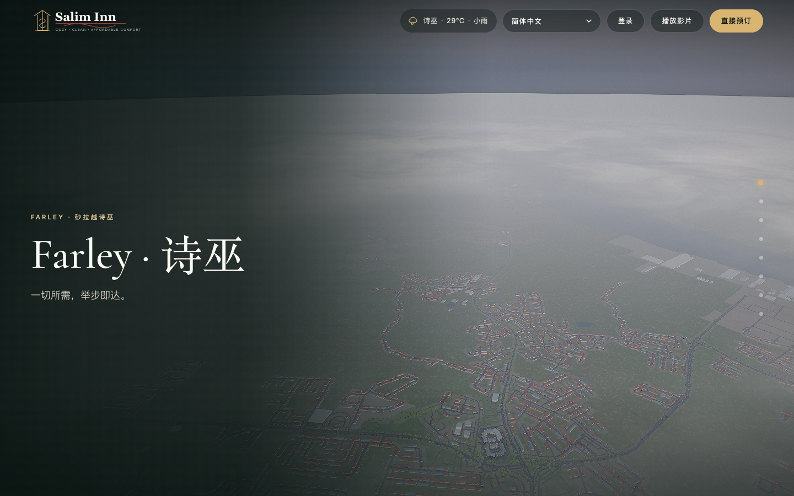

### 1.2 酒店基本信息与法定披露

依据马来西亚《2024 年消费者保护（电子交易）条例》（CPETTR 2024）等法规，官网页脚与页面清楚披露以下官方信息：

- **酒店名称与商业登记号**：`Salim Inn`（砂拉越商业名称法令第 64 章注册号 **`SA2012724`**）
- **酒店地址**：No. 21 & 22, Lorong Salim 17, Jalan Salim, Farley Commercial Centre, 96000 Sibu, Sarawak
- **24 小时联系与地图**：
  - 电话 / WhatsApp：`+60 11-1050 7083`（点击`致电`或`WhatsApp`按钮可直接拉起拨号或预填住宿信息的对话）
  - 电子邮箱：`saliminnsibu@gmail.com`
  - Google Maps 导航坐标：`2.26633, 111.86231`
- **基本服务时间**：`下午2:00起入住`（14:00）、`中午12:00前退房`（12:00）、`前台24小时服务`，公共区域配备 24 小时闭路电视（CCTV，仅视频无音频）。

### 1.3 五种房型与官网直订参考价

酒店共设 **29 间活跃客房**（分布在两层楼：101–114、201–215）。每间房均标配：**空调、免费 Wi-Fi、平板电视、热水淋浴、吹风机、电热水壶与茶具**。

| 房型代码 | 房型名称 | 床型与面积 | 基础入住上限 | 加床规则 | 官网直订参考价 | 特别说明 |
|---|---|---|---:|---|---:|---|
| `STDQ` | `标准大床房` | 1 张大床（152×190 cm）· 25 m² | 最多 2 人 | **不可加床** | **`RM 75` / 晚** | — |
| `DLX` | `豪华大床房` | 1 张特大床（183×190 cm）· 35 m² | 最多 2 人 | 可加 1 张（RM 35/晚） | **`RM 85` / 晚** | — |
| `SUP` | `高级双床房` | 2 张单人床（各 91×190 cm）· 28 m² | 最多 2 人 | 可加 1 张（RM 35/晚） | **`RM 95` / 晚** | — |
| `FR` | `家庭房` | 1 张特大床 + 1 张单人床 · 45 m² | 最多 3 人 | 可加 1 张（RM 35/晚） | **`RM 105` / 晚** | — |
| `FS` | `家庭套房` | 1 张特大床 + 1 张大床 · 55 m² | 最多 4 人 | 可加 1 张（RM 35/晚） | **`RM 110` / 晚** | 全店共 1 间；**无窗：内侧房间，以窗帘营造有窗的观感。** |

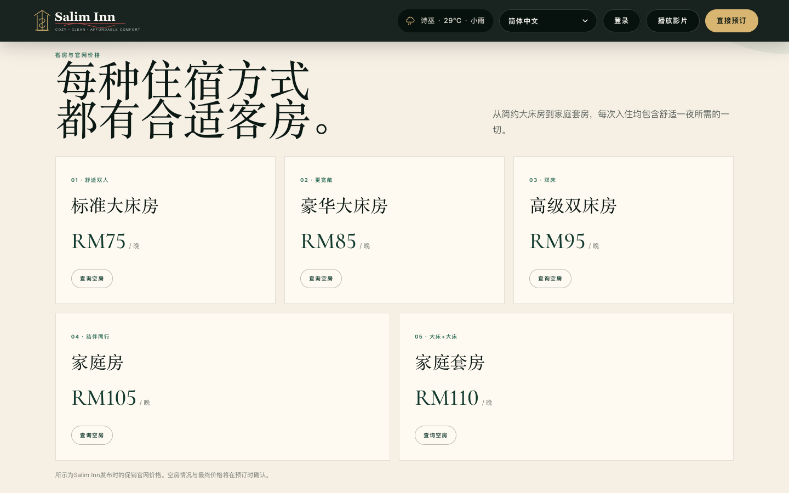

### 1.4 官网互动功能导览

- **顶部栏与全局控件**：
  - **跳过影片直达预订**：提供无障碍快捷按钮`跳过影片直接预订`，一键跳至第 8 章节预订面板。
  - **诗巫实时天气与 3D 光影切换**：顶部天气标签实时显示诗巫当前气温与天气（例如`诗巫 · 29°C · 局部多云`，数据源自 MET Norway 气象预报）。点击后可展开详情查看云量、降雨量、日出/日落、当地时刻，并手动切换 **5 种 3D 场景氛围**（`自动`跟随实时天气与昼夜变化、`白天`、`日落`、`夜晚`、`雨天`）。
  - **四语切换**：支持 `English`、`Bahasa Melayu`、`简体中文`、`繁體中文`。
  - **账户状态按钮**：未登录显示`登录`与`直接预订`；已登录宾客显示`我的账户`（带姓名首字母徽章）与`再次预订`。
- **8 章节 3D 实景飞跃影片与自动降级**：
  - 可点击`播放影片` / `暂停影片` / `重新播放`自动巡游，或手动上下滑动浏览 8 个章节：`01 · Farley` → `02 · 街区` → `03 · Salim Inn` → `04 · 抵达` → `05 · 前台` → `06 · 客房` → `07 · 举步即达` → `08 · 预订`。
  - **`02 · 街区`（Farley 周边向导）**：提供 4 个分类筛选标签（`超市与日用品`、`餐饮与咖啡馆`、`药房与诊所`、`日常服务`），标注 15 家周边精选商户（含营业时间与`致电`按钮）及 5 道诗巫`咖啡店必吃`美食（`干盘面`、`光饼`、`红酒鸡面线`、`点心`、`红哥罗面`）。
  - **`06 · 客房`（互动配置器）**：自由切换 5 种房型查看 3D 空间布局与规格参数，并支持一键切换`查看真实房间` / `返回3D房间`对比实拍照片；**在此选中的房型会自动带入第 8 章节的预订框**。
  - **`07 · 举步即达`**：以酒店为中心显示步行时间环，标注诗巫机场（SBW，约 13.3 公里）与诗巫市中心（约 4.2 公里）距离。
  - **`08 · 预订`**：选择入住/退房日期、成人（1–5）、儿童（0–4）与房型后，实时计算容纳建议（例如提示需加床或建议选 2 间房），点击**`直接预订`**将自动携带您的条件直达在线预订搜索结果；亦支持`WhatsApp`与`致电`下单。
  - **低配置设备平滑降级**：若设备不支持 WebGL2、内存较低或开启了系统减弱动画设置，系统会自动启用静态海报与实景照片版本，确保所有手机与老旧电脑同样顺畅浏览。
- **底部版块与手机端常驻栏**：影片下方展示`关于我们`、`客房与官网价格`、`一睹内部`（10 张实拍图）、`标准配备`、`规划行程`与 9 条`常见问题`；手机端底部常驻`每晚 RM75 起` + `直接预订`行动条。

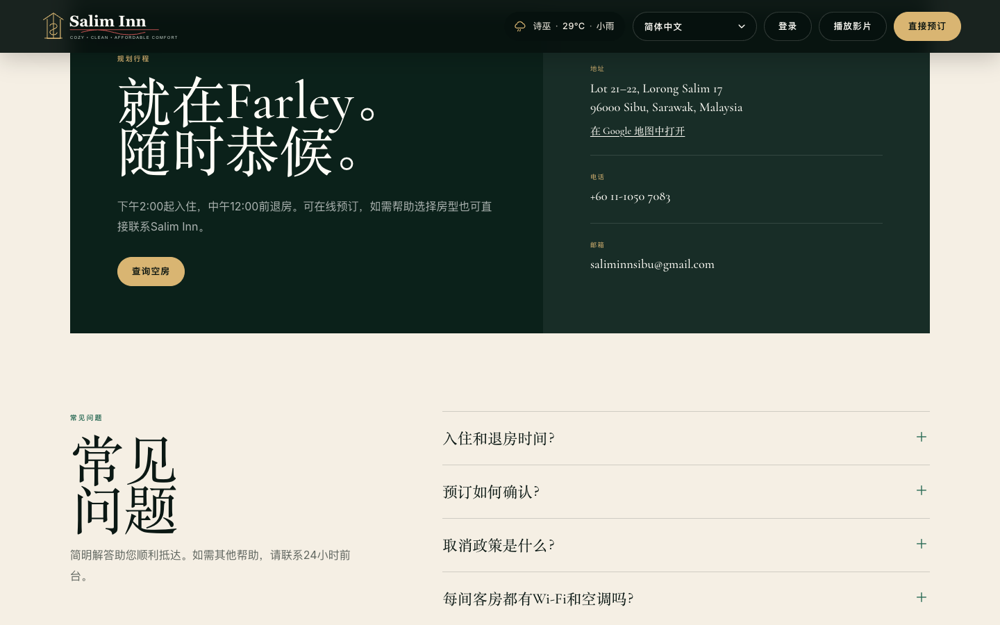

---

## 第 2 章：浏览公开优惠（`/offers`）

- **访问入口**：打开 `/offers`（无需登录即可访问，且顶部支持 Google One Tap 一键登录提示）。
- **页面内容**：集中展示酒店当前对外公开的有效`优惠`（deal）与`优惠券`（voucher）活动（最多展示 50 项），每张卡片清晰列出：
  - 优惠类型徽章（`优惠` / `优惠券`）与折扣力度（百分比或 MYR 金额）；
  - 活动描述、适用`住宿日期`、需满足的`最少入住：N 晚`、`领取截止`时间以及`条款`说明。
- **如何领取与使用（重要说明）**：
  - 未登录访客在 `/offers` 页面只能浏览活动详情，卡片按钮显示为**`登录后领取`**（点击跳转至 `/login` 登录，**不会**在未登录状态下直接领取或自动套用到订单）。
  - 完成登录后，请进入宾客门户的**`奖励 → 优惠`**（`/guest-portal?section=offers`）点击`领取优惠`（或积分兑换活动对应的`兑换 2,000 积分`），领取后的优惠券会存入**`我的优惠券`**（`/guest-portal?section=vouchers`），支持一键`复制代码`并在下单核对阶段下拉选用。

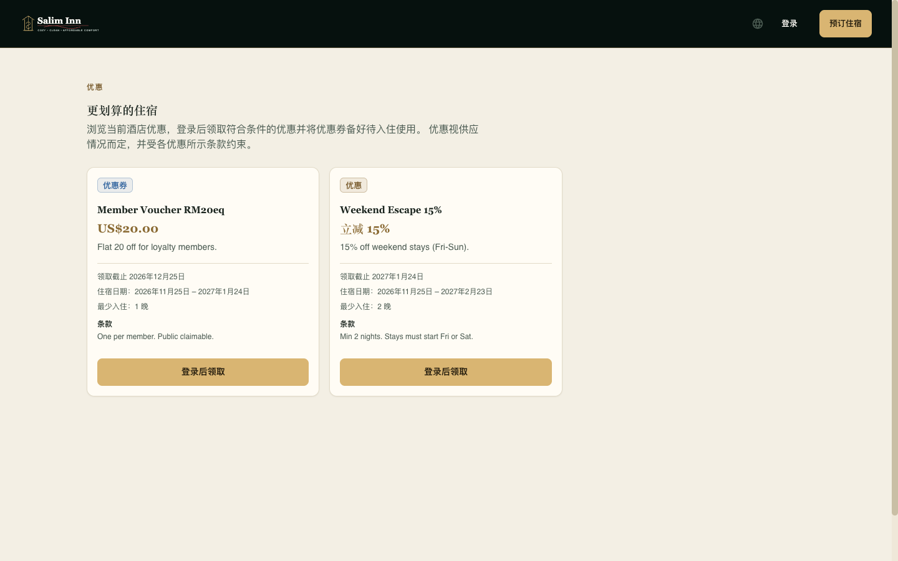

---

## 第 3 章：在线预订全流程（支持免注册访客预订与多房团订）

可通过官网`直接预订`、宾客门户右上角`预订住宿`或直接访问 `/portal/book`（自动跳转至 `/guest-portal?view=booking`）进入预订流程。整个流程共分 **4 步**：`搜索` → `选择` → `核对` → `支付`。

### 3.1 免注册访客预订 vs 会员登录预订对比

| 对比维度 | 免注册访客预订 | 登录会员预订 |
|---|---|---|
| **下单资格** | 无需注册或密码，填昵称与邮箱即可完成预订与在线支付 | 使用酒店账号或 Google 一键登录即可下单 |
| **优惠券与免费房晚** | 暂不可用 | 可使用已领取的`优惠券`与名下`免费房晚`额度（全额抵扣可免支付直接确认） |
| **会员积分与管理** | 仅获得单次预订编号与邮箱访问链接；日后可在预登记向导中一键将订单关联（认领）到新账户 | 自动在`宾客门户 → 住宿`集中管理全部历史与未来订单，并按规则累积积分 |
| **中途登录保留进度** | 在结账中途点击登录或使用 Google One Tap，**系统会自动保存购物车、日期、人数、偏好与已填信息**，登录完成后无缝回到原结账步骤 | 若刚登录账号尚未填全姓名或电话，系统会引导至 `/complete-profile` 补齐后再自动返回继续付款 |

> [!NOTE]
> 已登录酒店员工账号访问预订页时会被重定向至管理后台 `/admin-portal`；员工代客下单请使用后台`新建预订`。

### 3.2 第 1 步：`搜索`（日期与人数限制）

请按以下规则选择入住条件后点击`搜索`：

- **入住日期**：须为**今天**（`Asia/Kuching` 时区）及之后，且最远不超过未来 **3 个日历月**。
- **住宿晚数**：**1 至 30 晚**；退房日期必须晚于入住日期。
- **人数上限**：**1 至 20 位成人**、**0 至 20 位儿童**。

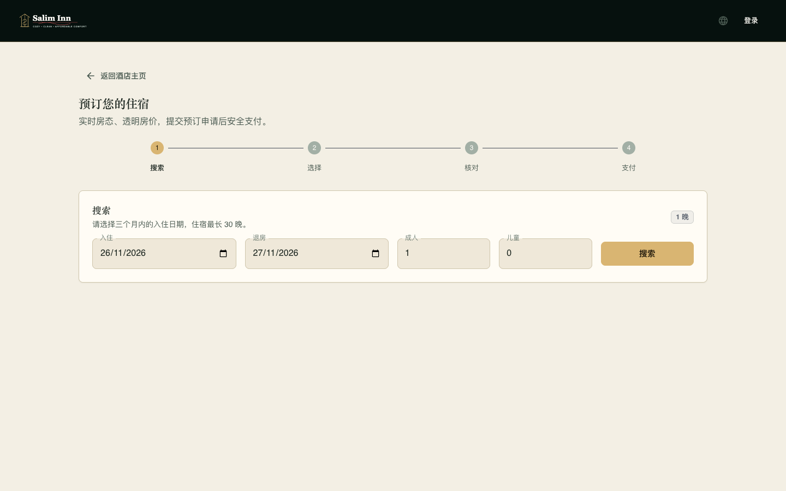

### 3.3 第 2 步：`选择`（实时余房、3D 看房与多房购物车）

- **实时余房同步**：页面通过实时通道动态显示各房型`仅剩 N 间房`。如果在您停留在核对页期间最后几间房被他人订走导致房态变化，系统会弹出`客房可订状态已变更`提示，自动刷新最新可订选项并清除旧报价，避免超售误扣。
- **房间实景照片轮播**：各房型卡片提供左右箭头与指示圆点可滑动浏览多角度实拍照片（如希望体验 3D 立体房间模型与实拍对比，可在官网 `/salim-inn/` 的`06 · 客房`章节查看）。
- **单房预订与多房购物车（1–5 间房）**：
  - 点击`选择`或`添加此类房间`加入底部悬浮**`预订购物车`**，可通过 `− n +` 自由增减同一或不同房型数量，**单笔订单最多支持预订 `5` 间房**。
  - 购物车会自动比对已选房间的基础最大入住人数总和与您搜索的总人数：若容量不足，会贴心提示`您的房间可容纳 X 位客人，但您搜索的是 Y 位。请再添加一间房…`（**注意：加床不计入房型基础最大可住人数校验**）。

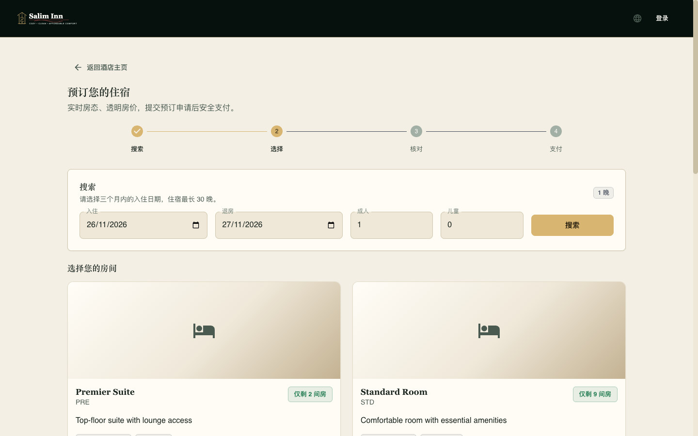

### 3.4 第 3 步：`核对`（入住信息、税费、优惠与同意声明）

#### 1. 房间分配与加床（多房或含加床订单自动进入团体核对视图）

- 当您预订 **2–5 间房**，或为单间房添加**加床（每床每晚 RM 35）**时，页面会按房间展开，允许为每间房独立设置`成人`、`儿童`与`加床`数量，并可点击`再添加一间房`（最多 5 间）。

#### 2. 填写入住联系信息

- **访客下单必填**：
  - **`昵称`**（必填，最多 100 字符）：仅用于保留房间，**不能与他人已有昵称重复**（若系统提示`该昵称已被使用，请换一个。`，更换昵称即可，不会清空您的购物车或报价）。**法定真实姓名将在办理入住时登记。**
  - **`电子邮箱`**（必填）：预订确认函、预订编号及专属管理链接都将发送至此邮箱。
  - **`电话`**（选填）。
- **`客人类型`（必选，永不预先代选）**：
  - **`本地游客（马来西亚籍）`**：免征旅游税。
  - **`外国游客`**：依法按**每房每晚 RM 10** 外加马来西亚旅游税（选择后页面立即重算最新价格明细）。
  - *注：所有房价与加床费均已**内含 8% 服务税（SST）**。*

#### 3. 偏好设置（选填）

- **`特殊要求`**：最多 1,000 字符，如高楼层、靠近电梯或晚到说明。
- **`我需要每日客房清洁`**：勾选表示希望入住期间每日安排打扫。
- **`客房偏好`**：可选`无偏好`（默认）、`无烟房`或`吸烟房`。页面明确提示「`视供应情况而定，无法保证。我们会尽量满足您的偏好。`」（注：依据马来西亚《2024 年第 852 号法令》，酒店室内原则上实行全面禁烟）。

#### 4. 会员专属减免：`免费房晚`与`优惠券`

- **使用`免费房晚`**：若您账户名下有与所选房型匹配的免费房晚额度，可勾选需要抵扣的具体晚数（多房订单默认优先抵扣最便宜的晚数，也可点开面板在同房型之间自由调换抵扣房晚）。如果免费房晚已全额抵扣全部房费与税费（应付总额为 RM 0），底部按钮会变为**`确认免费住宿`**，点击即可**免支付直接确认预订**。
- **使用`优惠券`**：从下拉列表中选择满足入住条件（最少晚数、房型、渠道）的可用优惠券。若该优惠券绑定的活动设为不可取消，页面会弹出醒目提醒`此优惠券不可取消…`。在**多房团体预订**中，固定金额优惠券或有折扣上限的百分比券会按各房间小计精确到分按比例分摊；若日后取消其中一间未付款房间，其优惠额度会按比例重新分配给组内其余未付款房间。

#### 5. 阅读并确认条款声明

在`前往支付`前，必须主动勾选以下两项必选声明（版本 `2026-11-18`）：
- 同意《预订条款与条件》（`/legal/terms`）
- 知悉《隐私通知》（`/legal/privacy`）
- *(另一项「可选：通过电子邮件向我发送优惠与消息。」默认永不勾选，您可自由决定是否订阅酒店促销邮件。)*

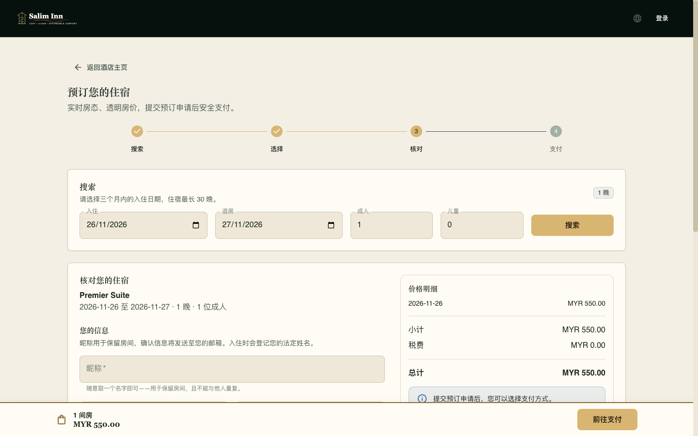

### 3.5 第 4 步：`支付`与订单确认

#### 付款前须知与未支付保留窗口

- 若选择稍后付款或提交前查看条款，系统告知：**如未支付，房间在下单后默认为您保留 `24 小时`**（可在酒店设置中调整，后台定时任务每 15 分钟清理到期未付订单）。
- 提交付款前需勾选同意`《付款条款》`并阅读 4 条付款前须知。

#### 两种在线支付方式

1. **`PayPal 或借记卡／信用卡`**：
   - 支持单房订单与多房团体订单**一次统一结账**。
   - 扣款成功后订单立即变为**`已确认`**，屏幕展示`付款收据`（含 `PAY-...` 收据编号）并支持点击`打印收据`。
2. **`线下银行转账`**：
   - 展开酒店收款银行信息（`银行`、`账户名称`、`账户号码`）。
   - 完成网银转账后，可直接在页内点击`附上收据（可选）`上传转账截图或回单（支持 **JPEG / PNG / WebP / PDF，最大 `10 MB`**），点击**`我已完成银行转账`**提交申报。
   - 订单状态变为**`待确认`**（等待酒店团队核对银行到账并批准）。若您暂未上传凭证或凭证模糊，酒店可能会向您发出补充收据请求，需在 **`24 小时`**内补传，否则该申请将被自动拒绝。

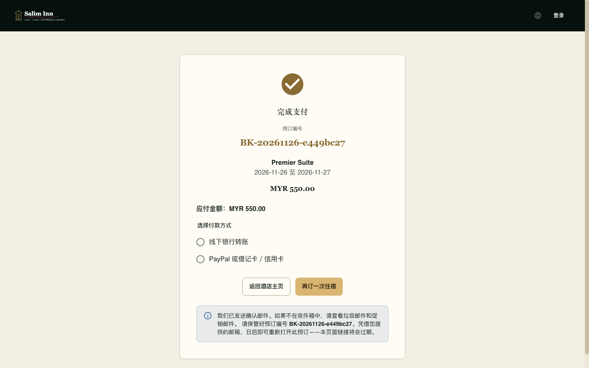

#### 保管确认编号与专属链接有效期

- **单房预订编号**格式为 `BK-YYYYMMDD-...`；**多房团体预订号**格式为 `GBK-YYYYMMDD-...`（同时组内每间房均有独立的 `BK-...` 编号）。
- 确认函将发送至您的邮箱（若收件箱未见请检查垃圾邮件或促销文件夹）。
- **专属访问链接说明**：通过邮件访问匿名订单的免登录链接具有时效性（一般保留至 `max(下单后14天, 入住前7天)` 之后），且**每当系统因您补传凭证或改态发送新邮件时，旧邮件中的链接会自动失效，仅最新一封邮件中的链接有效**。请务必妥善保存您的**预订编号**与**下单时填写的昵称**，日后可随时通过 `/guest-checkin` 找回并办理预登记。

---

## 第 4 章：宾客账户注册、登录与安全管理

### 4.1 注册账户（`/register`）与邮箱验证（`/verify-email`）

1. 打开 `/register`，填写以下资料：
   - **`用户名`*（必填）**、**`电子邮箱（选填）`**
   - **`名字`*（必填）**、**`姓氏`*（必填）**、**`电话`*（必填，10–15 位数字）**、**`地址（选填）`**（≤ 255 字符）
   - **`密码`*** 与 **`确认密码`***
2. **密码规则**：长度 **8–128 字节**，必须同时包含至少 **1 个大写字母、1 个小写字母、1 个数字、1 个特殊字符**（如 `!@#$%^&*` 等），且不能包含 `password`、`12345678` 等常见弱口令片段。
3. **同意条款与人机校验**：页面展示《预订条款与条件》与《隐私通知》告知声明（创建账户即表示同意，**不包含促销邮件捆绑**），并按提示完成安全验证（Cloudflare Turnstile）。
4. **验证激活**：
   - 若填写了电子邮箱，系统会发送验证邮件——点击邮件中的链接进入 `/verify-email` 完成验证后（5 秒自动跳回 `/login`），方可登录。*(注：若未收到验证邮件，请检查垃圾邮件；系统暂不提供公开自助重发入口，直接尝试登录会提示您验证状态。)*
   - 若未填写电子邮箱，账户将直接完成注册并在 5 秒后跳转登录页。

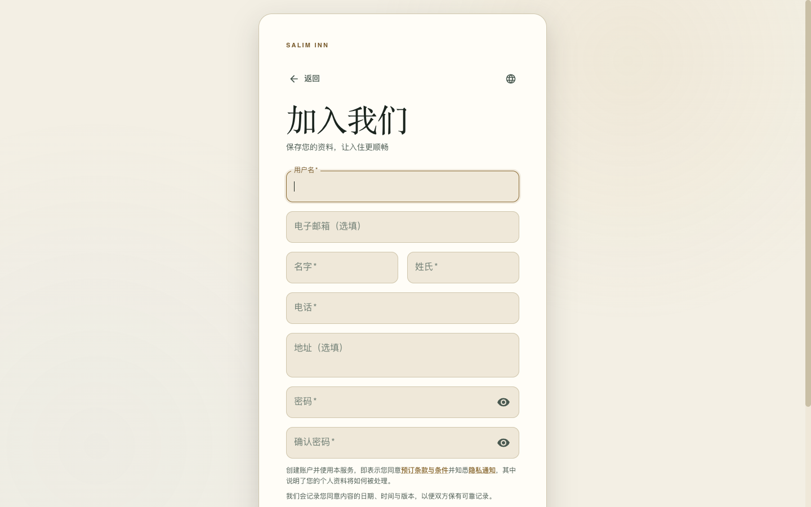

### 4.2 登录（`/login`）、Google 一键登录与完善资料（`/complete-profile`）

- **标准密码登录**：在 `/login` 输入`用户名或电子邮箱`及`密码`，通过安全验证后登录。
- **Google 登录 / Google One Tap**：
  - 在 `/login` 点击`使用 Google 登录`，或在 `/offers`、在线预订页响应顶部弹出的 Google One Tap 提示。
  - 若是首次使用该 Google 账号，One Tap 会先弹出`还差一步即可创建账户`确认声明，点击`同意并继续`后自动为您建立宾客账户。
- **补全个人资料（`/complete-profile`）**：通过 Google 首次登录或在预登记中快速认领的账号，若尚未填写姓名或 10–15 位联系电话，系统会自动引导至 `/complete-profile` 补全必填联系资料，完成后自动带您回到原先的门户或结账进度。

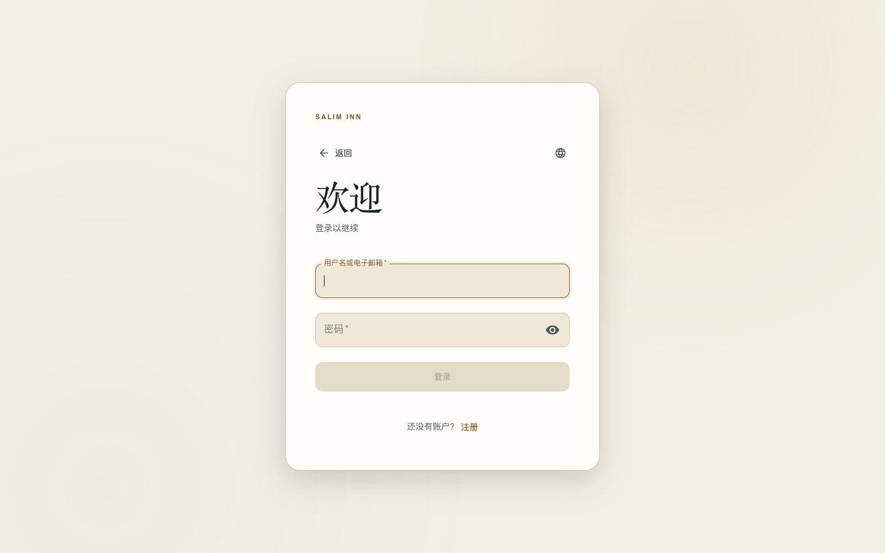

### 4.3 账户安全设置与设备管理（`/guest-portal?section=security` 与 `/profile`）

- **通行密钥（Passkeys / 生物识别登录）**：
  - 每个宾客账户最多可绑定 **`10` 个**通行密钥（支持指纹、面容 ID 或设备 PIN）。
  - 首次登录时可能会收到`使用通行密钥保护您的账户`引导；之后在`宾客门户 → 安全`中新增通行密钥时，为防盗号，系统要求先验证**当前密码或 6 位验证器动态码**。支持自定义重命名或随时删除。
- **验证器应用（TOTP 双重身份验证）与备用码**：
  - 开启时需先验证当前密码，屏幕会在**本地浏览器直接生成二维码**（密钥不外传），用验证器扫码并输入 **`6 位验证码`** 后，页面会**仅展示一次**由系统生成的`备用码`（`XXXXX-XXXXX-XXXXX-XXXXX`），请妥善保存。
  - 登录触发二次验证时，您有 **5 分钟**时间完成：输入 6 位验证器码（输满 6 位自动提交）、点击`使用通行密钥`，或通过`使用备用码`应急登录。
  - **锁定保护**：连续输错密码或 2FA 验证码达上限（默认 **5 次**）将锁定账户 **30 分钟**并退出全部活跃设备。
- **修改密码与忘记密码**：
  - 修改密码请前往 **`/profile` → `安全`**（先验证`当前密码`，再设新密码）。**修改密码后系统会立即退出所有其他设备，并自动撤销全部已绑定的通行密钥**（需重新绑定）。
  - **忘记密码**：当前系统暂未提供自助找回/重置密码页面。如果您忘记了密码，请通过电话 `+60 11-1050 7083` 或邮箱 `saliminnsibu@gmail.com` 联系酒店协助处理。
- **已登录设备（`DevicesSection`）**：在门户`安全`页可查看所有在线会话（显示浏览器/设备类型、`本设备`标识、依据时区估算的位置与 IP 地址），并可对陌生或公用电脑上的会话一键远程`退出登录`。
- **账户停用说明**：系统目前不提供网页端自助停用或销户按钮；如您希望停用账户或行使删除/更正权，请直接联系酒店资料保护联络点 `saliminnsibu@gmail.com`。

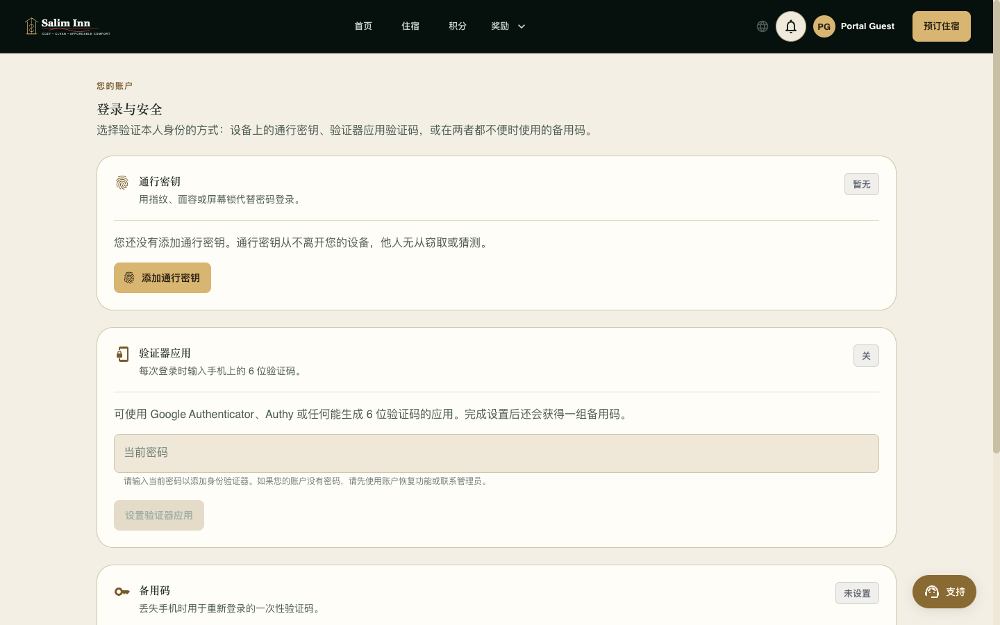

---

## 第 5 章：宾客门户全功能详解（`/guest-portal`）

已登录宾客访问 `/guest-portal`（或旧链接 `/portal`）即可进入个人门户首页；未登录访问时自动跳往 `/login`。

### 5.1 门户导航与快捷组件

- **桌面端顶栏**：`首页`、`住宿`、`积分`、`奖励`下拉菜单（含`优惠`、`优惠券`、`免费房晚`）、语言切换器、**通知铃铛**（若您提交的银行转账需要 24 小时内补交凭证，铃铛会泛红脉冲提醒，点开可直接上传 ≤10 MB 凭证）、头像菜单（`个人资料`、`身份认证`、`安全`、`偏好设置`、`探索酒店`回到官网、`退出登录`）以及金色**`预订住宿`**按钮。
- **手机端底栏**：底部固定显示 **`首页`、`住宿`、`积分`、`预订`、`更多`**（展开其余页面与个人设置）。
- **右下角浮动`支持`按钮**：在门户任意界面均可点开在线客服对话抽屉。

### 5.2 门户九大板块与`/my-rewards`详细功能

#### 1. `首页`（`?section=overview`）

- 展示欢迎语、`您的下一次住宿`卡片、`积分余额`卡片（支持实时推送更新）、`安排下次到访`（`查看优惠`按钮）以及底部`出行须知`（9 条常见问题速查，直连 Google Maps 与身份认证页）。

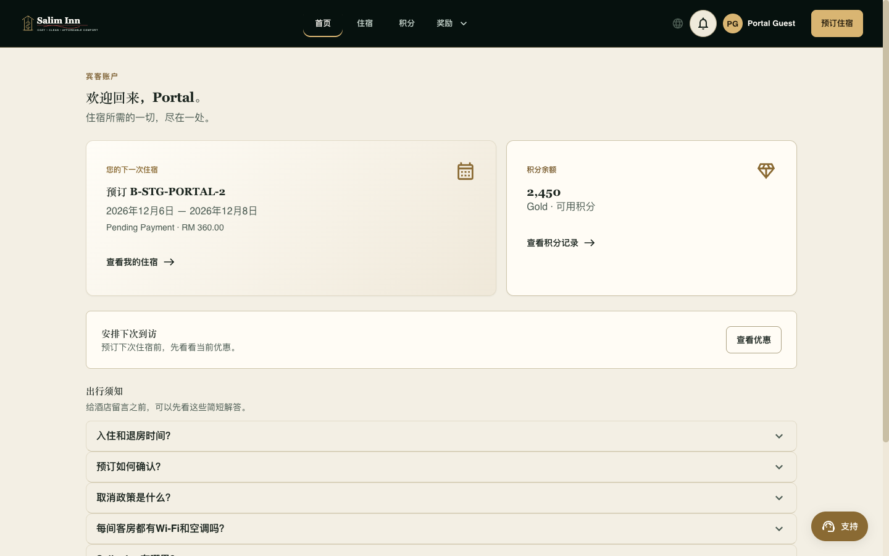

#### 2. `住宿`（`?section=stays`）

- **检索与分组**：支持按`预订编号、状态或日期`搜索（分页支持每页 10/25/50 条）。多房团体预订会汇总在同一`多房间预订 GBK-...`分组卡片下，显示房间数、团体总金额与整组取消入口。
- **状态徽章识别**：`待支付`、`待确认`（转账等待酒店核实）、`已确认`、`已入住`、`已退房`、`已取消`/`已作废`、`取消审核中`；需补交收据时会弹出醒目的`需要收据`提醒条。
- **点击`查看详情`可执行的操作**：
  - 查看房费、税费与支付明细；已确认住宿可打开`预订收据`并点击`打印收据`。
  - **补交银行转账凭证**：直接上传 **JPG / PNG / WebP / PDF（最大 10 MB）**。
  - **补付款**：对于`待支付`（`pending` / `pending_payment`）订单（含未支付团订），直接在弹窗内通过 PayPal/银行卡或银行转账完成支付。
  - **在线取消与取消政策**：
    - **未支付订单**：点击`取消预订`并选择原因（`行程有变`/`误操作下单`/`出行受阻`/`已另寻住宿`/`其他`）后**立即在线取消，且无法在线撤销**（团订提供`取消所有客房`）。
    - **已支付或银行转账待审核订单**：提交后状态变为**`取消审核中`**，系统会自动向酒店客服台发送高优先级人工退款审核请求。酒店政策为：**入住前至少 3 天取消可全额免费退款；不足 3 天或未按期入住可能收取首晚房费**。
    - *注意：使用“不可取消”促销优惠券的订单将禁用在线取消按钮。*

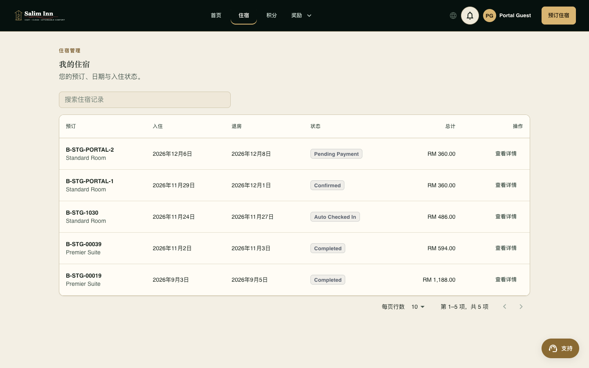

#### 3. `积分`（`?section=points-history`）与独立奖励中心（`/my-rewards`）

- **门户`积分`页**：展示您的实时会员卡（`青铜` / `白银` / `黄金` / `铂金`）、会员号、账户状态、`可用积分`、`累计积分`与`最近记录`明细，支持 WebSocket 实时刷新。

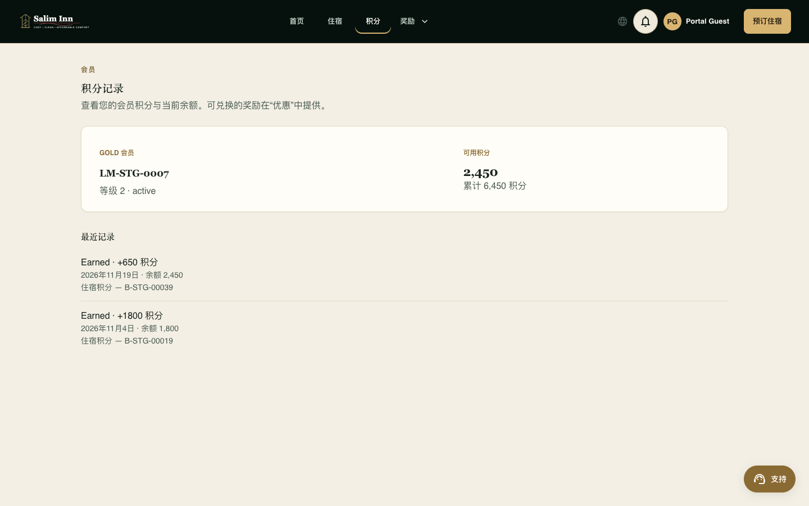

- **独立奖励中心（`/my-rewards`）**：
  - **前置准入门槛**：访问 `/my-rewards` 的完整奖励目录与礼品兑换**必须先通过 eKYC 身份认证**（未通过前页面会引导您前往`/profile`或身份认证流程）；通过后即可实时同步您的等级徽章、可用积分、升级进度与近期流水。
  - 包含 **3 个选项卡**：
    1. **`奖励目录`**：按分类浏览可兑换礼品/权益（查看所需积分与剩余库存），点击`立即兑换`（可附备注）提交申请；若该奖励需要人工审批，您可以在本页追踪待处理/已批准/已拒绝进度（若被拒绝，已扣积分将自动退回）。
    2. **`我的权益`**：查看当前等级权益、积分倍率及 4 个会员等级（青铜至铂金）的升级门槛对比。
    3. **`积分历史`**：查看完整的积分赚取、兑换、赠送与冲销流水。

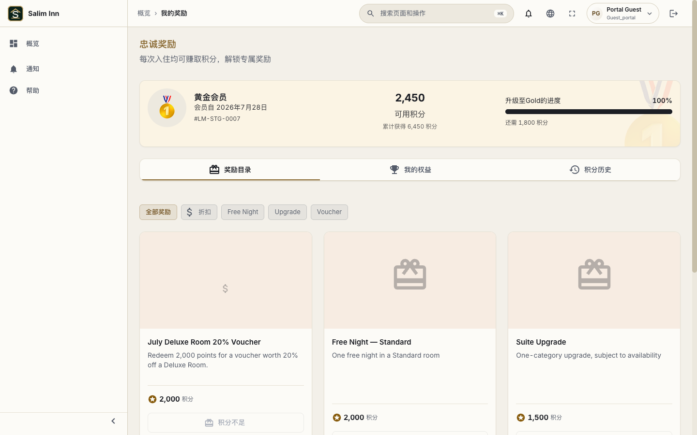

#### 4. `优惠`（`?section=offers`）、`优惠券`（`?section=vouchers`）与 `免费房晚`（`?section=credits`）

- **`优惠`**：浏览适用您的促销活动，点击`领取优惠`直接领取，或消耗可用积分兑换积分专享礼券（如`兑换 2,000 积分`）；已领取的活动标注`已领取`，积分不足时会显示还差多少积分。

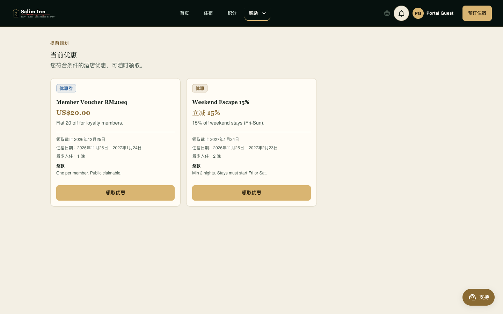

- **`优惠券`**：管理您名下所有优惠券，区分`可用`、`已使用`、`已作废`、`已过期`，点击`复制代码`即可复制，并标注来源（`从“优惠”领取`或`由酒店发放`）与到期时间。

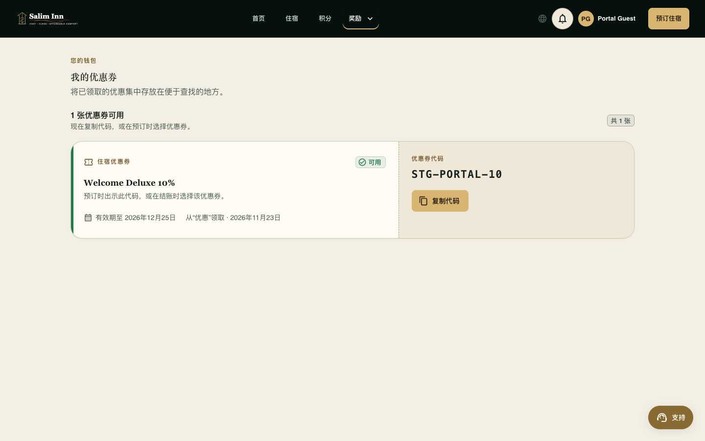

- **`免费房晚`**：查看总可用免费房晚及各房型专属余额（如 `DLX · 2 晚免费`），点击`预订`直接跳转选房抵扣。

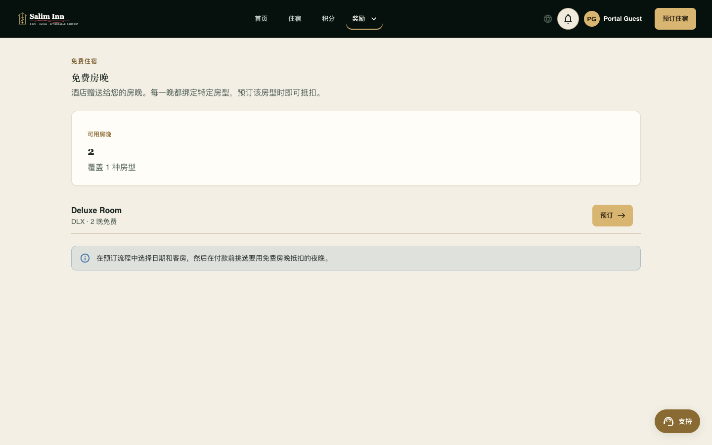

#### 5. `身份认证`（`?section=identity`）

- 查看您的 eKYC 审核状态与工作人员反馈意见（详见第 6.2 节）。

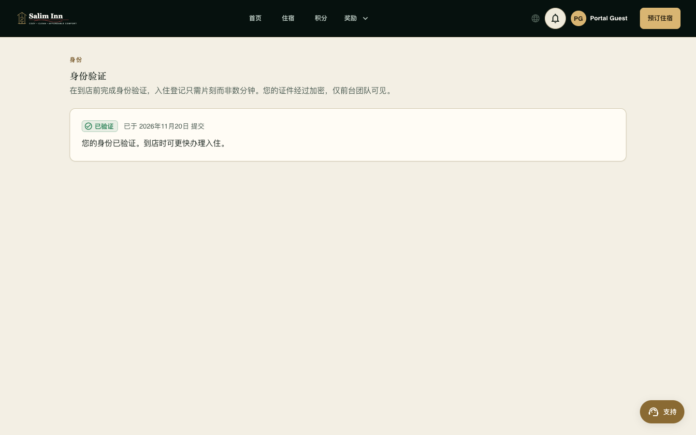

#### 6. `客服支持`（右下角`支持`抽屉或 `?section=support`）

- 点击右下角浮动`支持`按钮即可开启实时在线客服窗口（手机端全屏弹出）。
- **发起新咨询**：选定 6 个类别之一（`预订或入住`、`我的住宿或客房`、`账单或付款`、`会员或奖励`、`门户或技术问题`、`其他事项`），可选关联一笔预订，输入咨询内容后生成编号 `SUP-YYYYMMDD-...`。
- **沟通规则与限制**：
  - 支持与酒店工作人员通过 WebSocket 实时双向对话；状态依次显示`等待支持回复`、`等待您回复`、`已解决`、`已关闭`。
  - **仅支持纯文本消息（单条上限 4,000 字符），客服聊天窗口暂不支持上传图片或文件附件**（如您需要上传银行转账凭证或身份证件，请在`住宿`弹窗、铃铛提醒、预登记或`身份认证`页面上传）。
  - 会话标为`已解决`后，在酒店设定的重开窗口期（默认 **`7` 天**）内，如果您仍有后续问题可点击`重新开启`继续对话；超时或已`关闭`请新建会话。

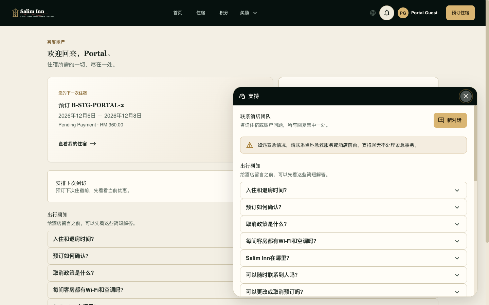

#### 7. `个人资料`（`?section=profile` 与 `/profile`）

- **门户`个人资料`**：可自助修改`名字`*、`姓氏`*、`称谓`、`电话号码`*（10–15 位）、`备用电话`、`国籍`、`地址`、`城市`、`州/省`、`邮政编码`、`国家/地区`。其中`电子邮箱`（一经验证即锁定）、`身份证／证件号码`与`显示名称`为受保护字段，如需更改请联系酒店。
- **独立 `/profile` 页面**：额外支持上传头像（JPG / PNG / GIF ≤ 2 MB）及修改登录密码。

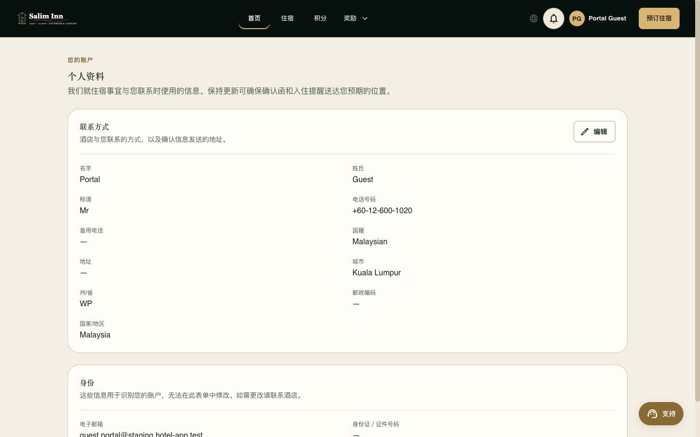

#### 8. `安全`（`?section=security`）与 `偏好设置`（`?section=preferences`）

- **`安全`**：管理通行密钥、验证器应用 2FA、备用码与已登录设备（详见第 4.3 节）。
- **`偏好设置`**：
  - **`外观`**：选择`跟随系统——随浏览器`、`浅色`或`深色`主题。
  - **`邮件通知`**：自主开启或关闭 **3 类非必要营销邮件订阅**：`酒店公告`、`促销与优惠`、`生日优惠券`（语言切换位于顶部导航栏）。

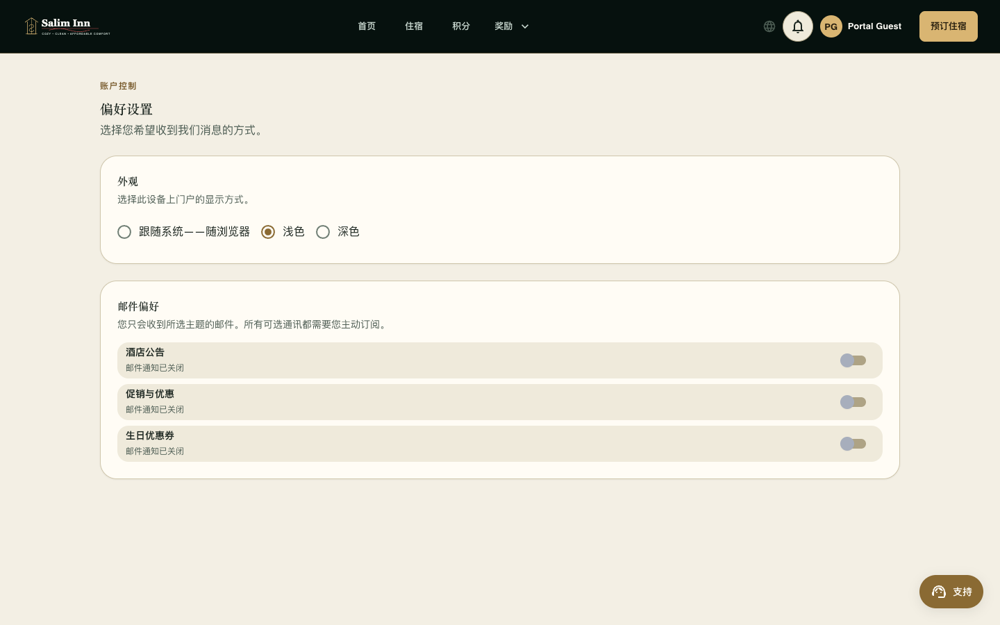

> [!NOTE]
> **关于住后点评**：当前宾客门户暂不提供自助提交住后评价或评分的界面；如有住宿体验反馈，欢迎通过`客服支持`直接告知酒店团队。

---

## 第 6 章：在线自助预登记、自动入住与 eKYC 身份认证

### 6.1 自助预登记与在线自动入住向导（`/guest-checkin*`）

如果您已完成订房，可在**入住前 `0` 至 `7` 天内**提前在线完成预登记，减少前台排队等待时间；若已过入住日期，请直接前往前台办理。

#### 第一步：身份查单（`/guest-checkin` 与 `/guest-checkin/verify`）

- **方式 A（邮件直达）**：点击预订确认或入住前提醒邮件中的链接，直接进入 `/guest-checkin/verify?token=...`（系统会自动将安全令牌转存并从地址栏抹除防泄露）。
- **方式 B（手动查单）**：打开 `/guest-checkin`，输入：
  1. **`预订编号`**（如 `BK-20261124-...`）
  2. **`宾客姓名`**（**请填写下单时使用的昵称或档案姓名——注意这里不是电子邮箱**）
  - 验证通过后系统签发一个有效期 **48 小时**的临时访问凭证。
- 在 `/guest-checkin/verify` 核对您的`宾客信息`与`住宿信息`后，点击继续（若此前预登记过，按钮显示`继续更新信息`）。

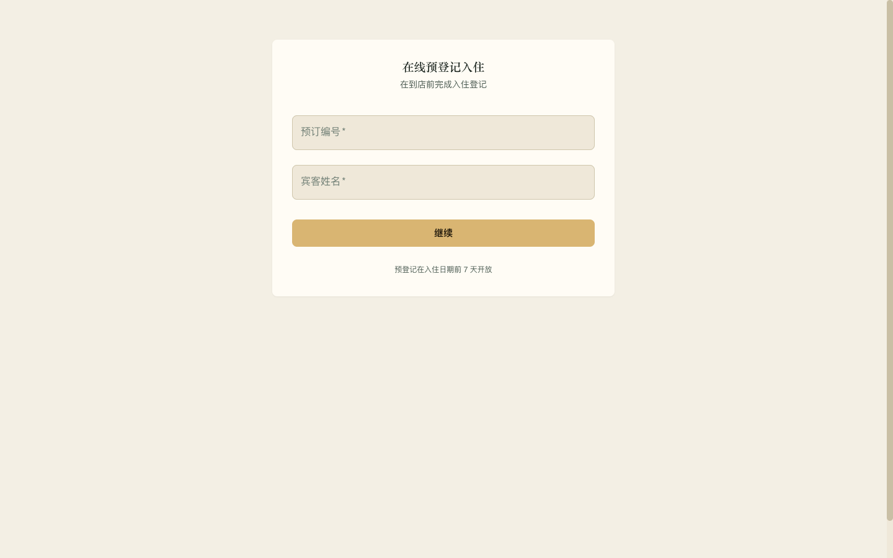

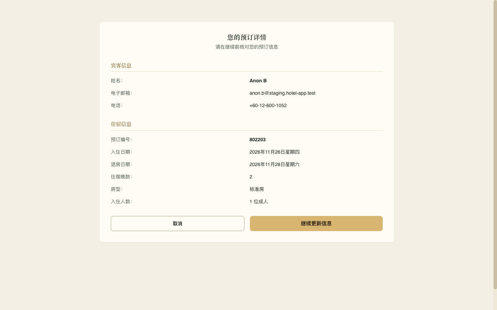

#### 第二步：动态多步预登记表单（`/guest-checkin/form`）

向导会根据您的订单与登录状态动态呈现所需步骤：

1. **`付款`**（仅在订单尚处于`待支付`或需要补传收据时出现）：可直接在线完成 PayPal / 银行卡付款，或上传银行转账凭证（≤ 10 MB）。
2. **`您的信息`**：补全或更新`电子邮箱`、`电话`、`身份证／护照号码`、`国籍`、`地址`、`城市`、`邮政编码`、`国家/地区`与`特殊要求`（可点`保存并继续`或`暂时跳过`）。**提示：填写`身份证／护照号码`是后续使用在线自助入住的必要条件。**
3. **`您的账户`**（仅对未关联账户的匿名访客订单显示）：可在此设置`用户名`、`密码`（符合复杂度要求）并确认条款，一键将匿名订单**认领并绑定到新创建的宾客账户**（立即登录），也可点`暂时跳过`。
4. **`身份验证`**：若已登录，可在此检查状态或提交身份信息（既可直接使用门户内嵌表单，也可进入 `/ekyc` 独立 4 步向导）；未登录宾客可跳至下一步并凭实体证件到前台办理入住。
5. **`完成`（在线自动入住触发）**：
   - 系统会实时检测您是否同时满足 **5 项自动入住条件**：
     1. 您的 eKYC 身份认证状态为`已验证`（`approved`）且被允许自助入住；
     2. 预订状态为`已确认`（已完成付款）；
     3. 当天（`Asia/Kuching`）处于入住日期与退房日期之间；
     4. 已分配客房已清洁就绪（非待清洁/维修停用）；
     5. 您的资料中已填写有效的`身份证／护照号码`。
   - **满足全部条件时**：页面显示`您的身份已验证，此预订可办理入住。`，点击**`立即办理入住`**即可完成线上入住并获取电子门禁指引，状态转为`自动入住`。
   - **任一条件未满足时**：页面会用中文清晰提示原因（例如未到入住日期、尚未付款、eKYC 审核中、缺证件号等——缺证件号时提供`更新信息`快捷跳转），您仍可在抵店后于前台正常办理入住，点击继续即到达 `/guest-checkin/confirm`（`预登记完成！`）。

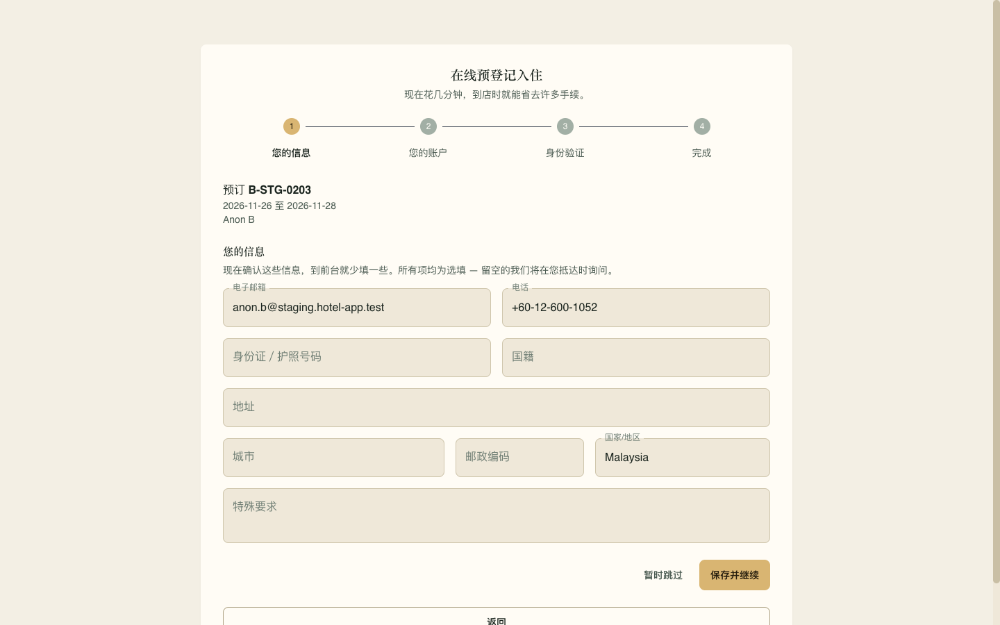

---

### 6.2 eKYC 线上身份认证（`/ekyc` 与 门户 `?section=identity`）

#### 完全自愿与隐私保证

- **完全自愿，同房同价**：您完全可以选择不上传线上 eKYC，抵店时只需在前台出示实体身份证或护照即可办理入住，**绝不会因此影响预订或产生任何额外费用**。
- **数据用途限制**：上传的证件照与自拍照仅由经过授权的酒店审核人员**人工目视比对**以履行法定登记义务与自助入住核验，**绝不用于 AI 模型训练、广告画像或商业转售**；退房后符合法定条件时您亦可申请删除影像。

#### 两个入口说明（均内置 PDPA 第 40 条生物识别明确同意声明）

1. **独立 4 步向导（`/ekyc`）**：
   - 第 1 步 `个人信息` → 第 2 步 `证件信息`（支持`护照`、`国民身份证`、`驾驶证`）→ 第 3 步 `上传文件`（支持调起手机前置摄像头自拍，单张图片要求 **`< 5 MB`**）→ 第 4 步 `验证`（核对信息、**主动勾选生物识别明确同意声明后方可执行上传**并提交）。提交成功后跳转 `/profile?ekycSubmitted=true`。

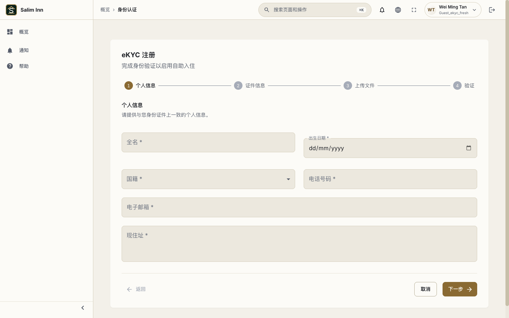

2. **宾客门户 / 预登记页内嵌表单（`/guest-portal?section=identity`）**：
   - 为单页表单，字段包含`姓名`*、`出生日期`*、`国籍`*、`证件类型`*、`证件号码`*、`证件有效期`*（须晚于今天）、`签发国家/地区`*、`电话`*、`电子邮箱`*、`现居地址`*，上传 `证件正面`*、`证件背面`（护照可免）、`手持证件自拍照`*及`地址证明（可选）`（支持 **JPEG / PNG / WebP，单张 ≤ `10 MB`**）。
   - 页面底部提交按钮上方内嵌**马来西亚 PDPA 第 40 条生物识别资料处理明确同意声明勾选框**，主动勾选后即可直接提交。

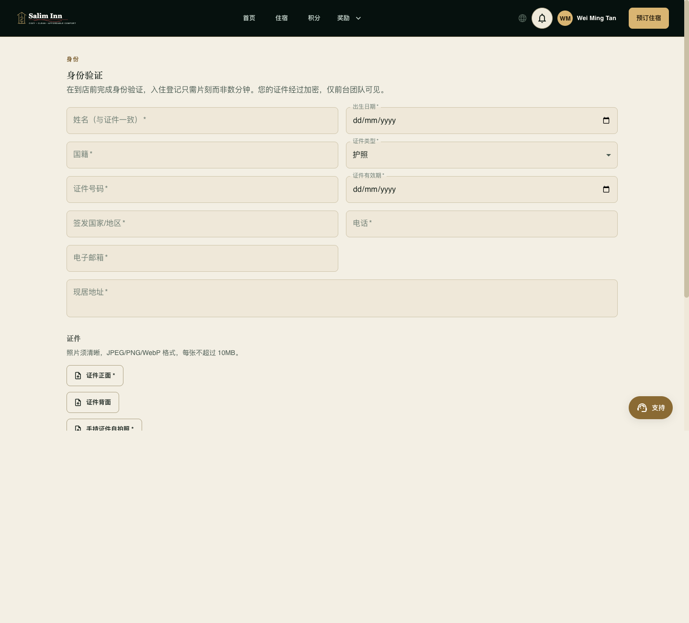

#### 审核状态解读

- 提交后，门户与个人资料页会实时显示徽章：`审核中`、`已验证`、`需要补充信息`、`未通过`、`已过期`、`已作废`。
- 当状态为`需要补充信息`、`未通过`、`已过期`或`已作废`时，页面会展示审核人员的中文说明留言并重新开放上传表单供您补充或重交。

---

## 第 7 章：付款失败与支付恢复（`/booking/recover-payment/$token`）

当您提交的`线下银行转账`申请因故被酒店拒绝（例如金额不符、未查到到账或凭证模糊），且该预订仍处于待支付状态并未过保留截止时间时，系统会自动向您的电子邮箱发送一封通知邮件，其中附带一条专用的**支付恢复链接**（无需登录门户账号即可直接打开）。

- **安全与时效规则**：
  - **有效期 `60 分钟`**（且不会晚于预订本身的未付保留到期时间）；仅首次打开后的操作有效，页面明确警示`此链接仅可使用一次，请勿转发给他人。`
  - **查看驳回原因**：**具体的拒绝原因附在您的通知邮件正文中**；打开恢复网页本身（`完成支付`）只展示`预订编号`、`应付金额`、`此链接有效期至`以及重新付款选项（此设计可在您打开页面预览时不提前消耗链接）。
- **如何重新完成支付**：
  1. **`使用 PayPal 或银行卡支付`**：通过 PayPal 按钮实时扣款确认；如果付款中途不慎刷新页面，系统会自动恢复此前尚未完成的 PayPal 订单号，防止重复扣款。
  2. **`银行转账支付`**：重新提交一笔银行转账申报，然后点击`发送转账凭证给我们`上传清晰的新转账回单（支持 **JPEG / PNG / WebP / PDF，最大 `10 MB`**）。
- **链接失效处理**：如果链接已超过 60 分钟、已被使用、订单已取消或已完成付款，页面会统一显示`此链接已失效`，请直接通过电话或客服联系酒店为您重新处理。

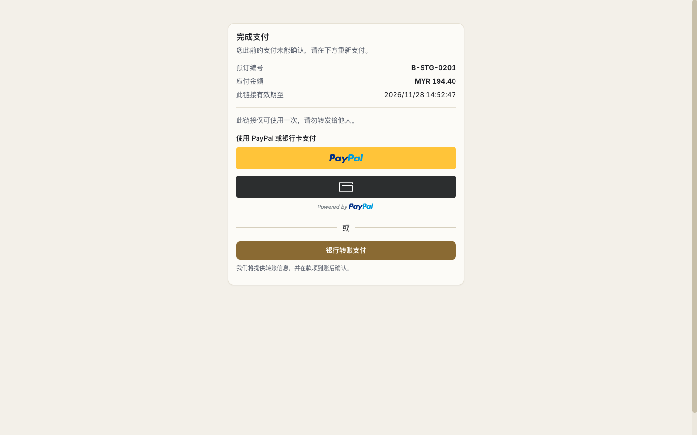

---

## 第 8 章：法律条款、隐私权利与邮件退订

### 8.1 五大公开法律与隐私页面（版本 `2026-11-18`）

系统在页脚及注册/下单/身份认证处提供 5 个公开条款页面（支持 English、Bahasa Melayu、简体中文、繁體中文 四语阅读）：

1. **`/legal/terms` —《预订条款与条件》**：
   - 公示酒店法定商号 `SA2012724`、地址与联系方式；预订人须年满 **18 周岁**；
   - 明确 MYR 含税价格（内含 SST 服务税，外国游客每房每晚外加 RM 10 旅游税）、钥匙卡押金退房退还以及支持向 LHDN 开具电子发票所需信息；
   - 明确标准取消政策：**入住前 ≥ 3 天取消可获全额退款；< 3 天或未按期入住可能收取首晚房费**；特殊不可取消促销会在结账前明示；
   - 载明马来西亚《1999 年消费者保护法》及消费者仲裁庭（**TTPM**）救济途径、《1965 年宾客登记法》入住证件登记义务、**《2024 年公共卫生烟草与吸烟管制法令》（第 852 号法令）100% 全面禁烟**、以及砂拉越适用的马来西亚法律。
2. **`/legal/privacy` —《隐私通知（2010 年个人资料保护法令）》**：
   - 遵循马来西亚 PDPA 2010 及 **2024 年修正案（第 A1727 号法令）**；
   - 公布数据保护联络邮箱（`saliminnsibu@gmail.com`）、各类数据保存期限（例如依据所得税法第 82 条，财务与预订账务记录保存 **7 年**；公共区域 24 小时无声闭路电视滚动覆盖；客房与浴室内部绝无摄像头）；
   - 载明您的法定权利：第 30 条查阅权（21 天内回复，必要时可延长最多 14 天）、第 34 条更正权、第 38/42/43 条撤回同意与退订直邮营销权、**第 43A 条数据可携权**，以及向马来西亚个人资料保护专员公署（**JPDP**，`www.pdp.gov.my`）投诉权；
   - 载明数据泄露通报承诺（72 小时内向专员报告，7 天内通知受影响个人）。
3. **`/legal/payment-terms` —《付款条款》**：
   - 说明线上方式（PayPal/银行卡、线上银行转账）与前台现场支付方式（现金、Visa/Mastercard、借记卡、Sarawak Pay / S Pay Global、Boost、MAE、QRPay / DuitNow QR）；
   - 依据反洗钱要求实行**原路退款原则**，并附防电信诈骗警示与马来西亚国家诈骗应对中心（**NSRC**）热线 **`997`**。
4. **`/legal/identity-verification` —《身份验证——处理敏感个人资料的明确同意》**：
   - 独立签署的 PDPA 第 4/40 条生物识别数据（证件影像与自拍照）明确同意书，**绝不与预订条款或营销订阅捆绑**；写明人工审核、加密隔离保存、自愿可替代性以及随时致信 `saliminnsibu@gmail.com` 撤回同意的方式。
5. **`/legal/cookies` —《Cookie 使用说明》**：
   - 说明网站仅使用维持安全会话的必要 HttpOnly Cookie、本地语言/主题偏好与付款安全校验 Cookie；**绝不使用任何广告追踪器、跨站画像 Cookie 或第三方营销像素**。您可随时在浏览器设置中清理或禁用 Cookie。

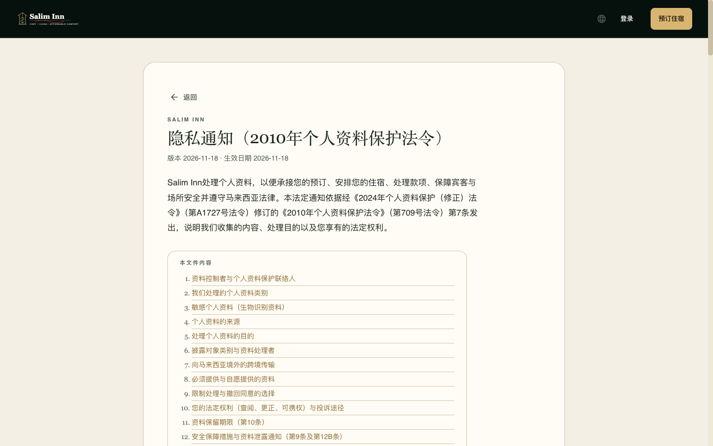

### 8.2 营销邮件一键退订（`/unsubscribe/$token`）与重要业务邮件保障

- 点击任何酒店营销邮件底部的退订链接即可**免登录**打开 `/unsubscribe/$token`：
  - 您可按需单独关闭 **`酒店公告`**、**`促销与优惠`**、**`生日优惠券`** 3 项营销主题，或直接点击**`退订所有邮件`**。
  - **重新订阅方法**：公开退订页出于隐私保护**仅支持退订操作**；如您日后希望重新开启优惠通知，请登录 `/guest-portal?section=preferences` 重新打开对应开关。

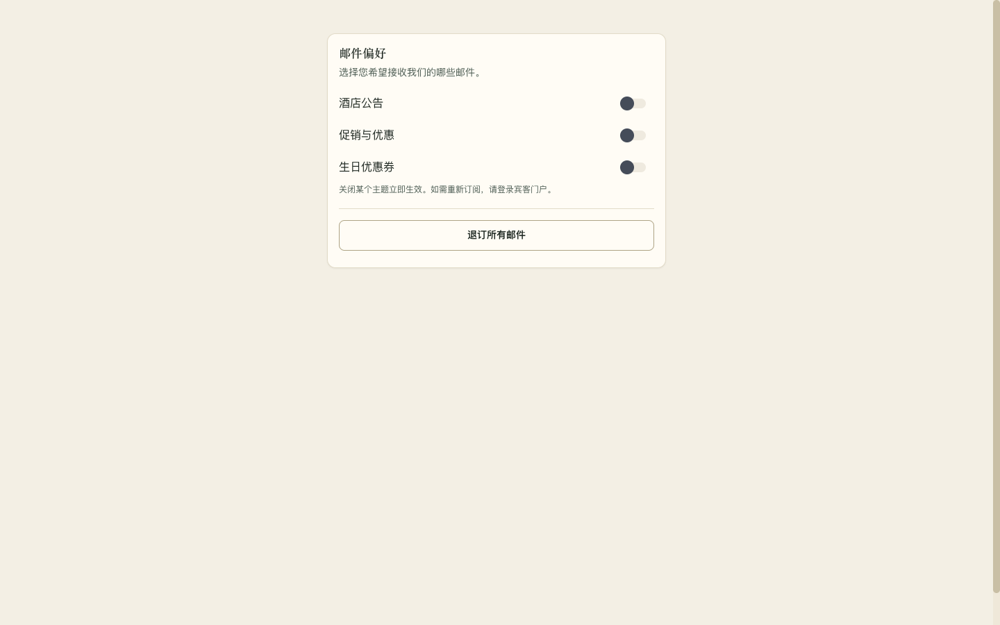
- **您绝不会错过重要行程通知（6 类事务型邮件受系统保护）**：
  即使您退订了全部营销邮件，以下 **6 类与您实际入住及付款息息相关的事务型服务邮件仍会照常发送**：
  1. 预订确认（`booking_confirmation`）
  2. 客房分配通知（`online_room_assignment`）
  3. 银行转账收据补传提醒（`payment_receipt_request`）
  4. 付款被拒及 60 分钟恢复支付链接（`payment_rejected`）
  5. 退房结账收据（`checkout_receipt`）
  6. 入住前提醒（`pre_arrival_reminder`）

---

## 第 9 章：宾客常见问题（FAQ）与联系酒店

### 9.1 宾客高频问题解答

1. **我没有注册会员账号就下单了，怎么查看订单、补交凭证或办预登记？**  
   请保管好确认界面或确认邮件中的**预订编号（`BK-...`）**与您下单时填写的**昵称**。在入住前 **0–7 天内**，可直接打开 `/guest-checkin`，输入预订编号与昵称即可进入；您也可以在预登记向导第 3 步`您的账户`将这笔订单直接关联（认领）到新注册的门户账户中。
2. **为什么我在 `/guest-checkin` 输入了预订编号和邮箱，却查不到订单？**  
   这里有两个常见原因：① 手动查单框的第二个字段要求填写的是**`宾客姓名`（下单时的昵称或姓名），不是电子邮箱**；② 预登记仅在**入住日期前 7 天至入住当天**开放，如果离入住还有超过 7 天，系统会提示尚未到开放窗口，或请登录门户在`住宿`页查看。
3. **我已经上传了身份证件，为什么预登记最后一步不能直接点`立即办理入住`？**  
   在线自动入住须同时满足 5 个条件：eKYC 已获批且启用自助入住、订单已付款确认、今天处于入离店日期之间、房间已打扫完毕、**且您在预登记`您的信息`中填写了身份证／护照号码**。如果有任一项未满足，页面会标出具体原因（如房间尚在打扫或身份审核中），您只需按正常时间携证件到酒店前台办理即可。
4. **我是多房团体预订，只取消其中一间房会影响优惠券或退款吗？**  
   - 若整组或该房间尚未付款：取消单个未付款房间会立刻释放该房，原订单中的定额/封顶优惠券会按比例重分给组内剩余未付款房间。  
   - 若订单已付款：无法单独在线秒退，在门户提交取消后将转为`取消审核中`，由酒店团队按“入住前 ≥ 3 天免费全退、< 3 天可能收首晚房费”的原则人工核对并原路退款。
5. **银行转账提交后多久能确认？忘记上传回单怎么办？**  
   您的申请会实时推送至酒店员工后台醒目提醒队列，工作人员核实银行入账后即会批准并发送确认邮件。若提交时未上传收据，您随时可在`宾客门户 → 住宿`点击订单`查看详情`补充上传（或点开顶部红色铃铛提醒上传）。**收到酒店要求补传收据的邮件后，请在 24 小时内上传**，超时申请会自动拒绝并为您寄出 60 分钟重新支付链接。
6. **在 `/offers` 页面看到了想用的优惠，为什么找不到直接点领的按钮？**  
   公开 `/offers` 页仅用于浏览；点击`登录后领取`登录您的账户后，在宾客门户的`奖励 → 优惠`页面即可领取，并在`我的优惠券`复制券码或于结账核对页直接选择。
7. **忘记登录密码怎么办？**  
   系统目前没有自助找回密码链接，请致电 `+60 11-1050 7083` 或发送邮件至 `saliminnsibu@gmail.com` 核验身份后由管理员协助重置；如需修改已知密码，请前往 `/profile` → `安全`。
8. **如何切换界面语言？**  
   在官网右上角、登录页或宾客门户顶栏点击语言地球图标，即可在 `English`、`Bahasa Melayu`、`简体中文`、`繁體中文` 之间随时切换。

### 9.2 联系 Salim Inn（24 小时服务）

- **酒店全称**：Salim Inn（注册号 `SA2012724`）
- **地址**：No. 21 & 22, Lorong Salim 17, Jalan Salim, Farley Commercial Centre, 96000 Sibu, Sarawak
- **24 小时电话 / WhatsApp**：`+60 11-1050 7083`
- **电子邮箱（预订咨询与隐私联络）**：`saliminnsibu@gmail.com`
- **在线客服**：登录`/guest-portal`点击右下角浮动`支持`按钮实时联络（支持文本沟通，单条上限 4,000 字符）
